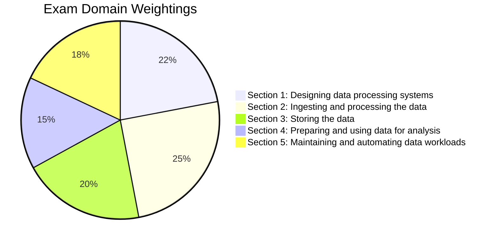

# Google Cloud Professional Data Engineer (PDE) Master Study Guide

Welcome to the definitive, deep-dive preparation curriculum for the **Google Cloud Certified Professional Data Engineer** exam. 

This guide is systematically structured to map 1:1 against the official Google Cloud Exam Guide domains, incorporating architectural patterns, Google Cloud best practices, hands-on code and SQL patterns, CLI commands, and exam decision trees.

---

## 🎯 About the Professional Data Engineer Exam

A **Professional Data Engineer** empowers data-driven decisions by collecting, transforming, storing, and delivering data for diverse applications. The engineer designs and builds robust data infrastructure, optimizing for performance, security, reliability, scalability, and cost.

### Exam Details at a Glance

| Attribute | Details |
| :--- | :--- |
| **Duration** | 2 Hours (120 minutes) |
| **Questions** | 50 – 60 Multiple Choice and Multiple Select |
| **Format** | Scenario-based technical design and troubleshooting questions |
| **Passing Score** | Pass / Fail (Google Cloud does not publish numerical cutoff; estimated ~70%) |
| **Prerequisites** | None formally required; 3+ years industry experience including 1+ year designing and managing solutions using Google Cloud is recommended |
| **Language Options** | English, Japanese |

---

## 📊 Exam Blueprint & Section Weightings

The exam covers five core technical domains. Each domain is represented in this platform with dedicated, exhaustive modules:

| Module | Exam Section | Weight | Key Technologies & Focus Areas |
| :---: | :--- | :---: | :--- |
| **01** | **Designing data processing systems** | **~22%** | IAM, Org Policies, KMS/CMEK/CSEK, Cloud DLP, Data Sovereignty, Dataform, Dataflow, Cloud Data Fusion, Disaster Recovery (RTO/RPO), ACID vs BASE, Data Migrations (DTS, DMS, Datastream). |
| **02** | **Ingesting and processing data** | **~25%** | Pipeline planning (sources & sinks), Apache Beam / Dataflow, Dataproc (Spark/Hadoop), Cloud Data Fusion, Pub/Sub, Kafka, Windowing, Watermarks, Triggers, AI Data Enrichment, CI/CD. |
| **03** | **Storing the data** | **~20%** | Storage selection matrix (BigQuery, BigLake, AlloyDB, Bigtable, Spanner, Cloud SQL, GCS, Firestore, Memorystore), Data Warehousing (Star/Snowflake, Partitioning & Clustering), Data Lakes, Dataplex & Data Mesh. |
| **04** | **Preparing & using data for analysis** | **~15%** | BI Engine, Materialized Views, Query Optimization, Column/Row-level security, BigQuery ML, Vector Search & Embeddings for RAG, Analytics Hub, Data Sharing & Clean Rooms. |
| **05** | **Maintaining & automating workloads** | **~18%** | Cost optimization, Dataproc Ephemeral vs Persistent, Cloud Composer (Airflow) DAG design, BigQuery Editions & Reservations, Cloud Monitoring/Logging, Disaster Recovery & High Availability. |

---

## 🧠 The PDE Mental Model: Google's Philosophy

To score 100% on the exam scenarios, always evaluate question choices through Google Cloud's core architectural tenets:

1. **Prefer Serverless & Managed Services Over IaaS**:
   - Prefer **Dataflow** over self-managed Beam/Spark, **Dataproc Serverless** over standing clusters, **BigQuery** over custom SQL engines, and **Datastream** over manual CDC connectors.
2. **Decouple Storage and Compute**:
   - Never store data permanently on compute disks (like Dataproc worker HDFS disks or Compute Engine local disks) when GCS, BigQuery, or Bigtable can be used. Compute should be ephemeral and auto-scaled.
3. **Minimize Data Movement and Joins**:
   - In BigQuery, prefer **denormalization with nested and repeated fields (`RECORD` / `ARRAY`)** over traditional 3NF relational schemas with multiple large table `JOIN`s.
4. **Security by Default (Zero Trust & Least Privilege)**:
   - Always use **IAM roles** (prefer predefined over primitive Owner/Editor), service accounts with minimal scopes, **Cloud KMS** (CMEK) when regulatory compliance requires customer-managed keys, and **VPC Service Controls** for exfiltration defense.
5. **Event-Driven & Streaming First**:
   - For real-time, pair **Pub/Sub** with **Dataflow** using proper windowing (tumbling, sliding, session) and handling late data via watermarks and allowed lateness.

---

## 🗺️ How to Use This Study Course

- **Step 1: Systematic Study**: Follow Modules 1 through 5 sequentially. Read each lesson thoroughly, paying close attention to the **Architecture Patterns**, **Code Examples**, and **Exam Traps**.
- **Step 2: Self-Assessment Checkpoints**: Every lesson concludes with targeted multiple-choice exam-style scenarios with in-depth explanations.
- **Step 3: Master Cheat Sheets**: Use the comprehensive Cheat Sheet in the Exam Prep section for rapid revision before taking the test.
- **Step 4: Practice Exams**: Test your timing and decision-making on the curated full-length practice question bank.

Let's begin your journey with **[Module 1: Designing Data Processing Systems](/docs/module-1-designing-systems/security-and-compliance)**!
