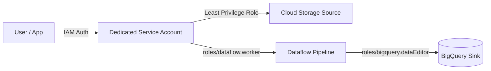
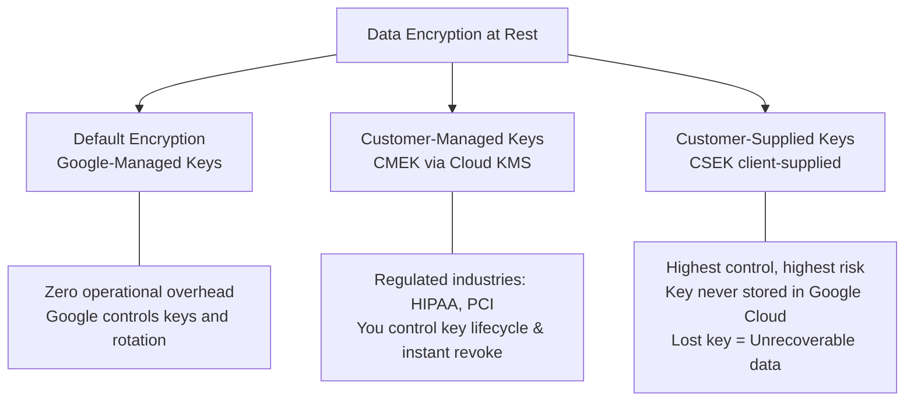
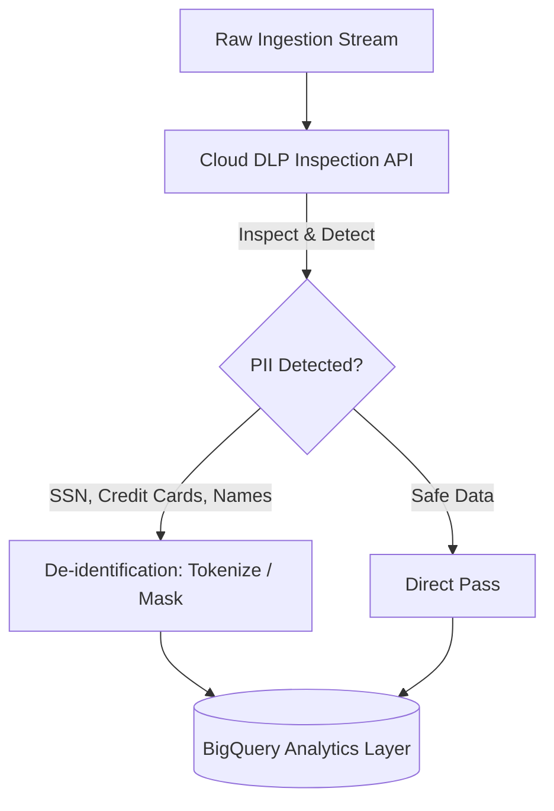
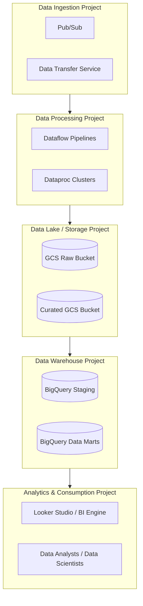

# 1.1 Designing for Security and Compliance

Security and regulatory compliance account for a substantial portion of Section 1 on the exam. As a Professional Data Engineer, you must know how to safeguard data across its lifecycle—in transit, at rest, and during processing—while adhering to strict data sovereignty and privacy mandates.

---

## 🛡️ Cloud IAM & Access Management

Google Cloud Identity & Access Management (IAM) governs authentication (who you are) and authorization (what you can do).

### The Principle of Least Privilege
Always avoid primitive roles (`Viewer`, `Editor`, `Owner`) in production data pipelines. Use **predefined roles** or create **custom roles** with scoped permissions.

### Key Predefined Roles for Data Workloads

| Service | Common Exam Roles | Permissions & Usage |
| :--- | :--- | :--- |
| **BigQuery** | `roles/bigquery.dataViewer` | Read data and metadata inside datasets and tables. Cannot run queries using project resources unless granted job creation rights. |
| | `roles/bigquery.dataEditor` | Create, update, and delete tables and datasets. |
| | `roles/bigquery.jobUser` | Run query jobs, export jobs, and load jobs (incurring project slot/query billing). Often paired with `dataViewer`. |
| | `roles/bigquery.admin` | Full administrative access to datasets, tables, and reservations. |
| **Cloud Storage** | `roles/storage.objectViewer` | Read object data and metadata. Essential for ETL pipelines reading raw files. |
| | `roles/storage.objectAdmin` | Create, delete, and manage objects (excluding bucket-level permissions). |
| | `roles/storage.admin` | Full control over buckets and objects. |
| **Pub/Sub** | `roles/pubsub.publisher` | Publish messages to a topic. |
| | `roles/pubsub.subscriber` | Consume messages from a subscription and acknowledge them. |
| **Dataflow** | `roles/dataflow.worker` | Assigned to the compute engine service account running Dataflow worker VMs (needs access to GCS staging buckets and Pub/Sub). |

### Service Account Best Practices
- Never use personal user credentials in automated data pipelines.
- Create distinct service accounts per pipeline stage (e.g., `sa-ingestion@project.iam.gserviceaccount.com` vs `sa-analytics@project.iam.gserviceaccount.com`).
- Grant `roles/iam.serviceAccountUser` only to authorized deployment pipelines or administrators.

---

## 🔐 Data Encryption & Key Management

By default, Google Cloud encrypts all customer data at rest using AES-256 without any configuration required. However, regulatory requirements dictate the choice between three encryption paradigms:

### Encryption Hierarchy Comparison

| Feature | Google-Managed Encryption | Customer-Managed (CMEK) | Customer-Supplied (CSEK) |
| :--- | :--- | :--- | :--- |
| **Key Generation** | Google Cloud | Cloud KMS (Customer controls) | On-premises / Customer HSM |
| **Key Storage** | Google Key Management | Google Cloud KMS | Your own hardware / disk |
| **Supported Services** | All GCP services | GCS, BigQuery, Bigtable, Pub/Sub, Dataflow, Dataproc, Spanner, etc. | Cloud Storage, Compute Engine disks only |
| **Key Rotation** | Automatic (approx 90 days) | Configurable automated schedule or manual | Customer responsibility |
| **Revocation Capability** | None | Instant: disable the key in Cloud KMS to cut off data access | Stop passing key in API requests |
| **Risk / Penalty** | Zero loss risk | Disabling key halts queries and jobs immediately | If key is lost, Google cannot recover data |

### Cloud KMS Key Ring & CryptoKey Hierarchy
- **Key Ring**: Regional container for organizational keys. Cannot be deleted.
- **CryptoKey**: The key resource inside a Key Ring with versioning.
- **Key Rotation**: You can set an automatic rotation period (e.g., every 30 days). New data is encrypted with the newest key version, while existing data can still be decrypted using previous versions until explicitly destroyed.

---

## 🕵️ Sensitive Data Protection (Cloud DLP)

Handling Personally Identifiable Information (PII) is mandatory for GDPR, CCPA, and HIPAA compliance. Google Cloud's Sensitive Data Protection service (formerly Cloud DLP) discovers, classifies, and de-identifies sensitive data.

### Core De-Identification Techniques

1. **Masking**: Partially replaces sensitive characters (e.g., masking credit card numbers: `4111-XXXX-XXXX-1111`).
2. **Cryptographic Hashing / Tokenization (HMAC)**:
   - Converts plaintext (e.g., Social Security Number) into a pseudorandom hash using a secret key.
   - Preserves referential integrity across analytical queries and joins without exposing the raw identifier.
3. **Pseudonymization / Crypto-Deterministic Tokenization**:
   - Reversible tokenization using cryptographic keys. Allows authorized re-identification when legally requested.
4. **Bucketing / Generalization**:
   - Replaces precise values with numerical or categorical ranges (e.g., changing Age `34` to `30-39` or ZIP code `94105` to `941xx`).
5. **Date Shifting**:
   - Shifts timestamps by a randomized deterministic offset per patient/user, preserving duration intervals for medical research while preventing re-identification.

---

## 🌍 Regional Considerations & Data Sovereignty

Data sovereignty laws require certain data to never leave a designated geographic boundary (e.g., EU data remaining in the European Union).

### Multi-Region vs. Regional Storage
- **Multi-region (e.g., `us`, `eu`)**: Highly available across multiple metropolitan areas. Designed for large-scale data warehouses and disaster tolerance.
- **Regional (e.g., `us-central1`, `europe-west3`)**: Guarantees data physical residence inside a single region, fulfilling strict residency laws and minimizing network egress latency between co-located compute (Dataflow, Dataproc) and storage (GCS, BigQuery).

### Organization Policies for Compliance
Use Resource Location Policies (`constraints/gcp.resourceLocations`) at the organization or folder level:
- Prevents engineers from provisioning GCS buckets, BigQuery datasets, or Compute instances outside authorized countries or regions.

---

## 🏗️ Project, Dataset, and Table Architecture for Governance

A recommended enterprise data architecture isolates duties across GCP projects:

### Benefits:
- **Cost Allocation & Quota Separation**: Analysts consuming query slots do not exhaust quotas reserved for critical ELT pipelines.
- **VPC Service Controls (VPC-SC)**: Place raw and warehouse projects inside a protected security perimeter to prevent unauthorized data exfiltration over the public internet.

---

## 🧪 Multi-Environment Architecture: Dev vs. Staging vs. Prod

1. **Dedicated Project per Environment**:
   - `company-data-dev`, `company-data-stage`, `company-data-prod`.
2. **Data Sanitization for Lower Envs**:
   - Never copy raw unmasked production PII into development or testing environments.
   - Use Cloud DLP to generate synthetically de-identified test datasets.
3. **Automated Promotion via CI/CD**:
   - Use Cloud Build or GitHub Actions with Terraform / Dataform to promote schemas, DAGs, and pipeline binaries across environments.

---

## 🎯 Exam Practice Scenario Checkpoint

### Scenario:
A financial services company needs to build a real-time fraud detection pipeline on Google Cloud. The system must process credit card transactions ingested through Cloud Pub/Sub, cleanse data using Cloud Dataflow, and write analytical aggregates to BigQuery. Regulatory auditors require that:
1. Cardholder PAN numbers must never appear in plaintext in BigQuery.
2. Analytics teams must still be able to join transaction events by individual cardholder accounts across multiple daily tables.
3. The encryption keys protecting the stored tables must be managed by the customer with an automatic 30-day rotation, and the security officer must be able to revoke key access instantly.

**Which architectural approach fulfills all requirements?**

- **A.** Store PAN in plaintext, enable BigQuery Google-managed default encryption, and grant analysts `roles/bigquery.dataViewer`.
- **B.** De-identify PAN in Dataflow using Cloud DLP with deterministic cryptographic tokenization (crypto-deterministic format-preserving encryption); store BigQuery datasets using Customer-Managed Encryption Keys (CMEK) configured in Cloud KMS with a 30-day rotation schedule.
- **C.** Use Customer-Supplied Encryption Keys (CSEK) on BigQuery tables, and hash PAN with SHA-256 without a cryptographic salt.
- **D.** Mask PAN digits with string replace in Dataflow and use Cloud KMS asymmetric signing keys.

> **Correct Answer: B**  
> **Explanation**: Crypto-deterministic tokenization in Cloud DLP replaces the sensitive PAN with a surrogate token that preserves data format and uniqueness, enabling analytical joins across datasets without leaking the original cardholder PAN. CMEK in Cloud KMS gives the customer complete authority to rotate keys every 30 days and instantly revoke access by disabling the key. CSEK (Option C) is not supported for BigQuery (only GCS and GCE disks), and simple SHA-256 without a secret key is susceptible to rainbow table attacks.
