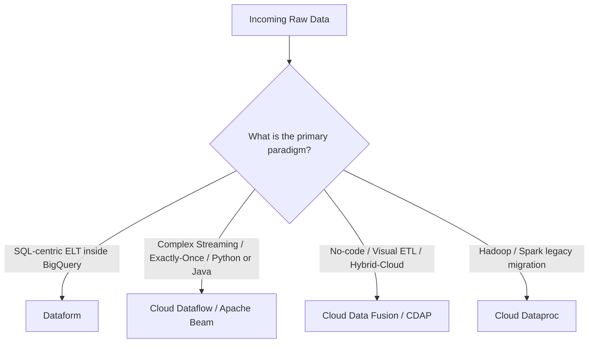
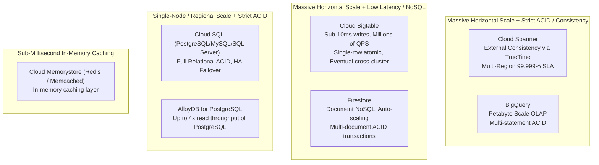
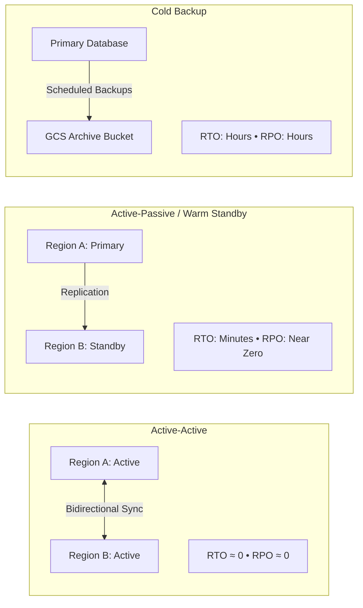
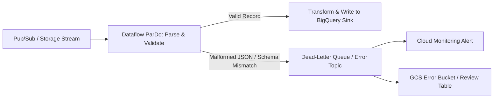

# 1.2 Designing for Reliability and Fidelity

Reliability guarantees that your data systems continue to operate properly in the face of machine failures, network outages, and evolving upstream data structures. Fidelity guarantees that the data flowing through those systems is accurate, consistent, and trustworthy.

---

## 🛠️ Data Preparation & Cleaning Tool Selection

When designing data transformation pipelines, Google Cloud offers distinct services tailored to different technical personas, latency profiles, and skill sets.



### Deep Comparison Matrix

| Capability | Dataform | Cloud Dataflow | Cloud Data Fusion |
| :--- | :--- | :--- | :--- |
| **Paradigm** | **ELT** (Extract, Load, Transform inside BigQuery) | **ETL / ELT** Streaming & Batch | Visual GUI-driven **ETL** |
| **Language** | SQLX (SQL + JavaScript templating) | Apache Beam (Java, Python, Go) | Visual pipeline canvas (CDAP plugins) |
| **Compute Engine** | Serverless BigQuery Slots | Serverless Dataflow Worker VMs | Dedicated Cloud Dataproc execution clusters |
| **Latency Profile** | Batch (scheduled or triggered) | Microsecond/sub-second Streaming & Batch | Batch & Micro-batch |
| **Dependency Management**| Built-in DAG execution graph with `ref()` | Apache Beam Pipeline DAG | Built-in workflow scheduler |
| **Version Control** | Native Git integration (GitHub, GitLab) | Source code repo + CI/CD | CDAP Hub / Git integration |
| **Best For** | Transforming raw warehouse staging tables into verified data marts | Real-time event stream processing, windowing, complex aggregations | Enterprise data integration with 100+ pre-built connectors without code |

### Dataform SQLX Example: Declarative Transformation with Data Quality Assertions
Dataform allows you to declare dependencies and embedded data validation checks directly in `.sqlx` files:

```sql
config {
  type: "table",
  description: "Curated daily customer order totals",
  assertions: {
    uniqueKey: ["order_id"],
    nonNull: ["order_id", "customer_id", "total_amount"]
  }
}

SELECT
  order_id,
  customer_id,
  order_date,
  SUM(item_price * quantity) AS total_amount,
  CURRENT_TIMESTAMP() AS processed_at
FROM
  ${ref("stg_orders")}
GROUP BY
  order_id, customer_id, order_date
```

### Prompting LLMs for Query Generation (Gemini in BigQuery)
Google Cloud has integrated Gemini into BigQuery Data Canvas and SQL workspace:
- **Natural Language to SQL**: Generating complex queries from business English prompts.
- **SQL Explanation & Optimization**: Asking Gemini to explain unfamiliar legacy queries and propose partition-friendly indexing.
- **Data Cleansing Rules**: Prompting LLMs to generate regex matching patterns and edge-case sanitization rules for malformed records.

---

## 🌐 ACID Compliance, Consistency, & The CAP Theorem

Selecting the right storage backend requires understanding the trade-offs between consistency, availability, and partition tolerance.



### Database Consistency Profile Summary

| Storage Service | Consistency Model | ACID Support | Typical Use Case |
| :--- | :--- | :--- | :--- |
| **Cloud Spanner** | **External Consistency** (via TrueTime hardware clocks) | Full distributed ACID across regions & continents | Global financial ledgers, mission-critical inventory, multi-region transactional systems |
| **Cloud SQL** | Strong consistency (single instance or failover replica) | Full ACID (relational RDBMS) | Traditional web applications, ERPs, CRM databases up to 64TB |
| **AlloyDB for PostgreSQL**| Strong consistency | Full ACID with up to 4x read throughput of standard PostgreSQL | Enterprise transactional workloads needing extreme PostgreSQL compatibility |
| **Cloud Bigtable** | Eventual consistency across replicated clusters (single cluster is strongly consistent for read-your-writes) | Row-level atomic transactions only (No multi-row ACID) | High-throughput time-series, IoT telemetry, AdTech events (millions of ops/sec) |
| **Firestore** | Strong consistency for documents | ACID multi-document transactions | Mobile/web app backends, user profiles, gaming leaderboards |
| **BigQuery** | Strong consistency | Multi-statement ACID transactions supported | Enterprise analytical data warehouse (OLAP) |

---

## 🚨 Disaster Recovery (DR) & Fault Tolerance

Disaster Recovery designs pivot around two essential business metrics:
- **RTO (Recovery Time Objective)**: The acceptable duration of downtime before systems are restored.
- **RPO (Recovery Point Objective)**: The maximum acceptable data loss measured in time (e.g., losing 5 minutes of transactions vs. 0 seconds).



### High Availability Architectural Strategies on Google Cloud
1. **Cloud Spanner Multi-Region**:
   - Replicated across multiple regions with synchronous consensus via Paxos and TrueTime.
   - Provides **99.999% (five nines)** availability SLA with zero RPO and zero RTO during zonal or regional failure.
2. **Cloud SQL High Availability (HA)**:
   - Configures a standby instance in a different zone within the same region with synchronous block-level disk replication.
   - Automatic failover in 60–120 seconds if the primary zone fails.
3. **Cloud Bigtable Multi-Cluster Routing**:
   - Deploy multi-cluster instances across zones or regions.
   - Routing policies:
     - **Multi-cluster routing (Anycast)**: Traffic routes automatically to the nearest available cluster; delivers high availability (99.999%) and failover.
     - **Single-cluster routing**: Delivers strong read-after-write consistency for single-row mutations; requires manual failover.

---

## 🛡️ Pipeline Data Validation & Dead-Letter Queues

To guarantee data fidelity, data pipelines must isolate corrupt or unexpected schemas without halting downstream consumption.



### Best Practice Dead-Letter Pattern in Apache Beam
```python
import apache_beam as beam

class ParseAndValidate(beam.DoFn):
    OUTPUT_TAG_VALID = 'valid'
    OUTPUT_TAG_DEAD_LETTER = 'dead_letter'

    def process(self, element):
        try:
            # Parse record
            data = element.decode('utf-8')
            parsed = json.loads(data)
            if 'user_id' not in parsed or parsed['amount'] <= 0:
                raise ValueError("Invalid business fields")
            yield beam.pvalue.TaggedOutput(self.OUTPUT_TAG_VALID, parsed)
        except Exception as e:
            # Route bad data to dead letter output without crashing the pipeline
            error_payload = {
                'raw_record': element.decode('utf-8', errors='ignore'),
                'error': str(e),
                'timestamp': str(datetime.utcnow())
            }
            yield beam.pvalue.TaggedOutput(self.OUTPUT_TAG_DEAD_LETTER, error_payload)
```

---

## 🎯 Exam Practice Scenario Checkpoint

### Scenario:
A global e-commerce enterprise is deploying an inventory tracking database. During peak sales events, thousands of concurrent checkouts execute across North America, Europe, and Asia. The inventory system requires:
1. Strict ACID transactions to prevent double-selling inventory across continents.
2. An availability SLA of 99.999% with virtually zero RTO and zero RPO during a regional datacenter disaster.
3. Standard ANSI SQL compatibility for application engineers.

**Which database service should the data engineer select?**

- **A.** Cloud SQL for PostgreSQL configured with cross-region read replicas.
- **B.** Cloud Bigtable with multi-cluster routing enabled across three regions.
- **C.** Cloud Spanner with a multi-region instance configuration.
- **D.** Cloud Firestore in Datastore mode.

> **Correct Answer: C**  
> **Explanation**: Cloud Spanner is the only globally distributed, horizontally scalable database that provides external consistency (strict ACID) and 99.999% availability SLA with zero RPO and zero RTO in multi-region configurations, driven by TrueTime and Paxos consensus. Cloud SQL (Option A) read replicas are asynchronous and do not support cross-region synchronous ACID writes. Cloud Bigtable (Option B) is a NoSQL store offering eventual consistency across clusters, not multi-row/table ACID transactions.
