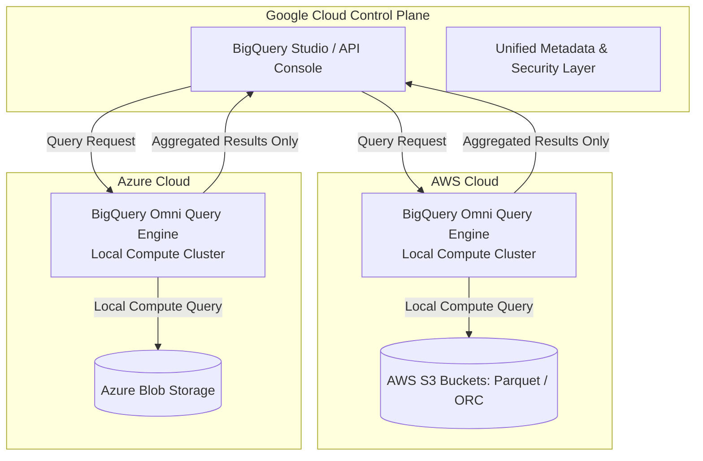
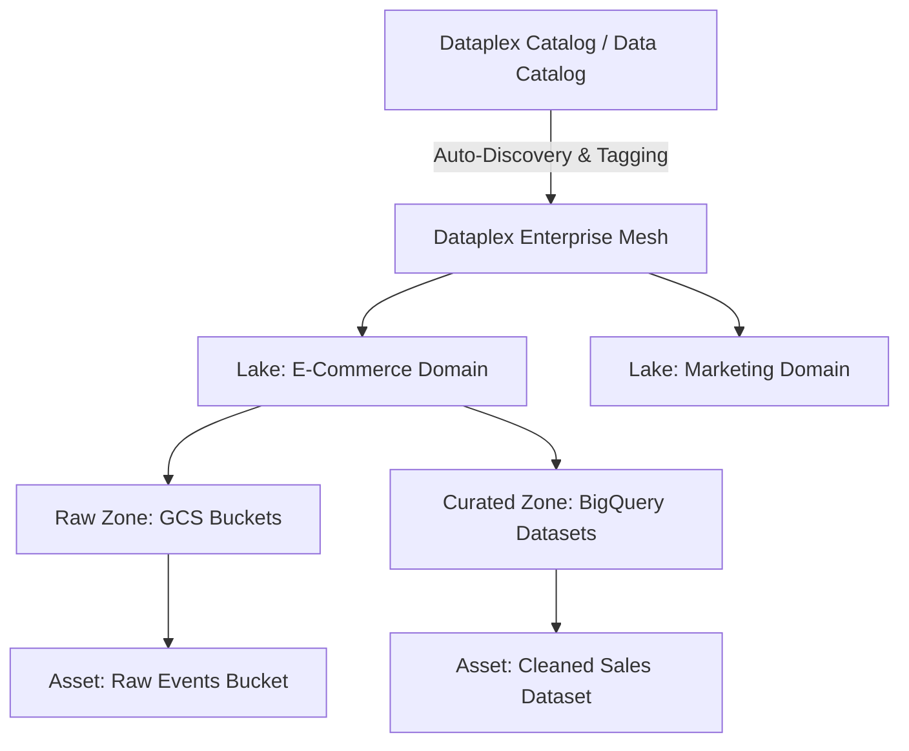

# 1.3 Designing for Flexibility and Portability

Modern enterprise architectures must evolve without costly migrations and vendor lock-in. Google Cloud emphasizes open-source standards, cross-cloud analytical capabilities, and centralized data governance.

---

## ☁️ Multi-Cloud Analytics with BigQuery Omni

Enterprise organizations frequently maintain large operational data lakes across multiple cloud providers (such as Amazon AWS S3 and Microsoft Azure Blob Storage). Moving petabytes of data across cloud boundaries incurs massive egress costs and creates governance risks.



### How BigQuery Omni Works
1. **Local Compute Execution**: BigQuery Omni runs the serverless BigQuery query engine inside managed clusters in AWS or Azure using Google Anthos technology.
2. **Data Never Moves Across Clouds for Processing**: Compute is brought to the data. Egress charges are eliminated because the raw data remains in AWS S3 or Azure Blob Storage.
3. **Cross-Cloud Transfer**: You can export analytical aggregates directly from AWS/Azure into native BigQuery storage using the `EXPORT DATA` SQL statement:

```sql
-- Querying AWS S3 from BigQuery without data egress
SELECT
  customer_region,
  COUNT(order_id) AS total_orders,
  SUM(order_value) AS revenue
FROM
  `aws-us-east-1.sales_omni_dataset.orders_s3_external`
WHERE
  order_date >= '2026-01-01'
GROUP BY
  customer_region;
```

---

## 🔄 Application Portability & Open Standards

To prevent vendor lock-in, Google Cloud architectures leverage open-source APIs and frameworks:

### 1. Apache Beam for Pipeline Portability
- **Write Once, Run Anywhere**: Pipelines written in Apache Beam (Python, Java, Go) define a unified data processing model for both batch and streaming.
- **Runners**: The exact same Beam code can execute on **Google Cloud Dataflow**, **Apache Flink**, **Apache Spark**, or locally via the DirectRunner.
- **Portability Framework**: Uses protocol buffers (Fn API, Runner API) allowing pipeline steps written in Python to run on a Java runner, or vice versa.

### 2. Open Storage Formats vs Proprietary Formats
For data lakes on Cloud Storage (GCS), always design using columnar, open standard formats:
- **Apache Parquet**: Columnar storage optimized for analytical queries with high compression and dictionary encoding. Ideal for Spark, Dataproc, and BigQuery external tables.
- **Apache ORC**: Highly optimized columnar format primarily utilized in Hive and Presto workloads.
- **Apache Avro**: Row-based binary format featuring embedded schema definition. Highly optimized for streaming serialization and ingestion (e.g., Kafka and Pub/Sub payloads).
- **Apache Iceberg / Delta Lake**: Open table formats providing ACID transactions, time travel, and schema evolution on top of object storage. BigQuery supports native querying via **BigLake**.

---

## 📚 Data Governance, Discovery & Cataloging (Dataplex)

As data platforms expand, maintaining data quality, visibility, and access controls across thousands of tables and files requires unified governance.



### Core Architecture Concepts in Dataplex:
1. **Lakes**: High-level logical containers representing a specific business domain (e.g., Sales, Logistics, Financial Reporting).
2. **Zones**: Subdivisions inside a Lake grouping data by readiness or purpose:
   - **Raw Zone**: Stores unvalidated, landed data (e.g., raw JSON/CSV files in GCS).
   - **Curated Zone**: Stores validated, cleansed, and partitioned data ready for analytics (e.g., BigQuery tables, optimized Parquet files).
3. **Assets**: Pointers to the physical storage resources (GCS buckets or BigQuery datasets) located within projects.
4. **Automated Discovery & Schema Registration**: Dataplex automatically crawls files in GCS, infers schemas, registers tables in BigQuery metastores, and indexes metadata.
5. **Data Quality Tasks**: Automated validation rules scheduled natively to test constraints (non-null, regex patterns, referential integrity).

---

## 🎯 Exam Practice Scenario Checkpoint

### Scenario:
A multinational enterprise has 500 TB of historical telemetry data stored in Amazon S3 in Apache Parquet format. The business intelligence team in Google Cloud wants to run analytical queries combining this historical data with fresh sales data stored in BigQuery in `us-central1`. The Chief Information Security Officer (CISO) and CFO have established two rules:
1. No raw telemetry data may be permanently copied or egressed over the public internet to Google Cloud due to bandwidth costs and compliance mandates.
2. Analysts must use standard SQL and the BigQuery interface without managing any VM clusters.

**What is the recommended architecture?**

- **A.** Create a Dataflow pipeline to read S3 objects and stream them into a BigQuery dataset.
- **B.** Set up BigQuery Omni on AWS, create an external dataset referencing the S3 bucket, and execute queries locally inside AWS using BigQuery Studio.
- **C.** Deploy a Dataproc on Compute Engine cluster, use Spark-S3 connector to read the data, and write the output to BigQuery.
- **D.** Use Storage Transfer Service to sync all Parquet files to a multi-region GCS bucket every morning.

> **Correct Answer: B**  
> **Explanation**: BigQuery Omni allows running queries directly against data stored in Amazon S3 by running BigQuery compute nodes inside AWS. The raw data remains in S3, avoiding egress charges and compliance violations, while analysts use standard BigQuery SQL. Options A, C, and D all require moving the 500 TB dataset over the internet into Google Cloud, violating the CISO and CFO requirements.
