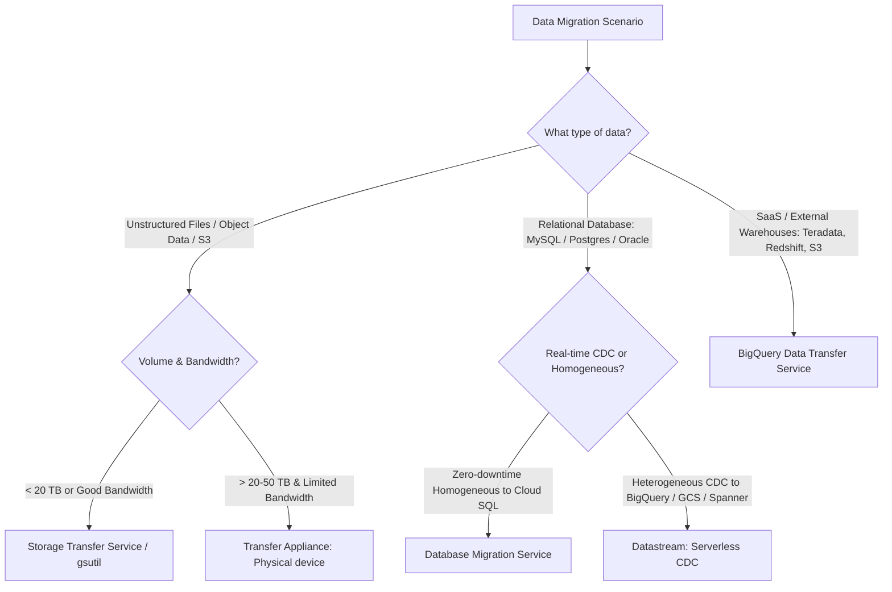
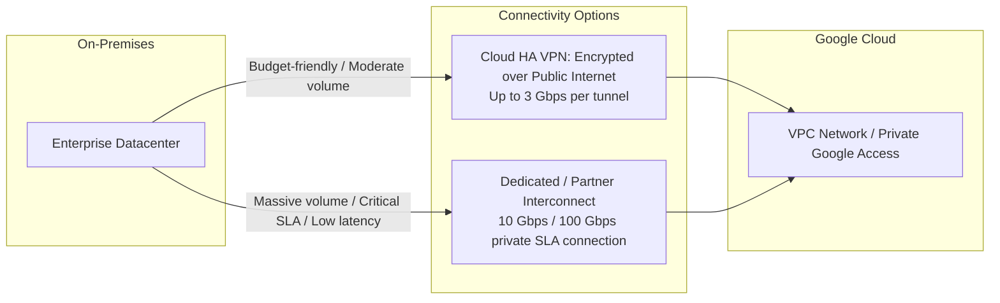

# 1.4 Designing Data Migrations

Migrating on-premises data warehouses, operational databases, and unstructured data lakes into Google Cloud requires selecting the right migration tool based on data volume, network bandwidth, allowable downtime, and change velocity.

---

## 🧭 Google Cloud Migration Tools Decision Matrix

### Comprehensive Migration Tool Comparison

| Migration Tool | Source Systems | Target Systems | Transfer Mode | Key Use Cases |
| :--- | :--- | :--- | :--- | :--- |
| **Storage Transfer Service (STS)** | AWS S3, Azure Blob, HTTP endpoints, On-Prem POSIX file systems | Cloud Storage (GCS) | Cloud-managed network transfer | Large-scale file migration, recurring multi-cloud synchronization, automated lifecycle moves |
| **Transfer Appliance** | On-premises data centers, network-attached storage (NAS) | Cloud Storage | Physical ruggedized high-capacity storage device shipped by Google | Datasets > 20 TB to petabytes when network bandwidth is constrained or costs are prohibitive |
| **Database Migration Service (DMS)** | MySQL, PostgreSQL, SQL Server, Oracle (on-premises, EC2, RDS) | Cloud SQL, AlloyDB | Continuous network replication using native engine logs (e.g. binlog, WAL) | Minimal-downtime lift-and-shift of operational transactional databases |
| **Datastream** | Oracle, PostgreSQL, MySQL, SQL Server | BigQuery, Cloud Storage, Spanner | Serverless real-time Change Data Capture (CDC) via log mining | Continuously streaming database mutations (inserts, updates, deletes) into BigQuery analytical lakes |
| **BigQuery Data Transfer Service (DTS)**| AWS S3, Teradata, Redshift, Snowflake, Google Ads, Campaign Manager, YouTube | BigQuery tables | Scheduled batch extraction and load | Migrating legacy enterprise data warehouses to BigQuery; automating Google Marketing data loads |

---

## 🔌 Hybrid Networking: Cloud VPN vs. Cloud Interconnect

When transferring high-volume enterprise data over the network, choosing the right connectivity option is critical for meeting migration timelines.

### Network Sizing Rule of Thumb for Exam Questions:
- If data volume is **multi-petabyte** and time to migrate is constrained (e.g. 1 month) with slow connection → **Transfer Appliance**.
- If migration requires a permanent, high-bandwidth connection (&gt; 10 Gbps) with direct enterprise SLA → **Dedicated Interconnect**.
- If connection requires lower setup time and moderate bandwidth (&le; 3 Gbps) → **Cloud HA VPN** (pair multiple tunnels for aggregate bandwidth).

---

## ⚡ Real-Time Change Data Capture (CDC) with Datastream

Modern data migrations often cannot tolerate hours of transactional downtime. Datastream provides serverless, log-based CDC without impacting transactional database performance.

### Key Datastream Advantages:
- **Zero-Impact Log Mining**: Reads database write-ahead logs (WAL) or transaction redo logs rather than executing polling queries against operational tables.
- **Auto-Schema Drift Handling**: Automatically adapts when columns are added to upstream source tables.
- **Native BigQuery Integration**: Direct streaming ingestion with automatic MERGE replication into BigQuery without requiring intermediate Dataflow glue code for standard CDC use cases.

---

## 🎯 Exam Practice Scenario Checkpoint

### Scenario:
A retail enterprise needs to migrate 120 TB of historical transaction log files stored on an on-premises NetApp NAS array into Google Cloud Storage within two weeks. The company has a 50 Mbps dedicated internet connection that is currently utilized at 80% capacity by daily business operations. Purchasing additional bandwidth would take three months to provision.

**Which strategy completes the migration on schedule with minimal cost and network disruption?**

- **A.** Run the `gsutil -m cp` command across multiple local servers during overnight hours.
- **B.** Order a Google Cloud Transfer Appliance, copy the data locally over the 10 GbE local network, ship the device to Google, and have it hydrated directly into the target Cloud Storage bucket.
- **C.** Provision Cloud HA VPN and configure Storage Transfer Service with on-premises agents.
- **D.** Compress the files with gzip and stream them via Cloud Pub/Sub into Cloud Storage.

> **Correct Answer: B**  
> **Explanation**: At 50 Mbps with 80% existing utilization, available bandwidth is 10 Mbps. Transferring 120 TB over a 10 Mbps line would mathematically take over 3 years (`(120 * 10^12 * 8) / 10^7 seconds ≈ 1,111 days`). The only feasible solution to meet the two-week deadline without saturating the corporate internet connection is a physical **Transfer Appliance**, which allows local high-speed ingest and rapid physical shipment.
