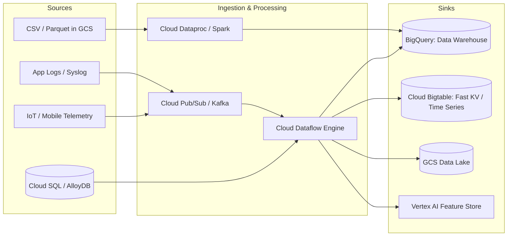
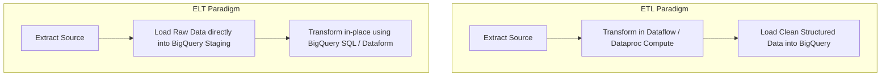
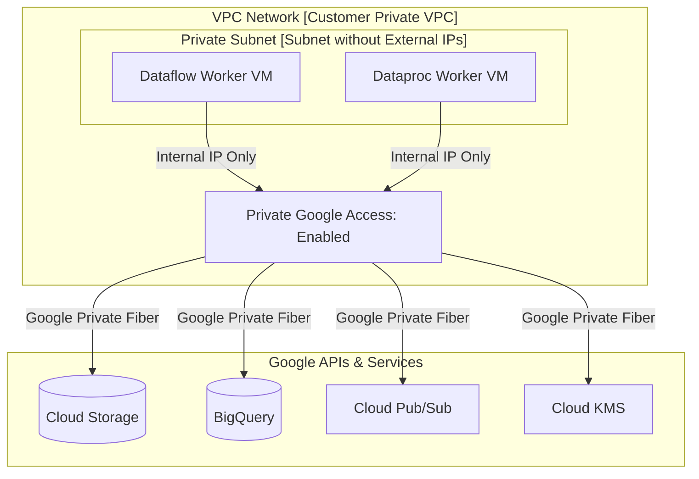

# 2.1 Planning Data Pipelines

Planning a scalable data pipeline requires aligning data sources, sinks, compute engines, and secure networking infrastructure to meet throughput and latency objectives while keeping costs predictable.

---

## 🚰 Sources and Sinks Architecture

A data pipeline connects upstream producer systems (sources) to downstream analytical, operational, or machine learning repositories (sinks).

### Source & Sink Selection Matrix

| Source / Sink Pattern | Recommended Technology | Processing Mode | Characteristics |
| :--- | :--- | :--- | :--- |
| **High-volume event streaming** | Cloud Pub/Sub $\to$ Dataflow $\to$ Bigtable / BigQuery | Real-time Streaming | Sub-second latency, horizontal auto-scaling, millions of messages/sec |
| **Microservices Messaging (FIFO)** | Pub/Sub with Ordering Keys $\to$ Dataflow | Streaming | Guarantees ordered processing per key while scaling horizontally |
| **Transactional Database CDC** | Datastream $\to$ BigQuery / GCS | Continuous / Micro-batch | Log-based Change Data Capture with minimal database overhead |
| **Bulk Analytical Exports** | BigQuery $\to$ Cloud Storage | Batch Export | Native `EXPORT DATA` supporting Parquet, CSV, and JSON |
| **High-throughput Key-Value Lookups** | Dataflow $\to$ Cloud Bigtable | Streaming / Batch | Write throughput scaling linearly with cluster node count |

---

## 🔄 ETL vs. ELT: When to Choose Which?

The debate between Extract-Transform-Load (ETL) and Extract-Load-Transform (ELT) is a classic exam topic.

### Decision Framework:

| Criteria | Choose ETL (Dataflow / Dataproc) | Choose ELT (BigQuery / Dataform) |
| :--- | :--- | :--- |
| **Data Cleanliness & Privacy** | Strict compliance: PII must be masked or tokenized **before** entering data storage. | PII can be safely stored in restricted raw datasets and masked at view time. |
| **Processing Paradigm** | Streaming events requiring sub-second windowing and enrichment. | Scheduled batch transformations of tabular or semi-structured data. |
| **Transformation Complexity** | Complex non-SQL logic (e.g. computer vision inference, custom Java/Python libraries). | SQL-friendly transformations, aggregations, joins, and window functions. |
| **Cost & Operational Simplicity** | Requires maintaining pipeline jobs and worker capacity. | Serverless; leverages BigQuery's petabyte-scale slot query engine. |

---

## 🌐 Secure Pipeline Networking Fundamentals

Google Cloud data processing workers (Dataflow worker VMs, Dataproc cluster instances, Cloud Composer worker pods) run within a Virtual Private Cloud (VPC). Securing their communication without exposing pipelines to the public internet is essential.

### Critical Networking Concepts Tested on the Exam:

1. **Private Google Access (PGA)**:
   - When Dataflow or Dataproc workers are launched without external (public) IP addresses for security compliance, PGA **must be enabled on the subnet**.
   - Enables instances with private RFC 1918 IPs to reach Google Cloud APIs and storage services over internal Google network routing.
2. **Disable Public IPs (`--no-use-public-ips`)**:
   - Google best practice: Always pass the `--no-use-public-ips` flag when submitting Dataflow jobs to adhere to enterprise security guidelines.
3. **Private Service Connect (PSC)**:
   - Allows private, secure communication between consumer VPCs and managed producer services (or SaaS platforms) via private endpoints without VPC peering.
4. **VPC Service Controls (VPC-SC)**:
   - Creates a cryptographic perimeter around GCP services (BigQuery, GCS, Cloud KMS) to prevent data exfiltration, even by authorized users with valid IAM credentials.

---

## 🔒 In-Flight and At-Rest Encryption Standards

- **In-Flight Encryption**: All network traffic between Google Cloud facilities, instances, and Google APIs is automatically encrypted using **TLS 1.3** and Google's internal ALTS (Application Layer Transport Security).
- **At-Rest Encryption**: Handled via default keys or **CMEK (Customer-Managed Encryption Keys)** via Cloud KMS. For Dataflow and Dataproc, workers can use CMEK to encrypt pipeline scratch disks, intermediate shuffle state, and persistent disks.

---

## 🎯 Exam Practice Scenario Checkpoint

### Scenario:
Your organization enforces a strict enterprise security rule: No compute instances or worker virtual machines may have external (public) IP addresses, and data flowing into Google Cloud must never traverse the public internet. You are configuring a Cloud Dataflow pipeline to read files from Cloud Storage, transform them, and load them into BigQuery.

When you submit the pipeline job, the Dataflow workers fail to communicate with Cloud Storage and BigQuery, and the job aborts.

**What configuration change must you implement?**

- **A.** Grant the Dataflow worker service account `roles/owner` on the project.
- **B.** Attach a Cloud NAT gateway to the VPC and assign static public IP addresses to the NAT router.
- **C.** Enable **Private Google Access** on the subnet where the Dataflow worker instances are provisioned.
- **D.** Provision a Cloud VPN tunnel between the Dataflow workers and the BigQuery API endpoint.

> **Correct Answer: C**  
> **Explanation**: When Dataflow worker VMs are provisioned without public IP addresses (via `--no-use-public-ips`), they cannot resolve or reach Google APIs (like Cloud Storage, BigQuery, or Cloud Pub/Sub) unless **Private Google Access** is enabled on their subnet. Enabling Private Google Access routes API traffic entirely through Google's internal private network backbone without requiring public IPs or NAT.
