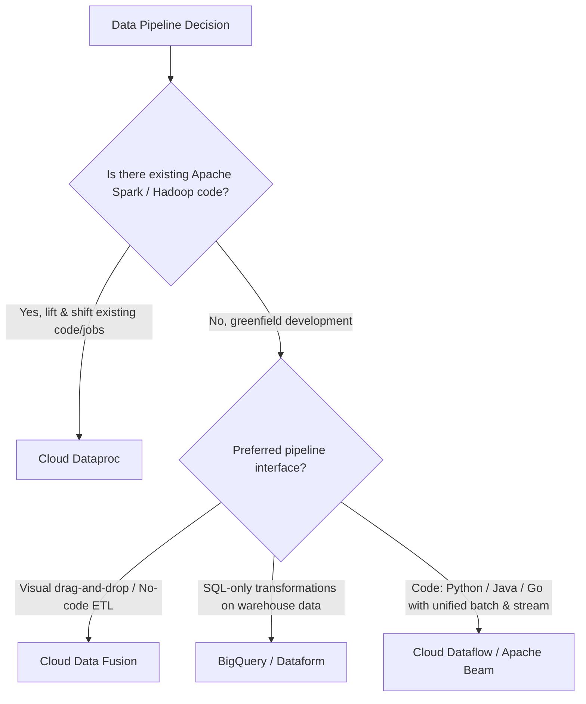
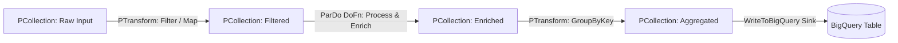
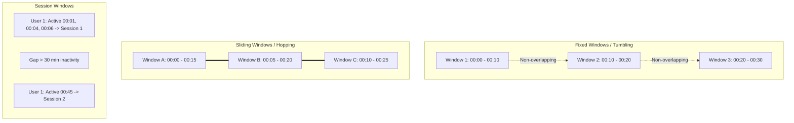
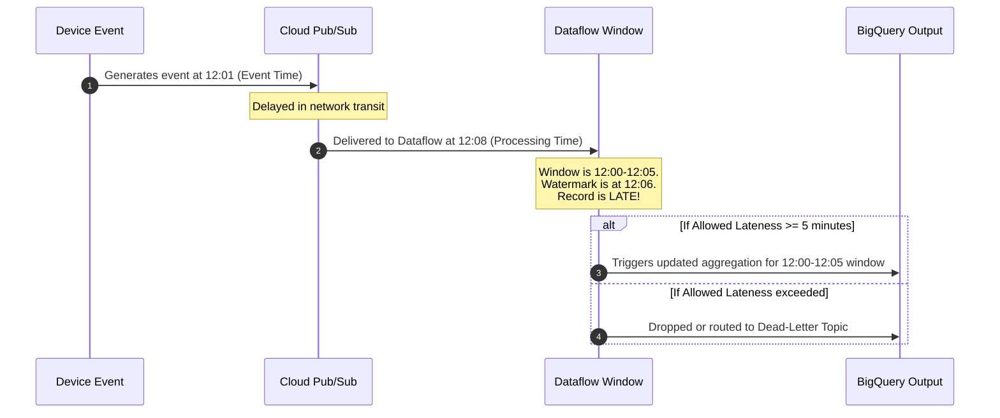

# 2.2 Building Pipelines

Transforming raw streams and batches into clean, enriched datasets is the core responsibility of a Google Cloud Data Engineer. This lesson covers service selection, the Apache Beam programming model, streaming window mechanics, and AI data enrichment.

---

## ⚙️ Service Selection: Dataflow vs. Dataproc vs. Cloud Data Fusion vs. BigQuery

A common exam challenge is determining whether to use Cloud Dataflow, Cloud Dataproc, Cloud Data Fusion, or native BigQuery for pipeline execution.



### Comprehensive Comparison Matrix

| Feature | Cloud Dataflow | Cloud Dataproc | Cloud Data Fusion | BigQuery |
| :--- | :--- | :--- | :--- | :--- |
| **Underlying Engine** | Apache Beam execution engine | Apache Spark, Hadoop, Hive, Presto, Flink | CDAP on Dataproc | Google Dremel SQL engine |
| **Serverless?** | **Yes**: Fully serverless, dynamic autoscaling, worker rebalancing | Optional: Dataproc Serverless or managed cluster VMs | Managed UI, provisions Dataproc clusters behind scenes | **Yes**: Serverless slot allocation |
| **Streaming Support** | Sub-second latency, unified batch/streaming semantics | Spark Structured Streaming (micro-batch) | Real-time pipelines via Spark Streaming | Streaming inserts / BigQuery Storage Write API |
| **Scaling Mechanism** | Horizontal auto-scaling of worker VMs + Liquid Shuffling | Auto-scaling policies on Dataproc worker nodes | Dataproc worker scaling | Dynamic slot allocation |
| **Operational Effort** | **Zero infrastructure management** | Requires cluster sizing, init actions, OS/package maintenance | Low to medium | **Zero infrastructure management** |
| **Primary Sweet Spot** | Unified batch & streaming pipelines with complex windowing | Migrating existing Spark/Hadoop applications with minimal code rewrites | Enterprise GUI-driven ETL integration | Analytical SQL aggregations, joins, and feature preparation |

---

## 🌊 Apache Beam & Dataflow Concepts

The Apache Beam programming model defines four fundamental primitives:



### Core Primitives:
1. **Pipeline**: Encapsulates the entire DAG of data processing operations.
2. **PCollection**: Represents a distributed, multi-element dataset (can be bounded for batch or unbounded for streaming). Immutable.
3. **PTransform**: An operation that takes one or more PCollections as input and produces one or more output PCollections.
4. **ParDo / DoFn**: The core parallel processing transform. Similar to `map` and `flat_map`. Each worker receives elements and yields zero or more outputs.

### Python Apache Beam Pipeline Example:
```python
import apache_beam as beam
from apache_beam.options.pipeline_options import PipelineOptions, StandardOptions

options = PipelineOptions()
options.view_as(StandardOptions).streaming = True

with beam.Pipeline(options=options) as p:
    (
        p
        | "ReadFromPubSub" >> beam.io.ReadFromPubSub(subscription="projects/my-proj/subscriptions/events-sub")
        | "ParseJSON" >> beam.Map(json.loads)
        | "FilterHighValue" >> beam.Filter(lambda x: x['amount'] > 100)
        | "AddTimestamp" >> beam.Map(lambda x: beam.window.TimestampedValue(x, x['timestamp']))
        | "WindowIntoHours" >> beam.WindowInto(beam.window.FixedWindows(3600))
        | "SumPerUser" >> beam.CombinePerKey(sum)
        | "WriteToBigQuery" >> beam.io.WriteToBigQuery(
            table='my-proj:analytics.hourly_user_totals',
            schema='user_id:STRING, total:FLOAT',
            write_disposition=beam.io.BigQueryDisposition.WRITE_APPEND
        )
    )
```

---

## ⏱️ Streaming Mechanics: Windowing, Watermarks, and Triggers

Streaming pipelines process unbounded data. To perform aggregations (e.g. calculating counts or averages), data must be grouped into finite temporal chunks.

### 1. Types of Windows



- **Fixed (Tumbling) Windows**: Discrete, uniform, non-overlapping time intervals (e.g., every 5 minutes). Every element belongs to exactly one window.
- **Sliding (Hopping) Windows**: Overlapping time intervals defined by a duration and a slide frequency (e.g., 10-minute window sliding every 2 minutes). An element belongs to multiple windows.
- **Session Windows**: Dynamic intervals grouped by a period of user inactivity (gap duration). Highly effective for website user journey tracking.

### 2. Event Time vs. Processing Time
- **Event Time**: The instant the event physically occurred at the source device/app (embedded inside the record payload).
- **Processing Time**: The wall-clock time when the Dataflow pipeline worker receives and processes the record.

### 3. Watermarks & Late-Arriving Data
Network latency or mobile disconnections cause records to arrive out of order.
- **Watermark**: The system's notion of when all data up to a certain event time has arrived.
- **Allowed Lateness**: Specifies how long the pipeline should wait for delayed data after the watermark passes a window's end.
- **Triggers**: Determine when the window's accumulated computation is emitted (e.g., emit early estimates, emit at the watermark, or emit updates for late data).



---

## 🤖 AI Data Enrichment in Pipelines

Modern data engineering pipelines incorporate machine learning enrichment directly into the ingestion stream:

1. **BigQuery ML SQL Enrichment**:
   - Call Gemini or text-bison models directly from SQL using `ML.GENERATE_TEXT`:
   ```sql
   SELECT
     review_id,
     ml_generate_text_result['predictions'][0]['content'] AS sentiment_analysis
   FROM
     ML.GENERATE_TEXT(
       MODEL `my_project.ml_models.gemini_pro`,
       TABLE `my_project.raw_data.customer_reviews`,
       STRUCT(
         'Classify the sentiment of this review as POSITIVE, NEGATIVE, or NEUTRAL:' AS prompt,
         0.2 AS temperature
       )
     );
   ```

2. **Dataflow with Vertex AI Endpoints**:
   - Use Beam's `RunInference` transform to run model predictions against models hosted on **Vertex AI Endpoints** or embedded PyTorch/TensorFlow models with automatic batching and GPU acceleration.

---

## 🎯 Exam Practice Scenario Checkpoint

### Scenario:
A ride-sharing application streams GPS location events from millions of driver mobile devices into Cloud Pub/Sub. The data engineering team must calculate the average driver speed over 10-minute intervals evaluated every 2 minutes. Because mobile phones regularly enter tunnels and lose cellular connectivity, GPS data packets frequently arrive up to 15 minutes late. The business intelligence team requires accurate aggregate statistics, and late-arriving points must update the corresponding historical averages.

**How should you design the Dataflow pipeline windowing and triggering logic?**

- **A.** Use Fixed (Tumbling) windows of 10 minutes with processing-time triggers and zero allowed lateness.
- **B.** Use Sliding windows of 10-minute duration with a 2-minute slide period, event-time watermarking, and an allowed lateness of at least 15 minutes with accumulation mode.
- **C.** Use Session windows with a 15-minute gap duration and write outputs directly to Cloud Storage.
- **D.** Ingest data directly into BigQuery via batch streaming inserts and run a cron query every 2 minutes.

> **Correct Answer: B**  
> **Explanation**: The business requires evaluating 10-minute windows every 2 minutes, which is the definition of a **Sliding (Hopping) window** (10-minute duration, 2-minute slide). Mobile devices going through tunnels generate late-arriving data in event time; therefore, using **event-time watermarking** combined with an **allowed lateness of 15+ minutes** ensures late records are not dropped, but rather update the window aggregates via accumulation mode.
