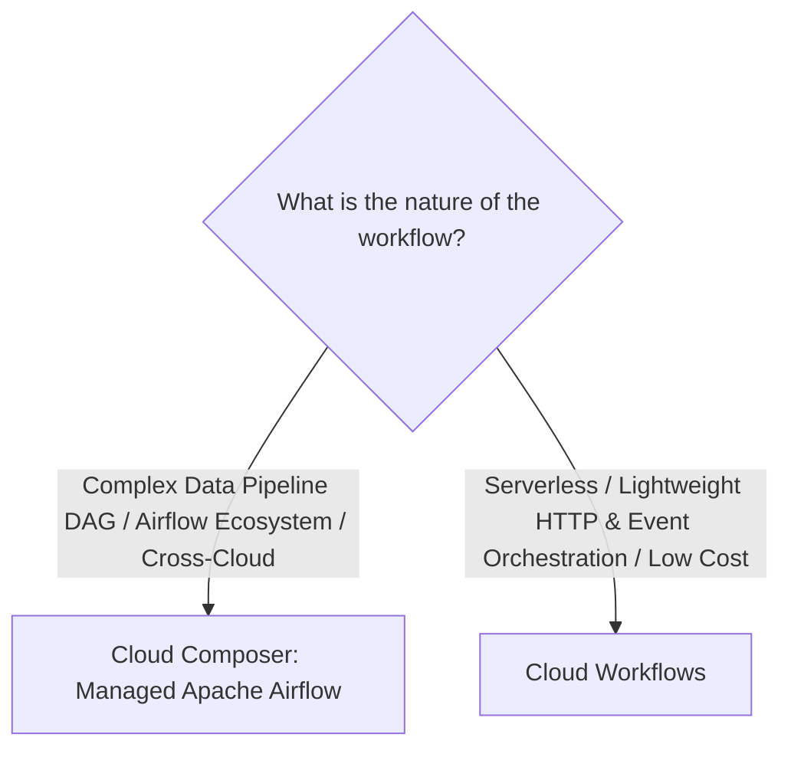
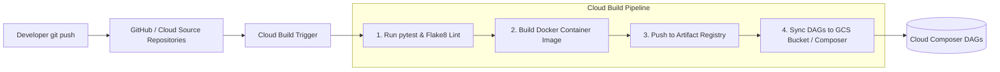

# 2.3 Deploying and Operationalizing Pipelines

Building a pipeline is only half the battle. Delivering production value requires robust orchestration, automated CI/CD deployment pipelines, unit testing, and automated release configurations.

---

## 🎼 Orchestration: Cloud Composer vs. Cloud Workflows

Google Cloud provides two distinct orchestration engines:



### Head-to-Head Comparison

| Feature | Cloud Composer | Cloud Workflows |
| :--- | :--- | :--- |
| **Engine** | Managed **Apache Airflow 2** | Google-native serverless workflow engine |
| **Language** | Python (DAG definitions) | YAML or JSON |
| **Infrastructure** | Provisions a GKE cluster, Cloud SQL instance, and Cloud Storage bucket | **100% Serverless**; zero standing infrastructure |
| **Startup / Latency** | Heavyweight; runs continuously 24/7 | Millisecond cold starts; scale to zero |
| **Cost Model** | Hourly fee for GKE nodes, Airflow webserver, and database | Pay-per-step executed (virtually zero cost when idle) |
| **Best Used For** | End-to-end data platform orchestration (Dataflow, Dataproc, BigQuery, dbt/Dataform, Slack alerts) | Event-driven microservices, Cloud Function chaining, lightweight Pub/Sub triggers |

### Apache Airflow 2 DAG Example in Cloud Composer:
```python
from datetime import datetime, timedelta
from airflow import DAG
from airflow.providers.google.cloud.operators.dataflow import DataflowCreatePythonJobOperator
from airflow.providers.google.cloud.operators.bigquery import BigQueryInsertJobOperator

default_args = {
    'owner': 'data-engineering',
    'depends_on_past': False,
    'email_on_failure': True,
    'email': ['data-alerts@company.com'],
    'retries': 2,
    'retry_delay': timedelta(minutes=5),
}

with DAG(
    'daily_analytics_etl',
    default_args=default_args,
    schedule_interval='0 2 * * *',  # Daily at 02:00 UTC
    start_date=datetime(2026, 1, 1),
    catchup=False,
) as dag:

    run_dataflow_cleansing = DataflowCreatePythonJobOperator(
        task_id='run_dataflow_cleansing',
        py_file='gs://my-bucket/pipelines/cleanse.py',
        job_name='cleanse-orders-{{ ds_nodash }}',
        options={'temp_location': 'gs://my-bucket/temp'},
    )

    run_bigquery_marts = BigQueryInsertJobOperator(
        task_id='run_bigquery_marts',
        configuration={
            "query": {
                "query": "CALL `my_project.analytics.refresh_daily_marts`('{{ ds }}');",
                "useLegacySql": False,
            }
        },
    )

    run_dataflow_cleansing >> run_bigquery_marts
```

---

## 🚀 CI/CD for Data Engineering with Cloud Build

Automating testing and deployment eliminates manual errors when deploying pipelines to staging and production.



### Essential CI/CD Steps for PDE:
1. **Beam Unit Testing with `TestPipeline`**:
   - Beam includes `apache_beam.testing.test_pipeline.TestPipeline` and `assert_that` to verify transformations locally against synthetic PCollections before deployment.
2. **Containerized Dataflow (Flex Templates)**:
   - Package Beam code and dependencies into a Docker container stored in **Artifact Registry**.
   - Enables multi-language support, custom dependencies, and automated execution via simple REST API or Composer operators without local Python environment conflicts.
3. **Dataform Environments & Release Configurations**:
   - Configure Dataform release configurations to pull code from the `main` Git branch, compile SQLX, and execute assertions against `dev`, `staging`, or `prod` BigQuery datasets automatically.

---

## 🎯 Exam Practice Scenario Checkpoint

### Scenario:
A financial intelligence team is deploying a new batch Apache Beam pipeline in Python that processes confidential transactions. During peak runs, the pipeline requires custom C-extensions for cryptography and specific Python library dependencies. When data engineers deploy the job directly from their individual laptops, dependencies frequently conflict with the default Dataflow worker environment, resulting in failed workers. Furthermore, corporate policy forbids running unversioned code in production.

**What deployment strategy solves these dependency and governance issues?**

- **A.** Install the libraries manually on the default Compute Engine template used by Dataflow.
- **B.** Package the Beam pipeline, dependencies, and execution environment into a custom Docker image, upload it to Artifact Registry, and launch the pipeline using Dataflow Flex Templates orchestrated by Cloud Composer.
- **C.** Rewrite the Python pipeline in bash scripts running on a standard Compute Engine VM.
- **D.** Place the Python `.whl` files on a public FTP server and pass the URL to Dataflow workers.

> **Correct Answer: B**  
> **Explanation**: **Dataflow Flex Templates** allow developers to package the complete runtime environment, including custom dependencies, C-libraries, and Python packages, into a standardized Docker container image stored securely in **Google Cloud Artifact Registry**. This guarantees consistent, reproducible execution in production and integrates cleanly with CI/CD and Cloud Composer orchestration.
