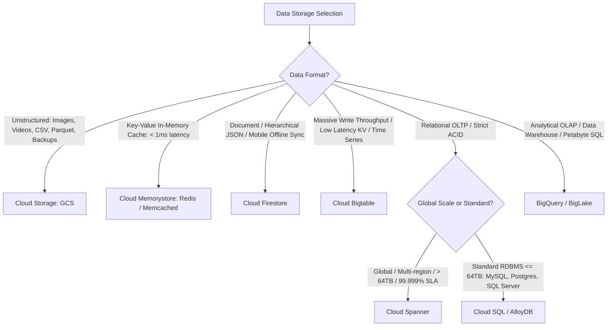
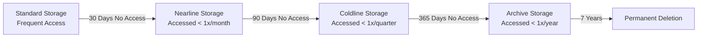

# 3.1 Selecting Storage Systems

Choosing the optimal Google Cloud storage technology is one of the most heavily tested domains on the Professional Data Engineer exam. This lesson equips you with an exhaustive evaluation matrix, access pattern taxonomy, and storage lifecycle management strategies.

---

## 🗄️ Master Storage Selection Decision Tree



---

## 📊 Comprehensive Storage Comparison Matrix

| Storage Service | Type / Paradigm | Latency | Max Capacity | Consistency | Primary Exam Triggers & Keywords |
| :--- | :--- | :--- | :--- | :--- | :--- |
| **BigQuery** | Serverless Columnar Data Warehouse (OLAP) | Seconds to Sub-seconds | Unlimited (Petabytes / Exabytes) | Strong | Complex SQL analytics, aggregations, data warehousing, BI Engine, BigQuery ML. |
| **Cloud Bigtable** | Wide-column NoSQL Key-Value Store | Sub-10ms (1-5ms typical) | Petabytes (scales linearly per node) | Single-row atomic; Eventual across clusters | High-throughput writes (> 100K QPS), time-series, IoT telemetry, AdTech, financial tickers. Row-key design is critical. |
| **Cloud Spanner** | Globally Distributed Relational Database (OLTP) | Low milliseconds (10-20ms) | Unlimited (horizontal scaling) | **External Consistency** (TrueTime) | Global ACID transactions, inventory management across regions, 99.999% SLA, relational schema at massive scale. |
| **Cloud SQL** | Managed RDBMS (MySQL, PostgreSQL, SQL Server) | Low milliseconds | 64 TB per instance | Strong | Standard relational web applications, legacy ERP/CRM migration, regional ACID transactions up to 64TB. |
| **AlloyDB for PostgreSQL** | High-performance enterprise PostgreSQL | Low milliseconds | Hundreds of Terabytes | Strong | High-performance transactional workloads, up to 4x faster than standard PostgreSQL, AI vector search integration (`pgvector`). |
| **Cloud Firestore** | Serverless NoSQL Document Store | Low milliseconds | Scales horizontally | Strong (documents) | Mobile apps, web clients, user profiles, shopping carts, offline device synchronization. |
| **Cloud Storage (GCS)** | Object Storage (Unstructured/Blobs) | Milliseconds to Seconds | Unlimited | Strong read-after-write & metadata | Staging raw files, data lake storage, backups, disaster recovery archives, media assets. |
| **Cloud Memorystore** | Managed In-Memory Cache (Redis / Memcached) | **Sub-millisecond** | Up to hundreds of GBs | In-memory | Session state, gaming leaderboards, low-latency caching layer in front of relational databases. |

---

## ⏳ Data Lifecycle Management

Managing storage tiers and automatic deletion is vital for cost governance.

### 1. Cloud Storage (GCS) Storage Classes & Lifecycle Rules



#### GCS Lifecycle Configuration (JSON):
```json
{
  "rule": [
    {
      "action": {"type": "SetStorageClass", "storageClass": "NEARLINE"},
      "condition": {"age": 30, "matchesPrefix": ["logs/"]}
    },
    {
      "action": {"type": "SetStorageClass", "storageClass": "ARCHIVE"},
      "condition": {"age": 90}
    },
    {
      "action": {"type": "Delete"},
      "condition": {"age": 365}
    }
  ]
}
```

### 2. BigQuery Table & Partition Expiration
- Set **default partition expiration** at the dataset or table level:
  ```sql
  CREATE TABLE `analytics.audit_events`
  (
    event_id STRING,
    event_timestamp TIMESTAMP
  )
  PARTITION BY DATE(event_timestamp)
  OPTIONS(
    partition_expiration_days = 90
  );
  ```
  Partitions older than 90 days are automatically purged without incurring manual deletion operations.

### 3. Cloud Bigtable Garbage Collection (GC) Policies
Bigtable maintains multiple versions of cell data. GC policies dictate automatic pruning:
- **Max Versions**: Retain only the latest $N$ versions (e.g. keep the 3 most recent GPS pings).
- **Max Age (TTL)**: Retain cells only for a specific duration (e.g. delete records older than 30 days).
- **Compound Rules**: Union (`OR`) or Intersection (`AND`) of Age and Versions.

---

## 🎯 Exam Practice Scenario Checkpoint

### Scenario:
A connected autonomous vehicle manufacturer receives telemetry from 500,000 vehicles every second. Each vehicle transmits GPS location, speed, engine temperature, and diagnostic codes. The ingest system must support over 1,500,000 write operations per second with sub-10ms latency. Analytics engineers periodically query the most recent 24 hours of data for individual vehicle VINs. The data architecture must scale horizontally by adding nodes as the vehicle fleet expands.

**Which Google Cloud service should the data engineer choose for storing this real-time telemetry?**

- **A.** Cloud Spanner with a multi-region configuration.
- **B.** Cloud SQL for PostgreSQL configured with 10 read replicas.
- **C.** Cloud Bigtable with an optimized row key starting with `VIN#Timestamp`.
- **D.** Cloud Firestore in Datastore mode.

> **Correct Answer: C**  
> **Explanation**: **Cloud Bigtable** is purpose-built for massive write throughput (millions of writes per second), sub-10 millisecond latency, and petabyte-scale horizontal scaling. A row-key design like `VIN#Timestamp` clusters all events for a given vehicle sequentially, making range scans for the last 24 hours of a vehicle's telemetry lightning-fast. Cloud Spanner (Option A) is designed for multi-region relational ACID workloads and is significantly more expensive per write op. Cloud SQL (Option B) cannot sustain 1.5M writes/second (capped at 64TB and single-master writes).
