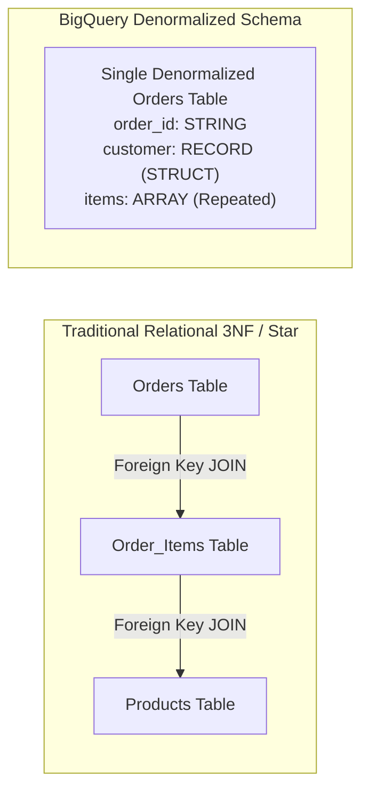
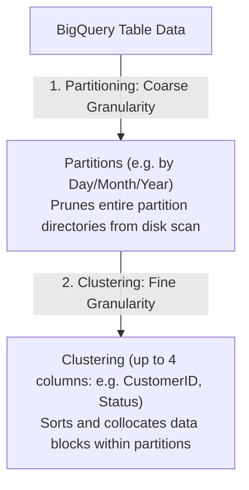

# 3.2 Data Warehousing with BigQuery

BigQuery is Google Cloud's fully managed, petabyte-scale, serverless analytical data warehouse. Mastering BigQuery data modeling, partitioning, clustering, and storage mechanics is essential for the PDE exam.

---

## 🏛️ Data Modeling: Normalization vs. Denormalization (Nested & Repeated Fields)

Traditional on-premises data warehouses rely on highly normalized schemas (3NF) or Star / Snowflake schemas with strict foreign keys to conserve disk space. 

In BigQuery, **compute and storage are physically decoupled**. Disk space in Colossus is cheap, but cross-network data shuffling during large table `JOIN` operations consumes expensive slot time. Therefore, the optimal BigQuery design principle is **denormalization using Nested and Repeated fields**.



### Why Nested & Repeated Fields Win in BigQuery:
1. **Preserves Relationships Internally**: BigQuery stores data in Capacitor columnar format. A nested record (`STRUCT`) and repeated field (`ARRAY`) keeps child items co-located on physical disk blocks with their parent row.
2. **Zero-Shuffle Joins**: Eliminates expensive distributed shuffles and `JOIN` operations across cluster nodes.
3. **Data Integrity**: Eliminates Cartesian product anomalies when joining multi-level one-to-many child tables.

### SQL DDL Example: Structs and Arrays
```sql
CREATE TABLE `ecommerce.orders`
(
  order_id STRING NOT NULL,
  order_timestamp TIMESTAMP NOT NULL,
  customer STRUCT<
    id STRING,
    name STRING,
    email STRING
  >,
  items ARRAY<STRUCT<
    product_id STRING,
    sku STRING,
    quantity INT64,
    price NUMERIC
  >>,
  shipping_address STRUCT<
    city STRING,
    state STRING,
    postal_code STRING
  >
)
PARTITION BY DATE(order_timestamp)
CLUSTER BY customer.id, shipping_address.state;
```

### Querying Nested & Repeated Records with `UNNEST`:
```sql
-- Flatten the items array to calculate product-level sales
SELECT
  o.order_id,
  o.customer.name,
  item.product_id,
  item.quantity * item.price AS line_total
FROM
  `ecommerce.orders` AS o,
  UNNEST(o.items) AS item
WHERE
  DATE(o.order_timestamp) = '2026-11-01';
```

---

## ✂️ Partitioning & Clustering Strategies

Optimizing data access patterns drastically slashes query execution time and financial cost (under on-demand pricing, BigQuery charges per byte scanned).



### 1. Table Partitioning
Partitioning divides a large table into distinct physical segments. When a query contains a partition filter (e.g. `WHERE order_date >= '2026-01-01'`), BigQuery **prunes** all other partitions, scanning zero bytes for unselected dates.

#### Partitioning Types:
- **Time-unit partitioning**: Partitioned by `DATE`, `DATETIME`, or `TIMESTAMP` column (e.g. daily, monthly, or yearly).
- **Ingestion-time partitioning**: Partitioned automatically by the pseudo-column `_PARTITIONDATE` or `_PARTITIONTIME` when records are loaded.
- **Integer-range partitioning**: Partitioned by an integer column with defined `start`, `end`, and `interval` parameters (e.g., customer account ranges `1-10000`, `10001-20000`).

> ⚠️ **Exam Quota Alert**: A BigQuery table supports a maximum of **10,000 partitions**. If you partition daily, your table can store over 27 years of data. Partitioning hourly allows ~1.1 years.

### 2. Table Clustering
Clustering automatically sorts data based on the values in one to four specified columns. It groups related data into the same storage blocks.

#### Partitioning vs. Clustering Comparison

| Feature | Partitioning | Clustering |
| :--- | :--- | :--- |
| **Column Count** | Exactly **one** column | **One to four** columns (order matters!) |
| **Cost Predictability** | Known upfront before query runs (shown in query validator) | Unknown upfront; cost reduction realized at execution time |
| **Cardinality** | Low to moderate cardinality (max 10,000 distinct values) | High cardinality columns (e.g. `user_id`, `device_id`, `uuid`) |
| **Maintenance** | None | Automatic re-clustering runs in background at no cost |

### Best Practice: Combine Both!
```sql
CREATE TABLE `analytics.transactions`
(
  tx_id STRING,
  user_id STRING,
  country_code STRING,
  amount NUMERIC,
  created_at TIMESTAMP
)
PARTITION BY DATE(created_at)
CLUSTER BY user_id, country_code;
```

---

## 🔍 BigQuery Search Indexes

For high-cardinality unstructured or semi-structured log queries (e.g. searching for a specific IP address or error message in text/JSON logs), full scans are expensive.
- Create a **Search Index**:
  ```sql
  CREATE SEARCH INDEX log_text_idx ON `monitoring.system_logs`(ALL COLUMNS);
  ```
- Use the `SEARCH()` function in queries:
  ```sql
  SELECT * FROM `monitoring.system_logs`
  WHERE SEARCH(log_message, '`Out of Memory`');
  ```
  BigQuery uses the inverted index to skip non-matching blocks entirely!

---

## 🎯 Exam Practice Scenario Checkpoint

### Scenario:
A streaming media platform logs video playback heartbeats into BigQuery at a rate of 100 million rows per day. Data analysts routinely execute two types of queries:
1. Aggregate daily dashboards filtered by date (`WHERE event_timestamp BETWEEN '2026-10-01' AND '2026-10-07'`).
2. Deep forensic investigations filtered by date AND a specific user (`WHERE user_id = 'usr_98124'`).

Currently, the table is unpartitioned and queries scan multiple terabytes, resulting in high query costs and slow execution.

**How should the data engineer redesign the BigQuery table to optimize performance and minimize costs?**

- **A.** Partition the table by `user_id` and cluster by `event_timestamp`.
- **B.** Partition the table by `DATE(event_timestamp)` and cluster by `user_id`.
- **C.** Shard the table into daily individual tables (`heartbeats_20261001`, `heartbeats_20261002`) and query with table wildcards.
- **D.** Create a Materialized View for every user in the platform.

> **Correct Answer: B**  
> **Explanation**: Partitioning by `DATE(event_timestamp)` prunes all unnecessary days for both query types, drastically reducing scanned bytes. Clustering by `user_id` inside those date partitions ensures that forensic queries targeting a specific high-cardinality user only read the specific storage blocks containing that user's data. Table sharding (Option C) is considered an anti-pattern on Google Cloud and is heavily discouraged in favor of native partitioning. You cannot partition by a high-cardinality string like `user_id` (Option A), as BigQuery limits tables to 10,000 partitions.
