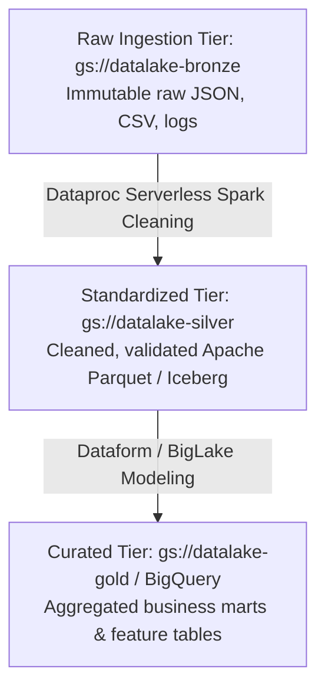
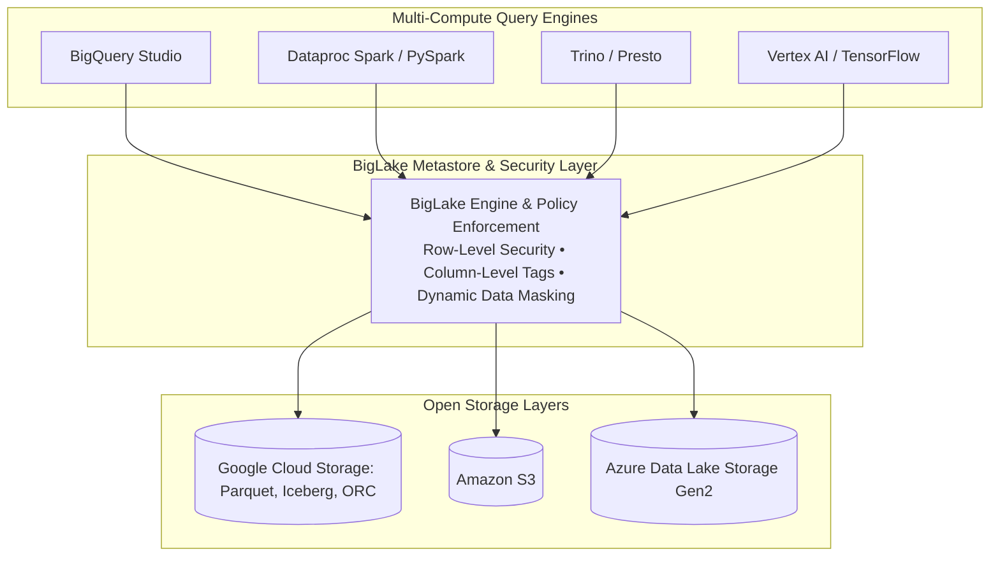
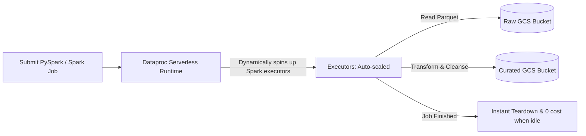

# 3.3 Data Lake Architectures & BigLake

A data lake on Google Cloud provides cost-effective, durable storage for structured, semi-structured, and unstructured data at exabyte scale using Cloud Storage (GCS) and BigLake.

---

## 🌊 Cloud Storage (GCS) as the Enterprise Data Lake Foundation

Cloud Storage acts as the primary data lake repository on Google Cloud due to its 99.999999999% (11 nines) annual durability, virtually unlimited scale, and fine-grained access control.



### Directory Partitioning Conventions (Hive Partitioning)
When storing Parquet or ORC files in GCS, structuring directories with key-value pairs enables query engines (BigQuery, Spark, Presto) to automatically perform partition pruning:
```
gs://my-datalake/events/dt=2026-11-01/region=US/part-0001.parquet
gs://my-datalake/events/dt=2026-11-01/region=EU/part-0002.parquet
gs://my-datalake/events/dt=2026-11-02/region=US/part-0003.parquet
```

---

## 💎 BigLake: Unified Storage Engine with Fine-Grained Governance

Historically, data engineers faced a dilemma:
- **BigQuery Native Storage**: Provides fine-grained security (column-level, row-level, data masking), but requires copying files into proprietary BigQuery storage.
- **External GCS Tables**: Open file formats (Parquet, ORC, Iceberg), but access was binary (all-or-nothing GCS bucket permissions) and query performance suffered.

**BigLake solves this dilemma** by decoupling compute and governance from the storage format.



### BigLake Architectural Superpowers:
1. **Access Delegation via Service Connections**:
   - End-users and analysts do not need read permissions on the underlying GCS buckets.
   - Queries connect via a **BigQuery Connection Resource**, which uses a dedicated service account to access files securely.
2. **Fine-Grained Column and Row-Level Security on Open Formats**:
   - You can apply BigQuery policy tags and row-level security directly to Parquet or Iceberg tables residing in GCS without moving the files!
3. **Storage Performance Acceleration**:
   - Caches external metadata and leverages BigQuery BI Engine to accelerate queries over GCS files.

### Creating a BigLake Table over Parquet in GCS:
```sql
CREATE EXTERNAL TABLE `enterprise_lake.sales_biglake`
WITH CONNECTION `us-central1.gcs_lake_connection`
OPTIONS (
  format = 'PARQUET',
  uris = ['gs://enterprise-datalake/sales/*.parquet'],
  hive_partition_uri_prefix = 'gs://enterprise-datalake/sales/'
);
```

---

## ⚡ Processing Lake Data with Dataproc Serverless

Legacy data lakes require provisioning, sizing, and managing permanent Hadoop/Spark VM clusters. **Dataproc Serverless** eliminates cluster management completely.



### CLI Command to Submit Dataproc Serverless Spark Job:
```bash
gcloud dataproc batches submit pyspark gs://my-scripts/cleanse_lake.py \
    --project=my-data-project \
    --region=us-central1 \
    --deps-bucket=gs://my-lake-staging \
    --subnet=default
```
- No cluster to create or delete.
- Billing is charged strictly per second of CPU and memory used by the Spark driver and executors.

---

## 🎯 Exam Practice Scenario Checkpoint

### Scenario:
A data science organization stores 3 PB of raw and curated data in Apache Parquet format in Google Cloud Storage. The Chief Compliance Officer mandates that:
1. Analysts must only be able to query records relevant to their respective geographic sales territories (Row-level security).
2. Credit card numbers stored in the Parquet files must be masked for non-finance users (Column-level data masking).
3. The data scientists must continue running Spark and BigQuery queries on the raw Parquet files without duplicating data into proprietary storage.

**Which architecture meets all compliance and query requirements?**

- **A.** Ingest all Parquet files into standard BigQuery managed tables and delete the files from GCS.
- **B.** Implement BigLake tables over the GCS Parquet files, define BigQuery row-level access policies, and apply Dataplex taxonomy policy tags for column-level masking.
- **C.** Create separate GCS buckets for each geographic territory and duplicate filtered files using Cloud Functions.
- **D.** Rely on POSIX file permissions on Cloud Storage to restrict directory access.

> **Correct Answer: B**  
> **Explanation**: **BigLake** extends BigQuery's enterprise governance—including Row-Level Security (RLS), Column-Level Security (CLS), and dynamic data masking—directly to open table formats (Parquet, ORC, Iceberg) in Cloud Storage without copying the data into BigQuery. Cloud Storage alone (Options C and D) only supports bucket-level or object-level ACLs/IAM and cannot evaluate row filters or column masks.
