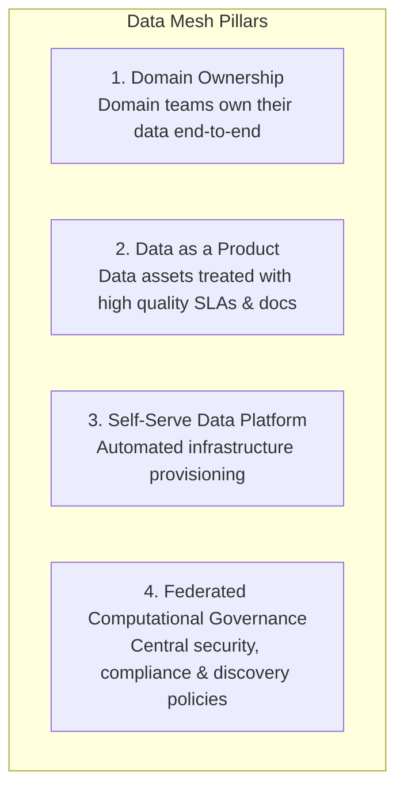
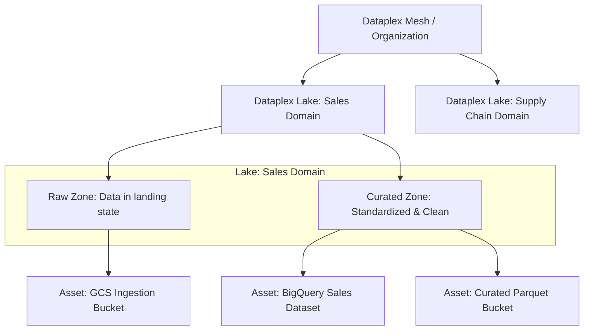

# 3.4 Modern Data Platform with Dataplex & Data Mesh

Enterprise organizations with hundreds of teams and petabytes of data face a common problem: centralized monolithic data lakes become operational bottlenecks. Google Cloud implements the **Data Mesh** pattern natively through **Dataplex**.

---

## 🕸️ The Data Mesh Paradigm on Google Cloud

Data Mesh shifts data architecture away from centralized engineering teams to decentralized, domain-driven ownership:



### Mapping Data Mesh to Google Cloud Services:
- **Domains**: Individual GCP projects owned by functional business units (e.g. `finance-domain`, `supply-chain-domain`).
- **Data Products**: BigQuery tables, views, BigLake tables, and GCS buckets curated for consumers.
- **Central Governance & Catalog**: **Dataplex** and **Dataplex Catalog**.
- **Data Sharing**: **Analytics Hub**.

---

## 🏛️ Dataplex Structural Hierarchy

Dataplex manages distributed data without requiring physical data movement into a single central project.



### Components:
1. **Dataplex Lake**: A logical container representing a business domain or regulatory boundary.
2. **Dataplex Zone**: A category inside a Lake:
   - **Raw Zone**: Contains data that is raw and uncurated. Flexible format requirements.
   - **Curated Zone**: Contains cleaned, curated data ready for production consumption. Requires structured/columnar formats (Parquet, ORC, Avro, BigQuery native tables).
3. **Dataplex Asset**: Points to physical Cloud Storage buckets or BigQuery datasets. The underlying storage stays physically in its original GCP project!

---

## 🔍 Dataplex Catalog & Automated Data Discovery

- **Automatic Metadata Crawling**: Dataplex automatically scans Cloud Storage buckets, extracts schemas (JSON, CSV, Avro, Parquet), registers them as external tables in BigQuery, and indexes them in Dataplex Catalog.
- **Data Profiling**: Dataplex executes automated profiling jobs calculating column statistics (min, max, null percentages, distinct value counts, quartile distributions) without exposing raw PII.
- **Data Quality Tasks**: Define declarative YAML rules (or Cloud Storage / BigQuery assertions) that run on a schedule:
  ```yaml
  rules:
    - column: customer_id
      ruleType: NOT_NULL
    - column: order_total
      ruleType: VALUE_RANGE
      threshold: 1.0
      params:
        minValue: 0
    - column: email
      ruleType: REGEX_MATCH
      params:
        regex: "^[A-Za-z0-9._%+-]+@[A-Za-z0-9.-]+\\.[A-Za-z]{2,}$"
  ```
- **Automated Alerts**: Publishes data quality metric failures directly to Cloud Monitoring and Cloud Logging.

---

## 🎯 Exam Practice Scenario Checkpoint

### Scenario:
A global conglomerate operates 15 distinct business units across multiple continents. Each unit operates its own independent Google Cloud projects with separate budgets and engineering teams. The Chief Data Officer (CDO) wants to establish a corporate-wide data governance architecture that:
1. Enables each business unit to retain complete autonomy over their data pipelines and storage resources.
2. Allows cross-functional data analysts to discover and search all corporate datasets across all 15 business units from a single portal.
3. Automatically scans for data quality rule violations and applies unified column-level security tags centrally.

**Which architectural approach meets these requirements?**

- **A.** Force all 15 business units to replicate their data daily into a single centralized BigQuery dataset in a corporate root project.
- **B.** Implement a Data Mesh architecture using Dataplex, registering each business unit's GCS buckets and BigQuery datasets as Dataplex Assets organized into domain Lakes, with centralized metadata indexed in Dataplex Catalog.
- **C.** Use gsutil rsync to copy all files to an on-premises Hadoop cluster for metadata indexing.
- **D.** Write custom Python scripts to poll BigQuery metadata tables every hour and store results in Cloud SQL.

> **Correct Answer: B**  
> **Explanation**: **Dataplex** is Google Cloud's native solution for implementing a federated **Data Mesh**. It allows individual business units to maintain physical ownership and autonomy over their storage assets in their own projects, while providing centralized metadata discovery, automated schema inference, data profiling, data quality validation, and unified security policies through domain-oriented Lakes and Zones. Centralizing data physically into a single project (Option A) creates an administrative bottleneck and violates domain autonomy.
