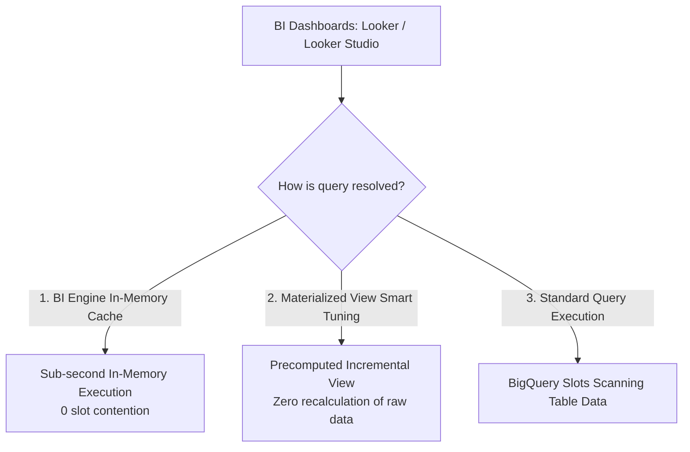
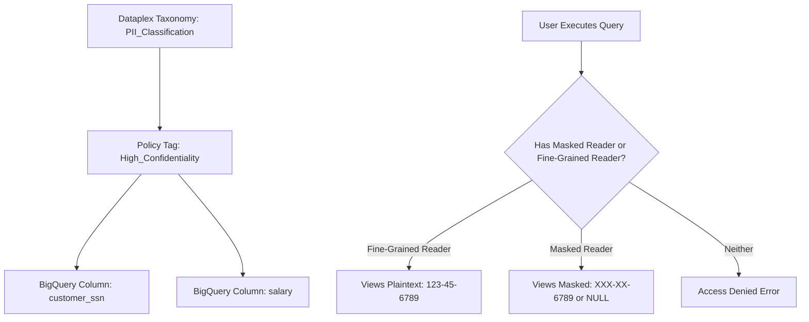

# 4.1 Preparing Data for Visualization & Query Optimization

Connecting business intelligence dashboards (Looker, Looker Studio, Tableau) to BigQuery requires strategies to prevent dashboard lag, reduce slot exhaustion, and enforce fine-grained access control.

---

## 🏎️ BigQuery BI Engine & Materialized Views



### 1. BigQuery BI Engine
- **What it is**: A fast, in-memory analysis service built directly into BigQuery.
- **How it works**: Caches frequently accessed table columns and partition segments in high-speed RAM.
- **Key Advantage**: Delivers **sub-second response times** for interactive dashboards without requiring ETL modifications or data extraction into external BI memory cubes.
- **Allocation**: Configured per project and region (e.g. allocate 50 GB of BI Engine capacity in `us-central1`).

### 2. Materialized Views (MVs)
Materialized Views precompute and cache the results of a query for blazing-fast performance.

#### Superpowers of BigQuery Materialized Views:
1. **Incremental Refresh**: When new data is appended to the base table, BigQuery only processes the delta, refreshing the view automatically without re-reading the entire table.
2. **Smart Tuning (Transparent Query Rewrite)**: If an analyst writes a query against the **base table**, BigQuery's query optimizer automatically reroutes the query to read from the Materialized View instead if it is cheaper and faster! The user does not even need to reference the MV name in their SQL.
3. **Partition Alignment**: MVs inherit and align with the partitioning of the base table.

```sql
-- Creating an auto-refreshing Materialized View
CREATE MATERIALIZED VIEW `analytics.mv_daily_sales_by_category`
PARTITION BY order_date
CLUSTER BY category_id
OPTIONS (enable_refresh = true, refresh_interval_minutes = 30)
AS
SELECT
  DATE(order_timestamp) AS order_date,
  category_id,
  COUNT(order_id) AS total_orders,
  SUM(order_total) AS total_revenue
FROM
  `analytics.orders`
GROUP BY
  order_date, category_id;
```

---

## 🔬 Troubleshooting Poor-Performing BigQuery Queries

When queries run slowly or consume unexpected slot capacity, use the **BigQuery Execution Graph** and `INFORMATION_SCHEMA` to identify performance bottlenecks.


### Identifying Bottlenecks in the Execution Plan:

| Symptom in Execution Graph | Root Cause | Optimization Solution |
| :--- | :--- | :--- |
| **High `Wait Ms`** | **Slot Contention**: Query is queued waiting for available compute slots. | Increase reservation baseline slots or purchase autoscale slots; schedule non-critical batch queries during off-peak hours using `BATCH` priority. |
| **Data Skew (Tail Worker Delay)** | One worker processes millions more rows than other parallel workers due to unbalanced `JOIN` or `GROUP BY` keys (e.g., millions of records with `NULL` or default key `0`). | Filter out `NULL` keys prior to joining, or salt the skewed join keys. |
| **Spilled to Disk (Shuffle Spill)** | Intermediate memory overflow during heavy `JOIN` or `ORDER BY`. Worker ran out of RAM and had to page data to persistent disk. | Filter early; avoid multi-table non-filtered Cartesian `CROSS JOIN`s; push `WHERE` filters before joins. |
| **Massive Bytes Scanned** | Unpartitioned table or query missing partition filter (e.g., using `WHERE DATE(timestamp_col) = ...` instead of filtering on the partitioned timestamp directly). | Partition and cluster the table; ensure `WHERE` clause references the exact partitioned column without functions wrapping it. |

---

## 🛡️ Column-Level Security & Dynamic Data Masking

Data governance frequently mandates that junior analysts or regional staff must view analytical aggregates without seeing sensitive attributes (such as SSNs, salaries, or emails).



### Implementation Steps:
1. **Create Taxonomy & Policy Tags**: In Dataplex / Data Catalog, create a taxonomy (e.g. `Security_Tier`) with policy tags (`PII_High`, `Confidential`).
2. **Assign Policy Tags to BigQuery Schema**:
   ```sql
   ALTER TABLE `customer_data.profiles`
   ALTER COLUMN ssn
   SET DATA POLICY `projects/my-proj/locations/us/dataPolicies/ssn_mask_policy`;
   ```
3. **Configure Dynamic Data Masking Rules**:
   - **Default masking**: Returns default value (`""`, `0`, `1970-01-01`).
   - **Hash (SHA-256)**: Returns irreversible cryptographic hash.
   - **Partial masking**: Shows first/last characters (e.g. `***-**-6789`).
   - **Nullify**: Replaces with `NULL`.

---

## 🎯 Exam Practice Scenario Checkpoint

### Scenario:
A retail executive dashboard in Looker Studio connects directly to an unpartitioned 20 TB BigQuery table containing three years of order events. During morning executive briefings, over 50 managers open the dashboard simultaneously. The dashboard queries take over 45 seconds to load, repeatedly hit project slot quota limits, and incur massive on-demand query costs. The underlying order data is updated once every hour.

**Which combination of actions resolves the latency, slot contention, and cost issues with minimal ongoing management? (Choose two)**

- **A.** Shard the orders table into 1,000 separate tables by store ID.
- **B.** Partition the base table by date and cluster by store and product category.
- **C.** Enable and allocate **BigQuery BI Engine** capacity for the analytics project.
- **D.** Write a Python script to export the table to CSV files on Compute Engine disks every morning.
- **E.** Migrate the entire table to Cloud Memorystore for Redis.

> **Correct Answers: B and C**  
> **Explanation**: Partitioning by date and clustering by frequently filtered dashboard dimensions (store and product) dramatically cuts the volume of data scanned by BigQuery. Allocating **BigQuery BI Engine** memory caches the frequently queried dashboard fields in ultra-fast RAM, delivering sub-second response times for dozens of concurrent Looker Studio users while drastically reducing slot consumption. Table sharding (Option A) and exporting to CSV (Option D) are anti-patterns, while Redis (Option E) cannot perform complex multi-column SQL aggregations over 20 TB of tabular data.
