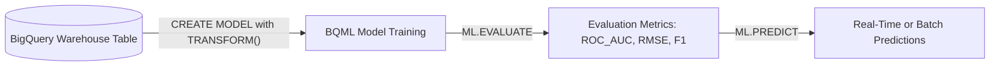
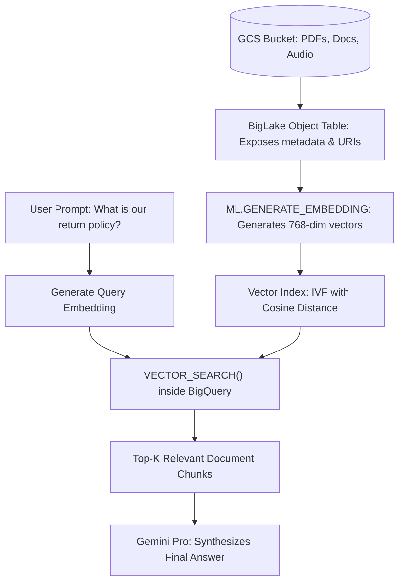

# 4.2 Preparing Data for AI, Machine Learning, and RAG

Modern data engineers must bridge the gap between enterprise data platforms and artificial intelligence. The Professional Data Engineer exam rigorously tests your ability to train models using BigQuery ML and prepare unstructured datasets for Vector Search and Retrieval-Augmented Generation (RAG).

---

## 🧠 Machine Learning Inside the Warehouse: BigQuery ML (BQML)

BigQuery ML democratizes machine learning by allowing SQL engineers to train, evaluate, and serve ML models directly within BigQuery without exporting data to Python notebooks or external servers.



### Supported Model Types & Common Exam Triggers

| Model Type | Algorithm in BQML | Exam Keyword / Problem Statement |
| :--- | :--- | :--- |
| **Linear Regression** | `MODEL_TYPE='LINEAR_REG'` | Predicting continuous numerical values (e.g. predicting home sale price, future revenue). |
| **Binary / Multi-class Classification** | `MODEL_TYPE='LOGISTIC_REG'` or `'BOOSTED_TREE_CLASSIFIER'` | Predicting categorical outcomes (e.g. churn yes/no, fraud detection, customer conversion). |
| **Time-Series Forecasting** | `MODEL_TYPE='ARIMA_PLUS'` | Multi-time-series demand forecasting with automatic holiday modeling, seasonality, and trend decomposition. |
| **Customer Segmentation** | `MODEL_TYPE='KMEANS'` | Unsupervised clustering of customers or transactions based on behavioral similarities. |
| **Recommendation Systems** | `MODEL_TYPE='MATRIX_FACTORIZATION'` | Collaborative filtering for recommending products, movies, or articles based on user-item interaction matrices. |
| **AutoML Tables** | `MODEL_TYPE='AUTOML_CLASSIFIER'` | Automated neural architecture search and hyperparameter tuning for highest tabular model accuracy. |

### End-to-End BQML Code Example:
```sql
-- 1. Train a churn classification model with embedded feature preprocessing
CREATE OR REPLACE MODEL `ml_dataset.customer_churn_model`
TRANSFORM(
  ML.STANDARD_SCALER(tenure_months) OVER() AS scaled_tenure,
  ML.QUANTILE_BUCKETIZE(total_spend, 5) OVER() AS spend_bucket,
  country,
  churned
)
OPTIONS(
  model_type = 'BOOSTED_TREE_CLASSIFIER',
  input_label_cols = ['churned'],
  max_iterations = 20,
  auto_class_weights = TRUE
) AS
SELECT
  tenure_months,
  total_spend,
  country,
  churned
FROM
  `ml_dataset.historical_subscribers`;

-- 2. Evaluate model performance
SELECT * FROM ML.EVALUATE(MODEL `ml_dataset.customer_churn_model`);

-- 3. Run batch prediction on new users
SELECT
  user_id,
  predicted_churned,
  predicted_churned_probs
FROM
  ML.PREDICT(
    MODEL `ml_dataset.customer_churn_model`,
    TABLE `ml_dataset.active_subscribers`
  );
```

---

## ⚡ Unstructured Data, Vector Search, and RAG Architectures

Retrieval-Augmented Generation (RAG) grounds Large Language Models (LLMs) with private enterprise knowledge bases. Google Cloud integrates this pipeline natively using BigLake Object Tables, Vertex AI embeddings, and BigQuery Vector Search.



### 1. BigLake Object Tables
Object tables expose unstructured files stored in Cloud Storage (PDFs, images, audio files) as BigQuery tables containing file metadata (size, content type, generation time) and secure signed URLs.
```sql
CREATE EXTERNAL TABLE `rag_dataset.legal_contracts_objects`
WITH CONNECTION `us-central1.vertex_ai_conn`
OPTIONS (
  object_metadata = 'SIMPLE',
  uris = ['gs://enterprise-contracts/*.pdf']
);
```

### 2. Generating Text Embeddings with SQL
Using a Cloud AI Connection to Vertex AI, BigQuery can convert text into high-dimensional vector representations directly in SQL:
```sql
CREATE OR REPLACE TABLE `rag_dataset.contract_embeddings` AS
SELECT
  doc_id,
  content,
  ml_generate_embedding_result AS text_embedding
FROM
  ML.GENERATE_EMBEDDING(
    MODEL `rag_dataset.text_embedding_model`,
    TABLE `rag_dataset.contract_chunks`,
    STRUCT(TRUE AS flatten_json_output)
  );
```

### 3. Creating a Vector Index for High-Speed Similarity Search
When performing nearest-neighbor lookups over millions of vector embeddings, a vector index accelerates search from minutes to milliseconds:
```sql
CREATE VECTOR INDEX contract_vec_idx
ON `rag_dataset.contract_embeddings`(text_embedding)
OPTIONS(
  index_type = 'IVF',
  distance_type = 'COSINE'
);
```

### 4. Running Vector Search
```sql
SELECT
  base.doc_id,
  base.content,
  distance
FROM
  VECTOR_SEARCH(
    TABLE `rag_dataset.contract_embeddings`,
    'text_embedding',
    (SELECT ml_generate_embedding_result FROM ML.GENERATE_EMBEDDING(
       MODEL `rag_dataset.text_embedding_model`,
       (SELECT 'What are the liability caps for data breach?' AS content)
     )),
    top_k => 5,
    distance_type => 'COSINE'
  );
```

---

## 🎯 Exam Practice Scenario Checkpoint

### Scenario:
A large healthcare network has 2,000,000 PDF medical research documents stored in Google Cloud Storage. Clinical researchers want to ask natural language questions in an internal web portal and receive answers citing the exact passages from the research papers. The data engineering team must design a scalable, serverless pipeline to index the documents and retrieve the most semantically relevant paragraphs for the LLM prompt.

**Which architecture provides the most efficient, scalable Google Cloud implementation?**

- **A.** Write a Python script on Compute Engine to download all PDFs, extract text, and write raw text into Cloud Memorystore for Redis.
- **B.** Create a BigLake Object Table over the Cloud Storage PDFs, parse the text chunks, generate embeddings using BigQuery `ML.GENERATE_EMBEDDING` connected to Vertex AI, build a BigQuery Vector Index with Cosine distance, and retrieve matching passages using `VECTOR_SEARCH()`.
- **C.** Train a custom TensorFlow neural network on Dataproc to classify each PDF into 10 static categories.
- **D.** Load the PDF binary blobs into Cloud Spanner and perform regex full-text searches.

> **Correct Answer: B**  
> **Explanation**: BigLake Object Tables allow BigQuery to read and process unstructured documents residing in Cloud Storage. Generating vector embeddings with `ML.GENERATE_EMBEDDING` and using BigQuery's native `VECTOR_SEARCH()` with an IVF vector index provides a fully serverless, highly optimized semantic retrieval mechanism that powers production RAG systems at petabyte scale. Redis (Option A) and Spanner regex (Option D) do not provide semantic vector embeddings.
