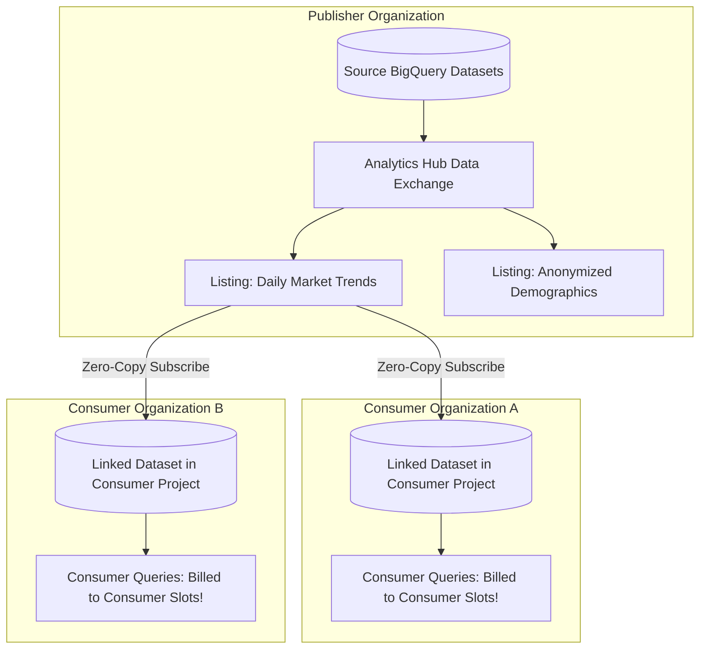
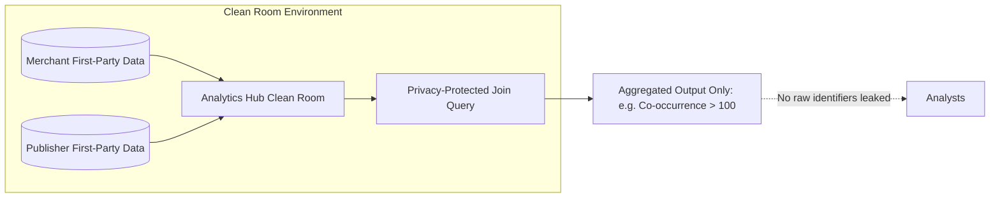
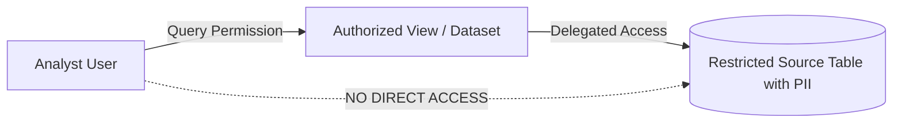

# 4.3 Secure Data Sharing & Analytics Hub

Sharing data across corporate business units, partners, and external customers without creating costly, insecure data copies is a core competency on the PDE exam.

---

## 🏛️ BigQuery Analytics Hub Architecture

Historically, sharing data between organizations required exporting files to SFTP or GCS buckets, exposing companies to security leaks, stale data, and massive egress costs. 

**Analytics Hub** enables zero-copy, secure, multi-tenant data sharing across organizations and projects:

### Core Concepts of Analytics Hub:
1. **Data Exchange**: A secure container for grouping listings. Can be private (within an organization or invited partners) or public (commercial marketplace).
2. **Listing**: References a BigQuery dataset (or view) published with metadata, documentation, and licensing terms.
3. **Linked Dataset**: When a subscriber subscribes to a listing, a read-only **linked dataset** is created in their BigQuery project.
   - **Zero Data Copying**: Data is not replicated. Queries in the consumer project read directly from the publisher's storage blocks.
   - **Real-Time Freshness**: Any update committed by the publisher is immediately visible to all subscribers.
   - **Cost Segregation**: **The consumer pays for the compute slots** used to query the linked dataset. The publisher only pays for their primary storage!

---

## 🧼 Privacy-Centric Data Clean Rooms

In regulated sectors (such as advertising, retail media, and healthcare), multiple companies want to join their first-party data (e.g. matching ad exposures with retail in-store purchases) without either company revealing raw customer identities or PII.

### Clean Room Controls in BigQuery:
- **Analysis Rules**: Publishers attach rules restricting what queries can be run (e.g., forbidding `SELECT *`, requiring minimum aggregation thresholds such as `COUNT() >= 50` to prevent differential privacy attacks).
- **Column Protections**: Certain columns can only be used in `JOIN` clauses and cannot appear in the output `SELECT` projection.

---

## 👁️ Authorized Views & Authorized Datasets

When sharing specific slices of data within the same organization without granting direct table permissions:

- **Authorized View**: Allows you to share query results (with row filters, aggregations, or column exclusions) with specific users without giving them access to the underlying tables.
- **Authorized Dataset**: Authorizes an entire dataset containing multiple views to query a source dataset, simplifying permissions management for large reporting suites.

---

## 🎯 Exam Practice Scenario Checkpoint

### Scenario:
A market research agency aggregates credit card transaction trends across hundreds of retailers. The agency wants to provide 50 enterprise client companies with real-time access to daily category sales benchmarks. The engineering lead requires that:
1. Data must be shared without physically copying or exporting petabytes of data daily.
2. Clients must see new sales data the second it is published by the agency.
3. The computational costs of querying the benchmarks must be paid for by the individual client companies, not the research agency.

**Which BigQuery feature should the data engineer implement?**

- **A.** Create a Dataflow pipeline that writes daily CSV files to a public Cloud Storage bucket.
- **B.** Grant the `roles/bigquery.dataViewer` role to each client's Google Group on the agency's internal BigQuery dataset.
- **C.** Publish the datasets to an **Analytics Hub Data Exchange** and have clients subscribe to create linked datasets in their own Google Cloud projects.
- **D.** Write a Python script to execute `EXPORT DATA` into each client's individual BigQuery project every midnight.

> **Correct Answer: C**  
> **Explanation**: **Analytics Hub** enables publishers to share datasets via data exchanges. Subscribers create **linked datasets** in their own GCP projects. Data is accessed via zero-copy reference (real-time freshness without replication), and the compute query slot costs are entirely charged to the subscriber's project, fulfilling all business requirements. Option B gives direct access to internal datasets and risks exhausting the agency's query quotas or billing them for client queries. Options A and D involve expensive, brittle daily data replication.
