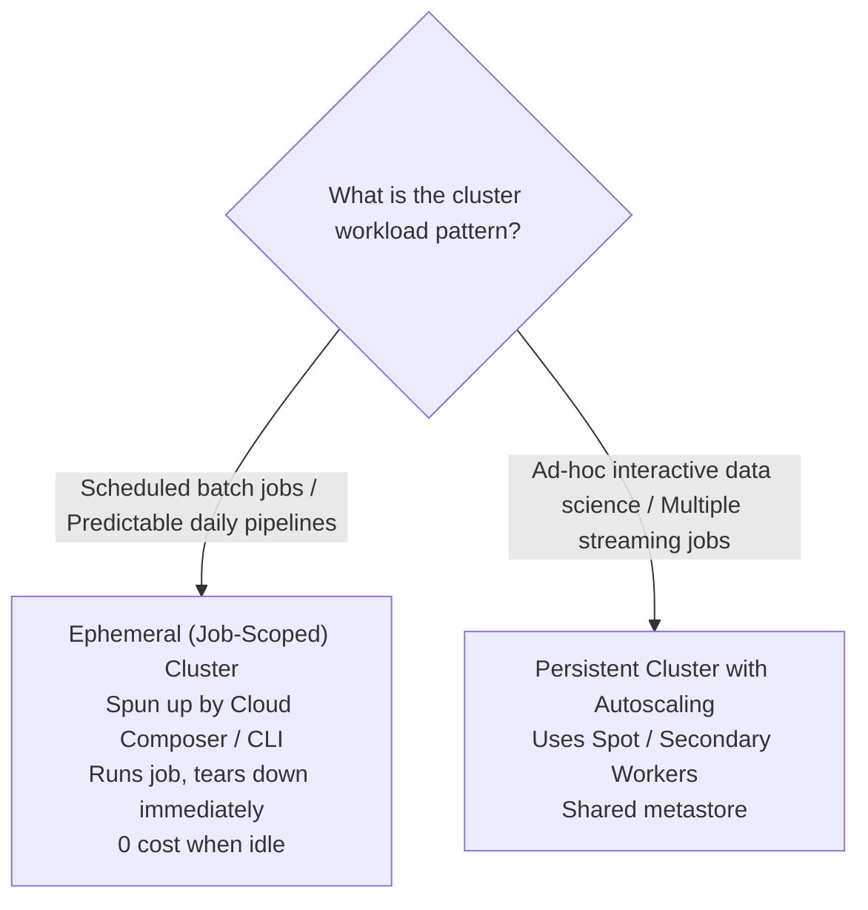
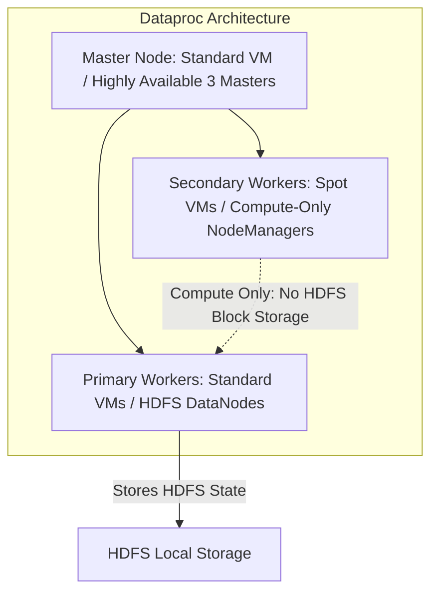

# 5.1 Resource Optimization: Compute & Cost

Optimizing compute and storage resources allows organizations to maximize throughput while minimizing cloud expenditures. On the PDE exam, a primary focus is optimizing **Dataproc clusters** and storage configurations.

---

## 💻 Dataproc: Ephemeral (Job-Scoped) vs. Persistent Clusters

A common operational dilemma on Google Cloud is whether to maintain long-running 24/7 Dataproc clusters or spin up ephemeral clusters per job.

### Head-to-Head Comparison:

| Dimension | Ephemeral (Job-Scoped) Clusters | Persistent Standing Clusters |
| :--- | :--- | :--- |
| **Lifecycle** | Created specifically for a single job or workflow; deleted as soon as the job finishes. | Runs 24/7 or for extended multi-month durations. |
| **Idle Cost** | **Zero idle cost** (no VMs running when there is no work). | Significant idle cost unless aggressively scaled to zero. |
| **Job Isolation** | Complete isolation. No risk of one misbehaved Spark job exhausting RAM or crashing another job. | Shared resources; risk of resource contention and noisy neighbors. |
| **Version Flexibility** | Each job can specify its own cluster image version, Java version, and Python libraries. | Upgrading Spark or OS packages requires migrating all existing pipelines. |
| **Startup Overhead** | Adds 90–180 seconds for cluster provisioning before job execution starts. | Immediate job execution (0 startup delay). |
| **Best Used For** | Scheduled nightly ETL/ELT pipelines orchestrated by Cloud Composer. | Interactive Jupyter / Zeppelin notebooks, Ad-hoc data discovery, continuous 24/7 streaming. |

---

## 💰 Dataproc Cost Optimization: Spot VMs & Autoscaling

To drive down Dataproc compute costs by up to 60–80%, use **Secondary Worker Nodes** configured with **Spot (Preemptible) VMs**.

### Golden Rules for Dataproc Spot Workers:
1. **Master Node**: Must **never** be Spot/Preemptible. Losing a master terminates the cluster.
2. **Primary Workers**: Must be standard persistent VMs. Primary workers host the Hadoop Distributed File System (HDFS) DataNode daemons. If too many DataNodes disappear simultaneously, HDFS experiences data corruption.
3. **Secondary Workers**: Can be up to **100% Spot VMs**. Secondary workers act purely as compute nodes (YARN NodeManagers). If Google Cloud reclaims a Spot VM, YARN simply reschedules the affected task onto another worker with zero job failure!
4. **Decouple with Cloud Storage Connector**:
   - Never store input or output data permanently in local HDFS disks.
   - Use the native **Google Cloud Storage connector (`gs://`)** as your storage layer. This allows clusters to be spun up and torn down at will without risking data loss.

---

## ⚡ BigQuery Cost Optimization Checklist

1. **Avoid `SELECT *`**: BigQuery charges based on the number of bytes read in queried columns. Projecting only needed columns reduces costs proportionally.
2. **Always Filter by Partition**: Ensure analytical queries specify partition boundaries (`WHERE date_col >= ...`) to prune unneeded physical storage segments.
3. **Enforce Query Maximum Bytes Billed**:
   - Prevent runaway rogue queries by setting the `--maximum_bytes_billed` limit on queries or setting project/user-level custom quotas.
4. **Utilize Table and Partition Expiration**: Automatically transition or delete stale scratch tables.

---

## 🎯 Exam Practice Scenario Checkpoint

### Scenario:
A marketing analytics company runs an Apache Spark job every night at 02:00 UTC that transforms customer clickstream data. The job takes 45 minutes to execute on a 20-node cluster. During the remaining 23 hours of the day, no Spark jobs run. The company wants to minimize compute costs and prevent infrastructure sprawl while ensuring that job failures do not occur due to machine preemption.

**Which architecture should the data engineer implement?**

- **A.** Keep a 20-node standard VM cluster running continuously 24/7 with a cron job on the master node.
- **B.** Use Cloud Composer to spin up an ephemeral Dataproc cluster consisting of 2 standard primary worker nodes and 18 Spot VM secondary workers, execute the Spark job reading/writing from Cloud Storage, and automatically delete the cluster upon job completion.
- **C.** Provision a 20-node cluster composed entirely of Spot VMs, including the master node.
- **D.** Run the Spark job on a single Compute Engine instance with 128 vCPUs.

> **Correct Answer: B**  
> **Explanation**: Ephemeral clusters eliminate 23 hours of idle compute costs every day. Combining 2 standard primary workers (protecting HDFS metadata) with 18 Spot VM secondary workers reduces compute cost by up to 70% while ensuring job resilience, as secondary worker preemption does not cause data loss or cluster failure. Decoupling storage to GCS (`gs://`) ensures data persists independently of cluster lifecycle. Master nodes should never be Spot VMs (Option C).
