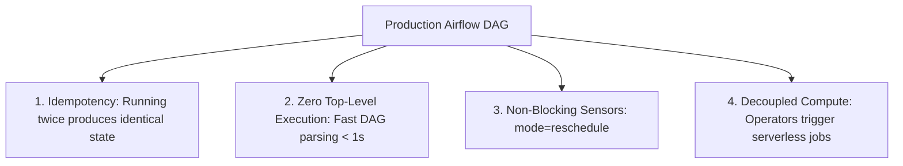

# 5.2 Designing Automation & Cloud Composer DAG Best Practices

Cloud Composer (managed Apache Airflow) is Google Cloud's premier orchestration platform. Authoring performant, resilient, and repeatable DAGs requires adhering to strict architectural best practices tested thoroughly on the certification exam.

---

## 📐 Core Principles of Resilient DAG Design



### 1. The Rule of Idempotency
A pipeline task is **idempotent** if running it multiple times with the exact same inputs produces the identical state as running it once.
- **Anti-pattern**: An `INSERT INTO` query without truncation or partition replacement. Retrying a failed task results in duplicate records.
- **Best Practice**: In BigQuery, use `WRITE_TRUNCATE` for target partitions, or use SQL `MERGE` statements:
  ```sql
  MERGE `analytics.daily_users` T
  USING `staging.daily_users` S
  ON T.user_id = S.user_id AND T.date = S.date
  WHEN MATCHED THEN
    UPDATE SET T.session_count = S.session_count
  WHEN NOT MATCHED THEN
    INSERT (user_id, date, session_count) VALUES (S.user_id, S.date, S.session_count);
  ```

### 2. Eliminating Top-Level Code in DAG Files
Airflow's scheduler parses every Python file in the `dags/` folder continuously (every 30 seconds).
- ❌ **Anti-Pattern**: Putting database queries, API calls, or heavy file reads at the global module level of the DAG file.
  ```python
  # BAD: This API call runs every 30 seconds on every DAG parsing loop!
  active_users = requests.get("https://api.internal/users").json()
  ```
- ✅ **Best Practice**: Move all computational logic inside tasks, operators, or Python functions executed by the `PythonOperator`.

### 3. Sensor Optimization: `reschedule` vs. `poke`
When waiting for upstream data (e.g. waiting for a file in GCS or an external BigQuery partition):
- `mode="poke"` (Default): The worker process stays alive, holding a worker slot and occupying cluster resources 24/7 while sleeping between checks.
- `mode="reschedule"` (Recommended): The sensor releases the worker slot between checks and goes to sleep, allowing other pipeline tasks to execute.

```python
wait_for_raw_file = GCSObjectExistenceSensor(
    task_id="wait_for_raw_file",
    bucket="enterprise-landing",
    object="incoming/{{ ds }}/orders.csv",
    mode="reschedule",  # Frees worker slot between checks!
    poke_interval=300,  # Checks every 5 minutes
    timeout=3600,       # Fails after 1 hour
)
```

---

## 🛠️ Complete Multi-Service Cloud Composer DAG

```python
from datetime import datetime, timedelta
from airflow import DAG
from airflow.providers.google.cloud.sensors.gcs import GCSObjectExistenceSensor
from airflow.providers.google.cloud.operators.dataproc import (
    DataprocCreateClusterOperator,
    DataprocSubmitJobOperator,
    DataprocDeleteClusterOperator
)
from airflow.providers.google.cloud.operators.bigquery import BigQueryInsertJobOperator

CLUSTER_NAME = "ephemeral-spark-{{ ds_nodash }}"
PROJECT_ID = "company-analytics"
REGION = "us-central1"

CLUSTER_CONFIG = {
    "master_config": {"num_instances": 1, "machine_type_uri": "n2-standard-4"},
    "worker_config": {"num_instances": 2, "machine_type_uri": "n2-standard-4"},
    "secondary_worker_config": {
        "num_instances": 10,
        "machine_type_uri": "n2-standard-4",
        "is_preemptible": True,
    },
}

with DAG(
    "ecommerce_nightly_etl",
    schedule_interval="0 1 * * *",
    start_date=datetime(2026, 1, 1),
    catchup=False,
    default_args={"retries": 2, "retry_delay": timedelta(minutes=5)},
) as dag:

    # 1. Wait for raw file with non-blocking sensor
    check_file = GCSObjectExistenceSensor(
        task_id="check_file",
        bucket="company-landing",
        object="raw/{{ ds }}/transactions.json",
        mode="reschedule",
        poke_interval=180,
    )

    # 2. Spin up ephemeral Dataproc cluster
    create_cluster = DataprocCreateClusterOperator(
        task_id="create_dataproc_cluster",
        project_id=PROJECT_ID,
        region=REGION,
        cluster_name=CLUSTER_NAME,
        cluster_config=CLUSTER_CONFIG,
    )

    # 3. Submit Spark Job
    submit_spark = DataprocSubmitJobOperator(
        task_id="submit_spark_job",
        project_id=PROJECT_ID,
        region=REGION,
        job={
            "placement": {"cluster_name": CLUSTER_NAME},
            "pyspark_job": {
                "main_python_file_uri": "gs://company-scripts/spark_transform.py",
                "args": ["--date", "{{ ds }}"],
            },
        },
    )

    # 4. Tear down cluster immediately
    delete_cluster = DataprocDeleteClusterOperator(
        task_id="delete_dataproc_cluster",
        project_id=PROJECT_ID,
        region=REGION,
        cluster_name=CLUSTER_NAME,
        trigger_rule="all_done",  # Deletes cluster even if Spark job fails!
    )

    # 5. Refresh BigQuery Data Marts
    refresh_bq = BigQueryInsertJobOperator(
        task_id="refresh_bq_marts",
        configuration={
            "query": {
                "query": "CALL `company-analytics.marts.refresh_sales`('{{ ds }}');",
                "useLegacySql": False,
            }
        },
    )

    check_file >> create_cluster >> submit_spark >> delete_cluster >> refresh_bq
```

---

## 🎯 Exam Practice Scenario Checkpoint

### Scenario:
A data team maintains an Apache Airflow DAG in Cloud Composer with 40 sensor tasks that wait for partner files to land in an SFTP server throughout the day. Although overall pipeline throughput is low, other critical DAGs in the environment are frequently delayed in a "queued" state, and the Cloud Composer Celery workers show 100% capacity utilization.

**What is the root cause and the optimal architectural fix?**

- **A.** The Airflow scheduler has crashed; restart the Cloud Composer environment.
- **B.** The sensor tasks are running in default `poke` mode, occupying all available worker slots while sleeping; change the sensor mode to `reschedule` so worker slots are released between checks.
- **C.** GKE node auto-repair is disabling compute instances; turn off GKE auto-repair.
- **D.** Double the number of BigQuery slots allocated to the project.

> **Correct Answer: B**  
> **Explanation**: By default, Airflow sensors operate in `poke` mode, which blocks an active worker slot for the entire duration of the wait time (even while sleeping). With 40 sensors polling continuously, all worker slots become exhausted, starving other DAGs and leaving them stuck in the "queued" state. Switching sensors to `mode="reschedule"` causes the sensor task to release its worker slot and sleep until the next interval, freeing worker capacity for other tasks.
