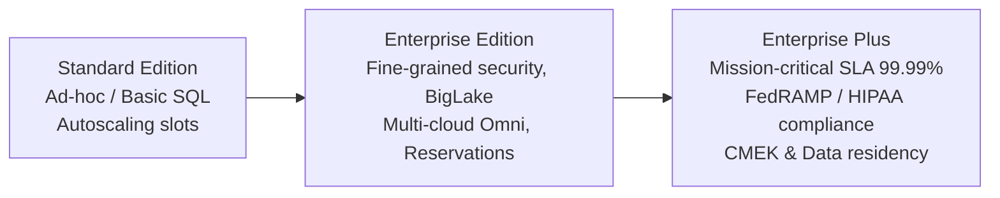
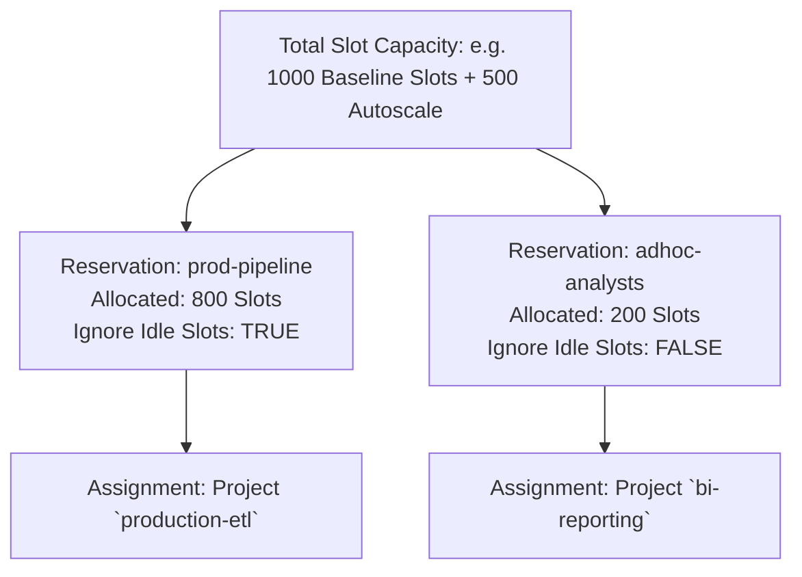
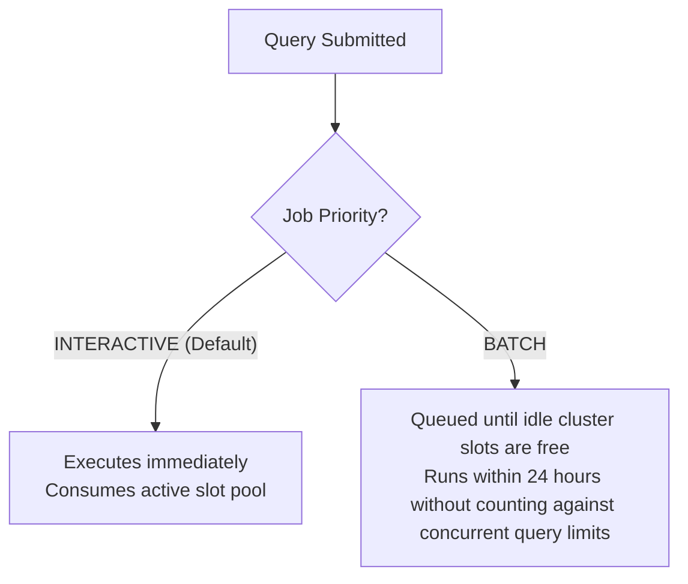

# 5.3 Workload & Capacity Management: BigQuery Editions & Slots

Managing compute capacity ensures business-critical analytics execute reliably without encountering noisy-neighbor bottlenecks or unpredictable billing spikes. BigQuery organizes compute resources through **Editions**, **Reservations**, and **Job Prioritization**.

---

## 🏛️ BigQuery Editions: Standard vs. Enterprise vs. Enterprise Plus

Google Cloud structures BigQuery capacity into three tiered Editions designed for varying operational and governance requirements:



### Edition Feature Comparison:

| Feature | Standard | Enterprise | Enterprise Plus |
| :--- | :--- | :--- | :--- |
| **Pricing Model** | Autoscaling slots (pay per slot-hour) | Baseline slots + Autoscaling slots (1-year / 3-year commitments optional) | Baseline slots + Autoscaling slots with highest discounts |
| **Data Masking & Column Security** | Basic | **Full support** | **Full support** |
| **BigLake Multi-Cloud (Omni)** | No | **Yes** | **Yes** |
| **BigQuery ML** | Supported | Supported | Supported |
| **Availability SLA** | 99.9% | 99.99% | **99.99%** |
| **Target Workload** | Low-cost ad-hoc analytical queries, dev/test | Enterprise production workloads, complex governance, BI Engine | Highly regulated financial/healthcare workloads, mission-critical DR |

---

## 🎟️ Capacity Management: Reservations & Slot Allocations

A **slot** is BigQuery's virtual CPU unit used to execute SQL queries. When using BigQuery Editions, capacity is managed via **Reservations**.



### Key Reservation Mechanics:
1. **Baseline Slots**: Dedicated slots provisioned continuously to handle steady-state query loads.
2. **Autoscaling Slots**: Dynamically added in response to query bursts, then scaled back down to zero when demand subsides.
3. **Idle Slot Sharing (`ignore_idle_slots = FALSE`)**:
   - If `prod-pipeline` is idle, its unutilized slots can be temporarily consumed by `adhoc-analysts`.
   - When `prod-pipeline` submits a new query, it immediately reclaims its baseline slots, throttling ad-hoc queries if necessary.
   - Set `ignore_idle_slots = TRUE` when strict latency guarantees are required and zero noisy-neighbor interference is permitted.
4. **Assignments**:
   - Link reservations to an Organization, Folder, or Project.
   - Can target specific job types: `QUERY`, `PIPELINE` (Dataform, load jobs), or `ML_EXTERNAL`.

---

## ⏳ Interactive vs. Batch Query Priorities

When submitting queries to BigQuery, you can configure query priority:



### When to Use Batch Priority:
- **Nightly Aggregations & ETL**: Jobs that do not require instant human-facing output.
- **Bypassing Concurrency Limits**: Interactive queries have strict concurrent rate limits (e.g. 100 concurrent queries per project). Batch queries queue gracefully in the background and execute automatically as capacity permits without failing.

```bash
# Submitting a query with BATCH priority using the bq CLI
bq query \
  --use_legacy_sql=false \
  --batch=true \
  "SELECT customer_id, SUM(amount) FROM \`analytics.orders\` GROUP BY 1;"
```

---

## 🎯 Exam Practice Scenario Checkpoint

### Scenario:
A company runs its mission-critical real-time executive dashboard alongside dozens of ad-hoc exploratory queries executed by data science interns within the same GCP project. Occasionally, when interns execute large exploratory queries, the executive dashboard queries experience severe slowdowns and fail their 5-second latency SLA. 

**What capacity management strategy guarantees dashboard performance without completely isolating interns into a separate billing account?**

- **A.** Switch all queries to BATCH priority.
- **B.** Create two distinct BigQuery Reservations under an Enterprise Edition: one dedicated to the executive dashboard project with dedicated baseline slots, and a second reservation with autoscaling slots for the intern project; configure the dashboard reservation with `ignore_idle_slots = TRUE`.
- **C.** Delete the intern dataset and move interns to Cloud SQL.
- **D.** Manually restart the BigQuery slot allocation daemon every morning.

> **Correct Answer: B**  
> **Explanation**: Creating dedicated **Reservations** and assigning projects independently isolates compute capacity. Giving the executive dashboard project its own reservation with guaranteed baseline slots and setting `ignore_idle_slots = TRUE` prevents any runaway intern queries from contending for or borrowing dashboard slots, guaranteeing sub-second response times regardless of background ad-hoc activity.
