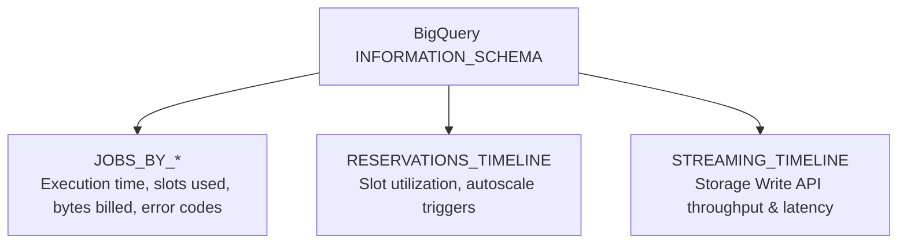

# 5.4 Monitoring, Observability & Troubleshooting

Maintaining visibility into data platform health enables prompt detection of pipeline failures, slot bottlenecks, and cost anomalies.

---

## 📈 BigQuery Observability with `INFORMATION_SCHEMA`

BigQuery exposes real-time administrative telemetry through system views in `INFORMATION_SCHEMA`. This is the primary method for diagnosing high query costs, runaway slot usage, and execution failures.



### Finding the Top 5 Most Expensive Queries in the Last 24 Hours:
```sql
SELECT
  job_id,
  user_email,
  query,
  total_bytes_billed / POW(10, 12) AS tb_billed,
  (total_bytes_billed / POW(10, 12)) * 6.25 AS estimated_cost_usd,
  total_slot_ms / (1000 * 60) AS slot_minutes,
  creation_time
FROM
  `region-us`.INFORMATION_SCHEMA.JOBS_BY_PROJECT
WHERE
  creation_time >= TIMESTAMP_SUB(CURRENT_TIMESTAMP(), INTERVAL 24 HOUR)
  AND job_type = 'QUERY'
ORDER BY
  total_bytes_billed DESC
LIMIT 5;
```

### Identifying Queries Experiencing Severe Slot Contention:
```sql
SELECT
  job_id,
  user_email,
  start_time,
  end_time,
  -- High wait ratio indicates query spent time waiting for slots
  job_stages[SAFE_OFFSET(0)].wait_ms_avg AS first_stage_wait_ms,
  total_slot_ms
FROM
  `region-us`.INFORMATION_SCHEMA.JOBS_BY_PROJECT
WHERE
  creation_time >= TIMESTAMP_SUB(CURRENT_TIMESTAMP(), INTERVAL 1 HOUR)
  AND error_result IS NULL
ORDER BY
  first_stage_wait_ms DESC
LIMIT 10;
```

---

## 🚨 Troubleshooting Common Data Platform Errors

The certification exam frequently presents exact error codes and asks for the proper diagnosis:

| Error Code / Symptom | Root Cause | Recommended Remedy |
| :--- | :--- | :--- |
| **`quotaExceeded: Exceeded rate limits`** | Too many table modifications or API requests per second (e.g. creating/dropping tables or streaming inserts). | Implement **exponential backoff with jitter** in producer clients; consolidate micro-batch table writes; use BigQuery Storage Write API with batch commits. |
| **`resourcesExceeded: Query exceeded memory limits during shuffle`** | Intermediate shuffle memory exhausted during massive un-indexed `JOIN` or unpartitioned `ORDER BY`. | Filter data prior to joins; do not join large tables on un-clustered high-cardinality strings; remove global `ORDER BY` from non-final subqueries. |
| **Dataflow: `System lag keeps growing`** | The streaming Dataflow pipeline cannot keep pace with the ingestion volume from Pub/Sub. | Check worker CPU/memory in Cloud Monitoring; increase max workers (`--maxNumWorkers`); verify that external downstream sinks (e.g. Bigtable) are not throttling writes. |
| **Pub/Sub: `Oldest unacknowledged message age spike`** | Downstream consumers (Dataflow workers or subscribers) are crashing or unable to process messages fast enough. | Check consumer worker logs in Cloud Logging for unhandled exceptions; inspect dead-letter subscription for schema anomalies. |

---

## 💰 Billing Anomaly Alerts & Budgets

To protect against runaway cloud costs:
1. **Cloud Billing Budgets & Alerts**:
   - Set threshold alerts at 50%, 80%, 100%, and 120% of forecasted monthly budget.
   - Attach a Cloud Pub/Sub notification to trigger a Cloud Function that automatically disables billing or caps query quotas when spend exceeds critical limits.
2. **BigQuery Custom Quotas**:
   - Set maximum daily query usage limits per project or per user (e.g., limit developer ad-hoc queries to 2 TB scanned per day).

---

## 🎯 Exam Practice Scenario Checkpoint

### Scenario:
A streaming Dataflow pipeline consumes messages from Cloud Pub/Sub and writes analytical records to Cloud Bigtable. At 14:00, operational alarms fire: the **Pub/Sub oldest unacknowledged message age** metric is rising rapidly, and Dataflow system latency has increased from 2 seconds to 35 minutes. When inspecting Cloud Monitoring, you observe that the Dataflow worker VMs have reached the configured `--maxNumWorkers` limit, with 95% CPU utilization across all workers.

**What is the first diagnostic step and recommended remediation?**

- **A.** Delete the Pub/Sub topic and re-create it.
- **B.** Inspect Cloud Bigtable CPU utilization and write latency metrics in Cloud Monitoring; if Bigtable is throttled or hot-spotting, add Bigtable nodes or review the row-key design, and increase Dataflow `--maxNumWorkers`.
- **C.** Switch Dataflow to DirectRunner.
- **D.** Grant the Dataflow service account `roles/owner` permissions.

> **Correct Answer: B**  
> **Explanation**: A rise in Pub/Sub backlog age and Dataflow system lag alongside maxed-out worker CPU indicates that the pipeline is blocked. In streaming architectures writing to Cloud Bigtable, sink throttling (e.g. Bigtable CPU reaching 100% or hot-spotting due to poor row-key hashing) causes Dataflow workers to back up and queue records in memory, driving up CPU and lag. Checking Bigtable metrics and scaling capacity / fixing key hotspots clears the bottleneck.
