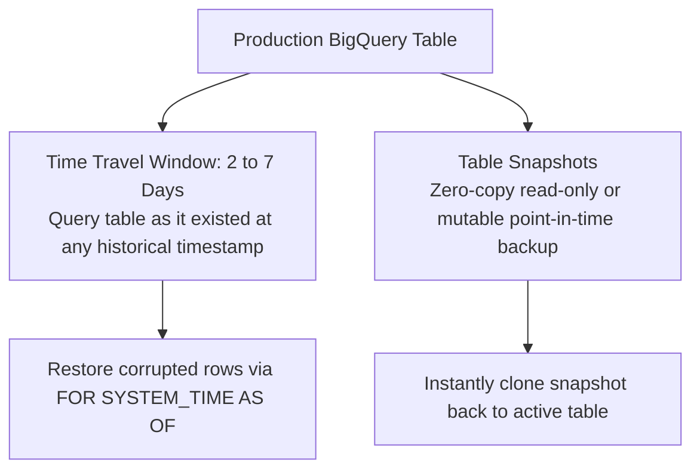

# 5.5 Resilience, Failover & Disaster Recovery

Data loss, human error (accidental table drops), and regional infrastructure outages must be planned for in advance. This lesson covers recovery techniques, replication models, and zero-copy data protection mechanisms.

---

## 🛡️ Defending Against Data Corruption: BigQuery Time Travel & Snapshots

When a junior engineer accidentally executes `DELETE FROM production.users WHERE 1=1` or runs a faulty ETL job that overwrites a partition, BigQuery provides built-in safety mechanisms.



### 1. BigQuery Time Travel (`FOR SYSTEM_TIME AS OF`)
BigQuery preserves historical versions of table data for up to **7 days** (configurable from 2 to 7 days at the dataset level):

```sql
-- Querying table state exactly as it existed 4 hours ago
SELECT *
FROM `production.users`
FOR SYSTEM_TIME AS OF TIMESTAMP_SUB(CURRENT_TIMESTAMP(), INTERVAL 4 HOUR);

-- Restoring a deleted table or corrupted partition
CREATE OR REPLACE TABLE `production.users` AS
SELECT *
FROM `production.users`
FOR SYSTEM_TIME AS OF TIMESTAMP '2026-11-08 12:00:00 UTC';
```

### 2. BigQuery Table Snapshots
- **Zero-Copy Storage**: Creating a table snapshot does not duplicate physical storage. You only pay for delta storage when rows change or are deleted in the base table.
- **Syntax**:
  ```sql
  CREATE SNAPSHOT TABLE `backup_dataset.orders_snapshot_20261108`
  CLONE `production.orders`
  OPTIONS(
    expiration_timestamp = TIMESTAMP '2026-12-08 00:00:00 UTC'
  );
  ```

---

## 🔄 High Availability & Failover Architectures

```mermaid
graph TD
    subgraph Cloud_SQL_High_Availability_HA ["Cloud SQL High Availability HA"]
        SQL_Primary[Primary Instance: Zone A] -->|Synchronous Persistent Disk Replication| SQL_Standby[Standby Instance: Zone B]
        SQL_Primary -. Automatic Failover 60s .-> SQL_Standby
    end

    subgraph Cloud_Spanner_Multi_Region ["Cloud Spanner Multi-Region"]
        Span1[Region US-East: Leader/Read-Write] <-->|TrueTime + Paxos Consensus Sync| Span2[Region US-Central: Read-Write]
        Span2 <-->|TrueTime + Paxos Consensus Sync| Span3[Region US-West: Read-Write]
    end

    subgraph Cloud_Bigtable_Multi_Cluster ["Cloud Bigtable Multi-Cluster"]
        BTC1[Cluster 1: us-central1-a] <-->|Asynchronous Replication| BTC2[Cluster 2: us-east1-b]
    end
```



### Failover Comparison:

| Storage Service | Replication Mechanism | Failover Characteristics | RPO / RTO Profile |
| :--- | :--- | :--- | :--- |
| **Cloud SQL HA** | Synchronous block-level persistent disk replication between two zones in the same region. | Automatic failover within 60–120 seconds. DNS endpoint reroutes seamlessly. | **RPO = 0** (Zero data loss across zones) / **RTO $\approx$ 1-2 minutes**. |
| **Cloud Spanner** | Synchronous multi-region / multi-zone Paxos quorum consensus with TrueTime atomic clocks. | Instant transparent failover. If a zone or region fails, remaining quorum continues serving transactions. | **RPO = 0** / **RTO = 0** (Instant, continuous availability 99.999% SLA). |
| **Cloud Bigtable** | Asynchronous multi-cluster replication across zones or regions. | Multi-cluster Anycast routing automatically reroutes traffic to healthy cluster. | **RPO $\approx$ seconds** (asynchronous lag) / **RTO $\approx$ 0** (instant traffic diversion). |
| **Cloud Memorystore (Redis)** | High Availability tier with master and read replicas across zones. | Automatic failover to replica in ~30 seconds. | In-memory cache recovery. |

---

## 🎯 Exam Practice Scenario Checkpoint

### Scenario:
At 10:15 AM, an ETL deployment script accidentally ran with an inverted filter, truncating and corrupting the main `customer_loyalty` table in BigQuery. The table contains 50 TB of data and is queried by operational APIs 24/7. The lead engineer must restore the table to its exact state as of 10:00 AM this morning with the absolute minimum downtime and without paying to re-import the entire 50 TB from backup archives in Cloud Storage.

**What is the fastest and most cost-effective solution?**

- **A.** Open a Google Cloud support ticket and request a tape backup restore.
- **B.** Restore the table using BigQuery Time Travel by running a `CREATE OR REPLACE TABLE` query utilizing the `FOR SYSTEM_TIME AS OF TIMESTAMP '2026-11-08 10:00:00 UTC'` clause.
- **C.** Export Cloud Logging audit records and replay every SQL mutation manually.
- **D.** Drop the dataset and redeploy from Terraform.

> **Correct Answer: B**  
> **Explanation**: BigQuery **Time Travel** automatically tracks data mutations for up to 7 days. By querying the table with `FOR SYSTEM_TIME AS OF TIMESTAMP '2026-11-08 10:00:00 UTC'` into a `CREATE OR REPLACE TABLE` statement, the data engineer restores the table to its pristine pre-incident state in seconds using internal storage pointers without incurring external network transfer or manual log replay.
