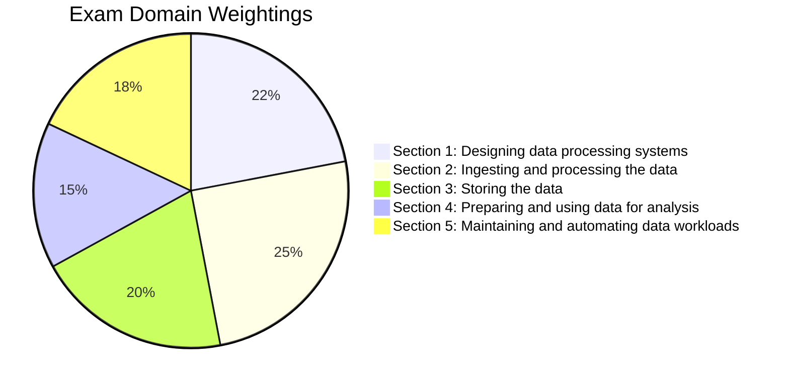

# Google Cloud Professional Data Engineer (PDE) — Guía Maestra de Estudio

Bienvenido al currículo definitivo y exhaustivo de preparación para el examen **Google Cloud Certified Professional Data Engineer**.

Esta guía está estructurada de forma sistemática para alinearse 1:1 con los dominios oficiales de la Guía de Examen de Google Cloud, e incorpora patrones de arquitectura, mejores prácticas de Google Cloud, ejemplos prácticos de código y SQL, comandos CLI y árboles de decisión para el examen.

---

## 🎯 Acerca del Examen Professional Data Engineer

Un **Professional Data Engineer** impulsa la toma de decisiones basada en datos mediante la recopilación, transformación, almacenamiento y distribución de datos para diversas aplicaciones. El ingeniero diseña y construye infraestructura de datos robusta, optimizando el rendimiento, la seguridad, la confiabilidad, la escalabilidad y el costo.

### Datos del Examen de un Vistazo

| Atributo | Detalles |
| :--- | :--- |
| **Duración** | 2 Horas (120 minutos) |
| **Preguntas** | 50 – 60 de opción múltiple y selección múltiple |
| **Formato** | Preguntas basadas en escenarios de diseño técnico y resolución de problemas |
| **Puntuación de Aprobación** | Aprobado / No Aprobado (Google Cloud no publica el puntaje mínimo; se estima en ~70%) |
| **Prerrequisitos** | No se requieren formalmente; se recomienda 3+ años de experiencia en la industria, incluyendo 1+ año diseñando y gestionando soluciones con Google Cloud |
| **Idiomas Disponibles** | Inglés, Japonés |

---

## 📊 Estructura del Examen y Ponderación por Sección

El examen cubre cinco dominios técnicos principales. Cada dominio está representado en esta plataforma con módulos dedicados y exhaustivos:

| Módulo | Sección del Examen | Peso | Tecnologías Clave y Áreas de Enfoque |
| :---: | :--- | :---: | :--- |
| **01** | **Diseño de sistemas de procesamiento de datos** | **~22%** | IAM, Políticas de Organización, KMS/CMEK/CSEK, Cloud DLP, Soberanía de Datos, Dataform, Dataflow, Cloud Data Fusion, Recuperación ante Desastres (RTO/RPO), ACID vs BASE, Migraciones de Datos (DTS, DMS, Datastream). |
| **02** | **Ingesta y procesamiento de datos** | **~25%** | Planificación de pipelines (fuentes y destinos), Apache Beam / Dataflow, Dataproc (Spark/Hadoop), Cloud Data Fusion, Pub/Sub, Kafka, Windowing, Watermarks, Triggers, Enriquecimiento de Datos con IA, CI/CD. |
| **03** | **Almacenamiento de datos** | **~20%** | Matriz de selección de almacenamiento (BigQuery, BigLake, AlloyDB, Bigtable, Spanner, Cloud SQL, GCS, Firestore, Memorystore), Data Warehousing (Star/Snowflake, Particionamiento y Clustering), Data Lakes, Dataplex y Data Mesh. |
| **04** | **Preparación y uso de datos para análisis** | **~15%** | BI Engine, Materialized Views, Optimización de Consultas, Seguridad a nivel de columna/fila, BigQuery ML, Vector Search y Embeddings para RAG, Analytics Hub, Compartición de Datos y Clean Rooms. |
| **05** | **Mantenimiento y automatización de cargas de trabajo** | **~18%** | Optimización de costos, Dataproc Efímero vs Persistente, Cloud Composer (Airflow) diseño de DAGs, BigQuery Editions y Reservations, Cloud Monitoring/Logging, Recuperación ante Desastres y Alta Disponibilidad. |

---

## 🧠 El Modelo Mental del PDE: La Filosofía de Google

Para obtener la máxima puntuación en los escenarios del examen, evalúa siempre las opciones a través de los principios arquitectónicos centrales de Google Cloud:

1. **Preferir Servicios Serverless y Administrados sobre IaaS**:
   - Prefiere **Dataflow** sobre Beam/Spark autogestionado, **Dataproc Serverless** sobre clusters permanentes, **BigQuery** sobre motores SQL personalizados, y **Datastream** sobre conectores CDC manuales.
2. **Desacoplar Almacenamiento y Cómputo**:
   - Nunca almacenes datos de forma permanente en discos de cómputo (como discos HDFS de workers de Dataproc o discos locales de Compute Engine) cuando se puede usar GCS, BigQuery o Bigtable. El cómputo debe ser efímero y con autoescalado.
3. **Minimizar el Movimiento de Datos y los Joins**:
   - En BigQuery, prefiere la **desnormalización con campos anidados y repetidos (`RECORD` / `ARRAY`)** sobre esquemas relacionales 3NF tradicionales con múltiples `JOIN`s de tablas grandes.
4. **Seguridad por Defecto (Zero Trust y Privilegio Mínimo)**:
   - Usa siempre **roles de IAM** (prefiere predefinidos sobre primitivos Owner/Editor), cuentas de servicio con permisos mínimos, **Cloud KMS** (CMEK) cuando el cumplimiento regulatorio requiere claves administradas por el cliente, y **VPC Service Controls** para la defensa contra exfiltración de datos.
5. **Orientado a Eventos y Streaming Primero**:
   - Para tiempo real, combina **Pub/Sub** con **Dataflow** usando windowing adecuado (tumbling, sliding, session) y manejo de datos tardíos mediante watermarks y latencia permitida.

---

## 🗺️ Cómo Usar Este Curso de Estudio

- **Paso 1: Estudio Sistemático**: Sigue los Módulos 1 a 5 de forma secuencial. Lee cada lección detenidamente, prestando especial atención a los **Patrones de Arquitectura**, los **Ejemplos de Código** y las **Trampas del Examen**.
- **Paso 2: Puntos de Autoevaluación**: Cada lección concluye con preguntas de escenario tipo examen con explicaciones detalladas.
- **Paso 3: Hojas de Referencia Rápida**: Usa la Hoja de Referencia integral en la sección de Preparación para el Examen para un repaso rápido antes de presentar la prueba.
- **Paso 4: Exámenes de Práctica**: Pon a prueba tu manejo del tiempo y toma de decisiones con el banco de preguntas de práctica de longitud completa.

¡Comencemos tu camino con el **[Módulo 1: Diseño de Sistemas de Procesamiento de Datos](/docs/module-1-designing-systems/security-and-compliance)**!
