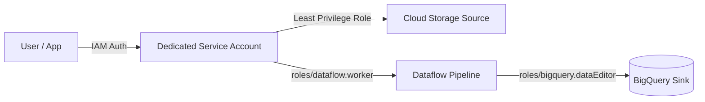
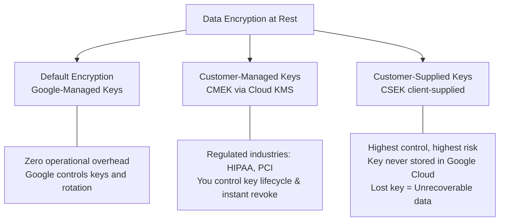
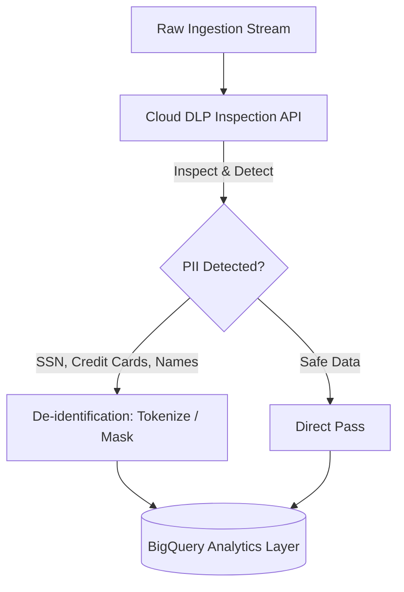
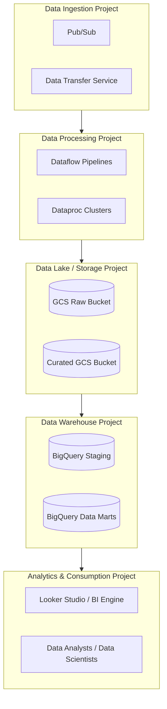

# 1.1 Diseño para Seguridad y Cumplimiento

La seguridad y el cumplimiento normativo representan una parte sustancial de la Sección 1 del examen. Como Professional Data Engineer, debes saber cómo proteger los datos a lo largo de todo su ciclo de vida —en tránsito, en reposo y durante el procesamiento— mientras cumples con estrictos mandatos de soberanía de datos y privacidad.

---

## 🛡️ Cloud IAM y Gestión de Accesos

Google Cloud Identity & Access Management (IAM) gobierna la autenticación (quién eres) y la autorización (qué puedes hacer).

### El Principio de Mínimo Privilegio
Evita siempre los roles primitivos (`Viewer`, `Editor`, `Owner`) en pipelines de datos en producción. Usa **roles predefinidos** o crea **roles personalizados** con permisos acotados.

### Roles Predefinidos Clave para Cargas de Trabajo de Datos

| Servicio | Roles Comunes en el Examen | Permisos y Uso |
| :--- | :--- | :--- |
| **BigQuery** | `roles/bigquery.dataViewer` | Leer datos y metadatos dentro de datasets y tablas. No puede ejecutar consultas usando recursos del proyecto a menos que se le otorguen derechos de creación de jobs. |
| | `roles/bigquery.dataEditor` | Crear, actualizar y eliminar tablas y datasets. |
| | `roles/bigquery.jobUser` | Ejecutar jobs de consulta, exportación y carga (generando facturación de slots/consultas del proyecto). Se combina frecuentemente con `dataViewer`. |
| | `roles/bigquery.admin` | Acceso administrativo completo a datasets, tablas y reservas. |
| **Cloud Storage** | `roles/storage.objectViewer` | Leer datos y metadatos de objetos. Esencial para pipelines ETL que leen archivos sin procesar. |
| | `roles/storage.objectAdmin` | Crear, eliminar y gestionar objetos (excluyendo permisos a nivel de bucket). |
| | `roles/storage.admin` | Control total sobre buckets y objetos. |
| **Pub/Sub** | `roles/pubsub.publisher` | Publicar mensajes en un topic. |
| | `roles/pubsub.subscriber` | Consumir mensajes de una suscripción y confirmarlos (acknowledge). |
| **Dataflow** | `roles/dataflow.worker` | Asignado a la cuenta de servicio de Compute Engine que ejecuta las VMs worker de Dataflow (necesita acceso a los buckets de staging en GCS y Pub/Sub). |

### Mejores Prácticas para Cuentas de Servicio
- Nunca uses credenciales personales de usuario en pipelines de datos automatizados.
- Crea cuentas de servicio distintas por etapa del pipeline (por ejemplo, `sa-ingestion@project.iam.gserviceaccount.com` vs `sa-analytics@project.iam.gserviceaccount.com`).
- Otorga `roles/iam.serviceAccountUser` únicamente a pipelines de despliegue autorizados o administradores.

---

## 🔐 Cifrado de Datos y Gestión de Claves

De forma predeterminada, Google Cloud cifra todos los datos de los clientes en reposo usando AES-256 sin necesidad de configuración alguna. Sin embargo, los requisitos regulatorios determinan la elección entre tres paradigmas de cifrado:

### Comparación de la Jerarquía de Cifrado

| Característica | Cifrado Administrado por Google | Administrado por el Cliente (CMEK) | Proporcionado por el Cliente (CSEK) |
| :--- | :--- | :--- | :--- |
| **Generación de Claves** | Google Cloud | Cloud KMS (el cliente controla) | On-premises / HSM del Cliente |
| **Almacenamiento de Claves** | Gestión de claves de Google | Google Cloud KMS | Tu propio hardware / disco |
| **Servicios Soportados** | Todos los servicios de GCP | GCS, BigQuery, Bigtable, Pub/Sub, Dataflow, Dataproc, Spanner, etc. | Cloud Storage y discos de Compute Engine únicamente |
| **Rotación de Claves** | Automática (aprox. 90 días) | Programación automatizada configurable o manual | Responsabilidad del cliente |
| **Capacidad de Revocación** | Ninguna | Instantánea: deshabilita la clave en Cloud KMS para cortar el acceso a los datos | Dejar de enviar la clave en las solicitudes de API |
| **Riesgo / Penalización** | Sin riesgo de pérdida | Deshabilitar la clave detiene consultas y jobs inmediatamente | Si se pierde la clave, Google no puede recuperar los datos |

### Jerarquía de Key Ring y CryptoKey en Cloud KMS
- **Key Ring**: Contenedor regional para claves organizacionales. No se puede eliminar.
- **CryptoKey**: El recurso de clave dentro de un Key Ring con versionado.
- **Rotación de Claves**: Puedes establecer un período de rotación automática (por ejemplo, cada 30 días). Los datos nuevos se cifran con la versión más reciente de la clave, mientras que los datos existentes pueden seguir siendo descifrados usando versiones anteriores hasta que se destruyan explícitamente.

---

## 🕵️ Protección de Datos Sensibles (Cloud DLP)

El manejo de Información de Identificación Personal (PII) es obligatorio para el cumplimiento de GDPR, CCPA e HIPAA. El servicio de Protección de Datos Sensibles de Google Cloud (anteriormente Cloud DLP) descubre, clasifica y desidentifica datos sensibles.

### Técnicas Principales de Desidentificación

1. **Enmascaramiento (Masking)**: Reemplaza parcialmente caracteres sensibles (por ejemplo, enmascaramiento de números de tarjeta de crédito: `4111-XXXX-XXXX-1111`).
2. **Hashing Criptográfico / Tokenización (HMAC)**:
   - Convierte texto plano (por ejemplo, un número de Seguro Social) en un hash pseudoaleatorio usando una clave secreta.
   - Preserva la integridad referencial en consultas analíticas y joins sin exponer el identificador original.
3. **Pseudonimización / Tokenización Cripto-Determinística**:
   - Tokenización reversible usando claves criptográficas. Permite la reidentificación autorizada cuando se solicita legalmente.
4. **Agrupación / Generalización (Bucketing)**:
   - Reemplaza valores precisos con rangos numéricos o categóricos (por ejemplo, cambiar Edad `34` a `30-39` o Código Postal `94105` a `941xx`).
5. **Desplazamiento de Fechas (Date Shifting)**:
   - Desplaza marcas de tiempo con un offset aleatorio determinístico por paciente/usuario, preservando los intervalos de duración para investigación médica y previniendo la reidentificación.

---

## 🌍 Consideraciones Regionales y Soberanía de Datos

Las leyes de soberanía de datos requieren que ciertos datos nunca abandonen un límite geográfico designado (por ejemplo, que los datos de la UE permanezcan en la Unión Europea).

### Almacenamiento Multi-Región vs. Regional
- **Multi-región (por ejemplo, `us`, `eu`)**: Alta disponibilidad a través de múltiples áreas metropolitanas. Diseñado para data warehouses a gran escala y tolerancia ante desastres.
- **Regional (por ejemplo, `us-central1`, `europe-west3`)**: Garantiza la residencia física de los datos dentro de una sola región, cumpliendo con leyes estrictas de residencia y minimizando la latencia de egreso de red entre el cómputo co-ubicado (Dataflow, Dataproc) y el almacenamiento (GCS, BigQuery).

### Políticas de Organización para Cumplimiento
Usa Políticas de Ubicación de Recursos (`constraints/gcp.resourceLocations`) a nivel de organización o carpeta:
- Impide que los ingenieros aprovisionen buckets de GCS, datasets de BigQuery o instancias de Compute fuera de países o regiones autorizadas.

---

## 🏗️ Arquitectura de Proyectos, Datasets y Tablas para Gobernanza

Una arquitectura empresarial de datos recomendada aísla las responsabilidades entre proyectos de GCP:

### Beneficios:
- **Asignación de Costos y Separación de Cuotas**: Los analistas que consumen slots de consulta no agotan las cuotas reservadas para pipelines ELT críticos.
- **VPC Service Controls (VPC-SC)**: Coloca los proyectos de datos sin procesar y de data warehouse dentro de un perímetro de seguridad protegido para prevenir la exfiltración no autorizada de datos a través de internet público.

---

## 🧪 Arquitectura Multi-Entorno: Dev vs. Staging vs. Prod

1. **Proyecto Dedicado por Entorno**:
   - `company-data-dev`, `company-data-stage`, `company-data-prod`.
2. **Sanitización de Datos para Entornos Inferiores**:
   - Nunca copies PII de producción sin enmascarar en entornos de desarrollo o pruebas.
   - Usa Cloud DLP para generar datasets de prueba sintéticamente desidentificados.
3. **Promoción Automatizada vía CI/CD**:
   - Usa Cloud Build o GitHub Actions con Terraform / Dataform para promover schemas, DAGs y binarios de pipelines entre entornos.

---

## 🎯 Punto de Control: Escenario de Práctica para el Examen

### Escenario:
Una empresa de servicios financieros necesita construir un pipeline de detección de fraudes en tiempo real en Google Cloud. El sistema debe procesar transacciones de tarjetas de crédito ingestadas a través de Cloud Pub/Sub, limpiar los datos usando Cloud Dataflow y escribir agregados analíticos en BigQuery. Los auditores regulatorios requieren que:
1. Los números PAN de los titulares de tarjetas nunca aparezcan en texto plano en BigQuery.
2. Los equipos de analítica deben poder realizar joins de eventos de transacciones por cuentas individuales de titulares de tarjetas a través de múltiples tablas diarias.
3. Las claves de cifrado que protegen las tablas almacenadas deben ser administradas por el cliente con rotación automática de 30 días, y el oficial de seguridad debe poder revocar el acceso a las claves de forma instantánea.

**¿Qué enfoque arquitectónico cumple con todos los requisitos?**

- **A.** Almacenar el PAN en texto plano, habilitar el cifrado predeterminado administrado por Google en BigQuery y otorgar a los analistas `roles/bigquery.dataViewer`.
- **B.** Desidentificar el PAN en Dataflow usando Cloud DLP con tokenización criptográfica determinística (cifrado cripto-determinístico con preservación de formato); almacenar los datasets de BigQuery usando Customer-Managed Encryption Keys (CMEK) configuradas en Cloud KMS con un programa de rotación de 30 días.
- **C.** Usar Customer-Supplied Encryption Keys (CSEK) en las tablas de BigQuery y aplicar hash al PAN con SHA-256 sin un salt criptográfico.
- **D.** Enmascarar los dígitos del PAN con reemplazo de cadena en Dataflow y usar claves de firma asimétrica de Cloud KMS.

> **Respuesta Correcta: B**  
> **Explicación**: La tokenización cripto-determinística en Cloud DLP reemplaza el PAN sensible con un token sustituto que preserva el formato y la unicidad de los datos, permitiendo joins analíticos entre datasets sin filtrar el PAN original del titular de la tarjeta. CMEK en Cloud KMS otorga al cliente autoridad completa para rotar claves cada 30 días y revocar el acceso instantáneamente deshabilitando la clave. CSEK (Opción C) no es compatible con BigQuery (solo GCS y discos de GCE), y un simple SHA-256 sin clave secreta es susceptible a ataques de tablas arcoíris.
