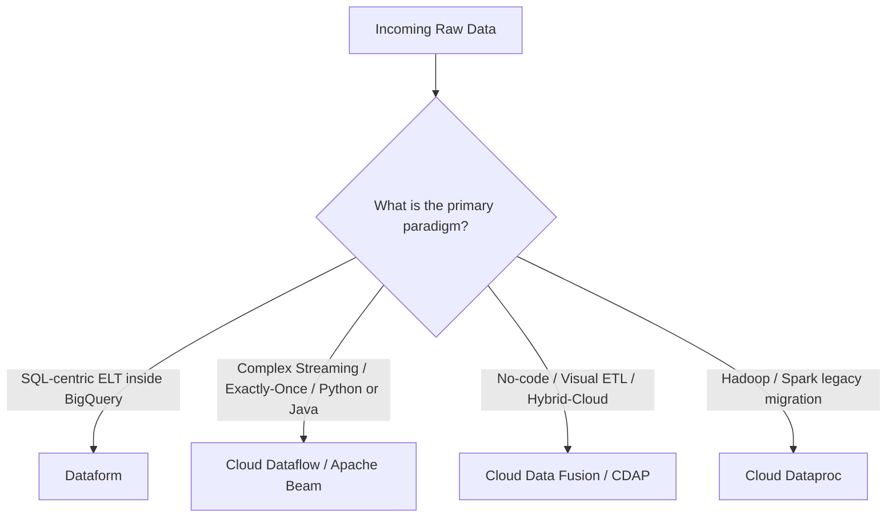
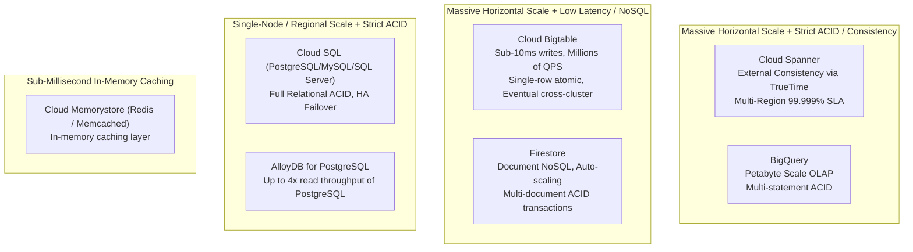
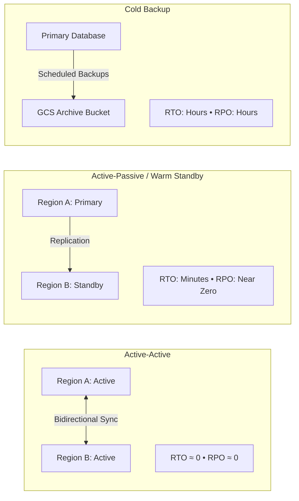
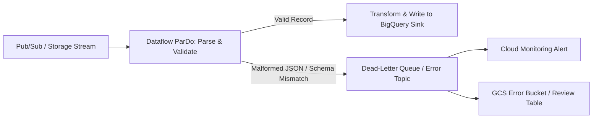

# 1.2 Diseño para Confiabilidad y Fidelidad

La confiabilidad garantiza que tus sistemas de datos continúen operando correctamente ante fallas de máquinas, interrupciones de red y cambios en las estructuras de datos de origen. La fidelidad garantiza que los datos que fluyen a través de esos sistemas sean precisos, consistentes y confiables.

---

## 🛠️ Selección de Herramientas para Preparación y Limpieza de Datos

Al diseñar pipelines de transformación de datos, Google Cloud ofrece servicios diferenciados según el perfil técnico del usuario, los requisitos de latencia y las habilidades del equipo.



### Matriz de Comparación Detallada

| Capacidad | Dataform | Cloud Dataflow | Cloud Data Fusion |
| :--- | :--- | :--- | :--- |
| **Paradigma** | **ELT** (Extraer, Cargar, Transformar dentro de BigQuery) | **ETL / ELT** Streaming y Batch | **ETL** visual guiado por interfaz gráfica |
| **Lenguaje** | SQLX (SQL + plantillas JavaScript) | Apache Beam (Java, Python, Go) | Canvas visual de pipelines (plugins CDAP) |
| **Motor de Cómputo** | Slots serverless de BigQuery | VMs Worker serverless de Dataflow | Clusters de ejecución dedicados en Cloud Dataproc |
| **Perfil de Latencia** | Batch (programado o por trigger) | Streaming en microsegundos/sub-segundo y Batch | Batch y Micro-batch |
| **Gestión de Dependencias** | Grafo de ejecución DAG integrado con `ref()` | DAG del Pipeline de Apache Beam | Programador de workflows integrado |
| **Control de Versiones** | Integración nativa con Git (GitHub, GitLab) | Repositorio de código fuente + CI/CD | CDAP Hub / integración con Git |
| **Ideal Para** | Transformar tablas staging sin procesar del data warehouse en data marts verificados | Procesamiento de flujos de eventos en tiempo real, windowing, agregaciones complejas | Integración empresarial de datos con más de 100 conectores preconstruidos sin código |

### Ejemplo de SQLX en Dataform: Transformación Declarativa con Aserciones de Calidad de Datos
Dataform permite declarar dependencias y verificaciones de validación de datos integradas directamente en archivos `.sqlx`:

```sql
config {
  type: "table",
  description: "Curated daily customer order totals",
  assertions: {
    uniqueKey: ["order_id"],
    nonNull: ["order_id", "customer_id", "total_amount"]
  }
}

SELECT
  order_id,
  customer_id,
  order_date,
  SUM(item_price * quantity) AS total_amount,
  CURRENT_TIMESTAMP() AS processed_at
FROM
  ${ref("stg_orders")}
GROUP BY
  order_id, customer_id, order_date
```

### Generación de Consultas con LLMs (Gemini en BigQuery)
Google Cloud ha integrado Gemini en BigQuery Data Canvas y el espacio de trabajo SQL:
- **Lenguaje Natural a SQL**: Generación de consultas complejas a partir de indicaciones en lenguaje de negocios.
- **Explicación y Optimización de SQL**: Solicitar a Gemini que explique consultas heredadas desconocidas y proponga indexación compatible con particiones.
- **Reglas de Limpieza de Datos**: Solicitar a los LLMs que generen patrones de coincidencia con regex y reglas de sanitización para casos extremos en registros malformados.

---

## 🌐 Cumplimiento ACID, Consistencia y el Teorema CAP

Seleccionar el backend de almacenamiento adecuado requiere comprender las compensaciones entre consistencia, disponibilidad y tolerancia a particiones.



### Resumen del Perfil de Consistencia de Bases de Datos

| Servicio de Almacenamiento | Modelo de Consistencia | Soporte ACID | Caso de Uso Típico |
| :--- | :--- | :--- | :--- |
| **Cloud Spanner** | **Consistencia Externa** (vía relojes de hardware TrueTime) | ACID distribuido completo entre regiones y continentes | Libros contables financieros globales, inventario de misión crítica, sistemas transaccionales multi-región |
| **Cloud SQL** | Consistencia fuerte (instancia única o réplica de failover) | ACID completo (RDBMS relacional) | Aplicaciones web tradicionales, ERPs, bases de datos CRM hasta 64TB |
| **AlloyDB for PostgreSQL** | Consistencia fuerte | ACID completo con hasta 4x el rendimiento de lectura del PostgreSQL estándar | Cargas de trabajo transaccionales empresariales que requieren compatibilidad extrema con PostgreSQL |
| **Cloud Bigtable** | Consistencia eventual entre clusters replicados (un solo cluster es fuertemente consistente para lectura-tras-escritura) | Transacciones atómicas solo a nivel de fila (sin ACID multi-fila) | Series temporales de alto rendimiento, telemetría IoT, eventos de AdTech (millones de ops/seg) |
| **Firestore** | Consistencia fuerte para documentos | Transacciones ACID multi-documento | Backends de apps móviles/web, perfiles de usuario, tablas de clasificación de juegos |
| **BigQuery** | Consistencia fuerte | Transacciones ACID de múltiples sentencias soportadas | Data warehouse analítico empresarial (OLAP) |

---

## 🚨 Recuperación ante Desastres (DR) y Tolerancia a Fallas

Los diseños de Recuperación ante Desastres giran en torno a dos métricas empresariales esenciales:
- **RTO (Recovery Time Objective)**: La duración aceptable de tiempo de inactividad antes de que los sistemas sean restaurados.
- **RPO (Recovery Point Objective)**: La máxima pérdida de datos aceptable medida en tiempo (por ejemplo, perder 5 minutos de transacciones vs. 0 segundos).



### Estrategias Arquitectónicas de Alta Disponibilidad en Google Cloud
1. **Cloud Spanner Multi-Región**:
   - Replicado entre múltiples regiones con consenso síncrono vía Paxos y TrueTime.
   - Proporciona un SLA de disponibilidad de **99.999% (cinco nueves)** con cero RPO y cero RTO durante fallas zonales o regionales.
2. **Alta Disponibilidad (HA) de Cloud SQL**:
   - Configura una instancia en espera en una zona diferente dentro de la misma región con replicación síncrona a nivel de bloque de disco.
   - Failover automático en 60–120 segundos si la zona primaria falla.
3. **Enrutamiento Multi-Cluster de Cloud Bigtable**:
   - Despliega instancias multi-cluster entre zonas o regiones.
   - Políticas de enrutamiento:
     - **Enrutamiento multi-cluster (Anycast)**: El tráfico se dirige automáticamente al cluster disponible más cercano; ofrece alta disponibilidad (99.999%) y failover.
     - **Enrutamiento de cluster único**: Ofrece consistencia fuerte de lectura-tras-escritura para mutaciones de fila única; requiere failover manual.

---

## 🛡️ Validación de Datos en Pipelines y Dead-Letter Queues

Para garantizar la fidelidad de los datos, los pipelines de datos deben aislar schemas corruptos o inesperados sin detener el consumo downstream.



### Patrón de Dead-Letter Queue como Mejor Práctica en Apache Beam
```python
import apache_beam as beam

class ParseAndValidate(beam.DoFn):
    OUTPUT_TAG_VALID = 'valid'
    OUTPUT_TAG_DEAD_LETTER = 'dead_letter'

    def process(self, element):
        try:
            # Parse record
            data = element.decode('utf-8')
            parsed = json.loads(data)
            if 'user_id' not in parsed or parsed['amount'] <= 0:
                raise ValueError("Invalid business fields")
            yield beam.pvalue.TaggedOutput(self.OUTPUT_TAG_VALID, parsed)
        except Exception as e:
            # Route bad data to dead letter output without crashing the pipeline
            error_payload = {
                'raw_record': element.decode('utf-8', errors='ignore'),
                'error': str(e),
                'timestamp': str(datetime.utcnow())
            }
            yield beam.pvalue.TaggedOutput(self.OUTPUT_TAG_DEAD_LETTER, error_payload)
```

---

## 🎯 Punto de Control: Escenario de Práctica para el Examen

### Escenario:
Una empresa global de comercio electrónico está desplegando una base de datos de seguimiento de inventario. Durante eventos de ventas pico, miles de compras concurrentes se ejecutan a través de América del Norte, Europa y Asia. El sistema de inventario requiere:
1. Transacciones ACID estrictas para prevenir la doble venta de inventario entre continentes.
2. Un SLA de disponibilidad de 99.999% con virtualmente cero RTO y cero RPO durante un desastre en un centro de datos regional.
3. Compatibilidad con SQL ANSI estándar para los ingenieros de aplicaciones.

**¿Qué servicio de base de datos debe seleccionar el ingeniero de datos?**

- **A.** Cloud SQL for PostgreSQL configurado con réplicas de lectura entre regiones.
- **B.** Cloud Bigtable con enrutamiento multi-cluster habilitado en tres regiones.
- **C.** Cloud Spanner con una configuración de instancia multi-región.
- **D.** Cloud Firestore en modo Datastore.

> **Respuesta Correcta: C**  
> **Explicación**: Cloud Spanner es la única base de datos globalmente distribuida y horizontalmente escalable que proporciona consistencia externa (ACID estricto) y un SLA de disponibilidad de 99.999% con cero RPO y cero RTO en configuraciones multi-región, impulsado por TrueTime y consenso Paxos. Las réplicas de lectura de Cloud SQL (Opción A) son asíncronas y no soportan escrituras ACID síncronas entre regiones. Cloud Bigtable (Opción B) es un almacén NoSQL que ofrece consistencia eventual entre clusters, no transacciones ACID multi-fila/tabla.
