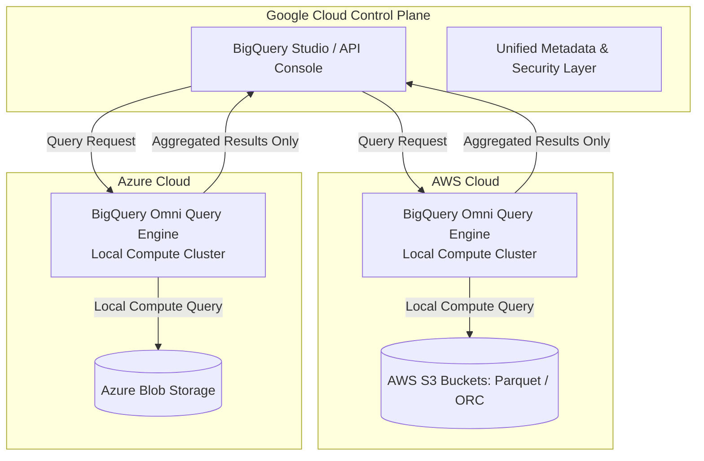
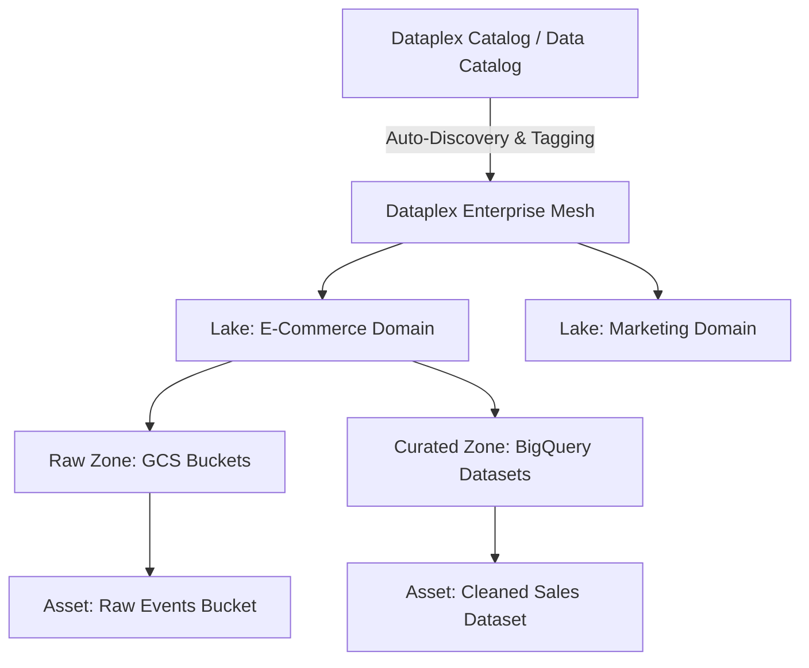

# 1.3 Diseño para Flexibilidad y Portabilidad

Las arquitecturas empresariales modernas deben evolucionar sin migraciones costosas ni dependencia de un solo proveedor (vendor lock-in). Google Cloud enfatiza los estándares de código abierto, las capacidades analíticas multi-cloud y la gobernanza centralizada de datos.

---

## ☁️ Analítica Multi-Cloud con BigQuery Omni

Las organizaciones empresariales frecuentemente mantienen grandes data lakes operacionales en múltiples proveedores de nube (como Amazon AWS S3 y Microsoft Azure Blob Storage). Mover petabytes de datos a través de los límites de la nube genera costos masivos de egreso y crea riesgos de gobernanza.



### Cómo Funciona BigQuery Omni
1. **Ejecución de Cómputo Local**: BigQuery Omni ejecuta el motor de consultas serverless de BigQuery dentro de clusters administrados en AWS o Azure usando la tecnología Google Anthos.
2. **Los Datos Nunca se Mueven Entre Nubes para el Procesamiento**: El cómputo se lleva a los datos. Los cargos de egreso se eliminan porque los datos sin procesar permanecen en AWS S3 o Azure Blob Storage.
3. **Transferencia Cross-Cloud**: Puedes exportar agregados analíticos directamente desde AWS/Azure al almacenamiento nativo de BigQuery usando la sentencia SQL `EXPORT DATA`:

```sql
-- Querying AWS S3 from BigQuery without data egress
SELECT
  customer_region,
  COUNT(order_id) AS total_orders,
  SUM(order_value) AS revenue
FROM
  `aws-us-east-1.sales_omni_dataset.orders_s3_external`
WHERE
  order_date >= '2026-01-01'
GROUP BY
  customer_region;
```

---

## 🔄 Portabilidad de Aplicaciones y Estándares Abiertos

Para prevenir el vendor lock-in, las arquitecturas de Google Cloud aprovechan APIs y frameworks de código abierto:

### 1. Apache Beam para Portabilidad de Pipelines
- **Escribe Una Vez, Ejecuta en Cualquier Lugar**: Los pipelines escritos en Apache Beam (Python, Java, Go) definen un modelo unificado de procesamiento de datos tanto para batch como para streaming.
- **Runners**: El mismo código Beam puede ejecutarse en **Google Cloud Dataflow**, **Apache Flink**, **Apache Spark** o localmente mediante el DirectRunner.
- **Framework de Portabilidad**: Usa protocol buffers (Fn API, Runner API) que permiten que pasos de pipeline escritos en Python se ejecuten en un runner de Java, o viceversa.

### 2. Formatos de Almacenamiento Abiertos vs. Formatos Propietarios
Para data lakes en Cloud Storage (GCS), diseña siempre usando formatos columnares de estándar abierto:
- **Apache Parquet**: Almacenamiento columnar optimizado para consultas analíticas con alta compresión y codificación por diccionario. Ideal para Spark, Dataproc y tablas externas de BigQuery.
- **Apache ORC**: Formato columnar altamente optimizado utilizado principalmente en cargas de trabajo de Hive y Presto.
- **Apache Avro**: Formato binario basado en filas con definición de schema embebida. Altamente optimizado para serialización e ingesta en streaming (por ejemplo, payloads de Kafka y Pub/Sub).
- **Apache Iceberg / Delta Lake**: Formatos de tabla abiertos que proporcionan transacciones ACID, time travel y evolución de schema sobre almacenamiento de objetos. BigQuery soporta consultas nativas a través de **BigLake**.

---

## 📚 Gobernanza de Datos, Descubrimiento y Catalogación (Dataplex)

A medida que las plataformas de datos se expanden, mantener la calidad, visibilidad y controles de acceso de los datos a través de miles de tablas y archivos requiere una gobernanza unificada.



### Conceptos Arquitectónicos Fundamentales en Dataplex:
1. **Lakes**: Contenedores lógicos de alto nivel que representan un dominio de negocio específico (por ejemplo, Ventas, Logística, Reportes Financieros).
2. **Zones**: Subdivisiones dentro de un Lake que agrupan datos por nivel de preparación o propósito:
   - **Raw Zone**: Almacena datos no validados y recién llegados (por ejemplo, archivos JSON/CSV sin procesar en GCS).
   - **Curated Zone**: Almacena datos validados, limpios y particionados listos para analítica (por ejemplo, tablas de BigQuery, archivos Parquet optimizados).
3. **Assets**: Punteros a los recursos de almacenamiento físico (buckets de GCS o datasets de BigQuery) ubicados dentro de los proyectos.
4. **Descubrimiento Automático y Registro de Schemas**: Dataplex rastrea automáticamente los archivos en GCS, infiere schemas, registra tablas en metastores de BigQuery e indexa metadatos.
5. **Tareas de Calidad de Datos**: Reglas de validación automatizadas programadas de forma nativa para probar restricciones (no nulos, patrones regex, integridad referencial).

---

## 🎯 Punto de Control: Escenario de Práctica para el Examen

### Escenario:
Una empresa multinacional tiene 500 TB de datos históricos de telemetría almacenados en Amazon S3 en formato Apache Parquet. El equipo de inteligencia de negocios en Google Cloud quiere ejecutar consultas analíticas combinando estos datos históricos con datos de ventas recientes almacenados en BigQuery en `us-central1`. El Director de Seguridad de la Información (CISO) y el CFO han establecido dos reglas:
1. Ningún dato de telemetría sin procesar puede ser copiado permanentemente ni transferido por egreso a través de internet público hacia Google Cloud debido a costos de ancho de banda y mandatos de cumplimiento.
2. Los analistas deben usar SQL estándar y la interfaz de BigQuery sin gestionar ningún cluster de VMs.

**¿Cuál es la arquitectura recomendada?**

- **A.** Crear un pipeline de Dataflow para leer objetos de S3 y transmitirlos por streaming a un dataset de BigQuery.
- **B.** Configurar BigQuery Omni en AWS, crear un dataset externo que haga referencia al bucket de S3 y ejecutar consultas localmente dentro de AWS usando BigQuery Studio.
- **C.** Desplegar un cluster de Dataproc en Compute Engine, usar el conector Spark-S3 para leer los datos y escribir la salida en BigQuery.
- **D.** Usar Storage Transfer Service para sincronizar todos los archivos Parquet a un bucket de GCS multi-región cada mañana.

> **Respuesta Correcta: B**  
> **Explicación**: BigQuery Omni permite ejecutar consultas directamente contra datos almacenados en Amazon S3 ejecutando nodos de cómputo de BigQuery dentro de AWS. Los datos sin procesar permanecen en S3, evitando cargos de egreso y violaciones de cumplimiento, mientras los analistas usan SQL estándar de BigQuery. Las opciones A, C y D requieren mover el dataset de 500 TB a través de internet hacia Google Cloud, violando los requisitos del CISO y el CFO.
