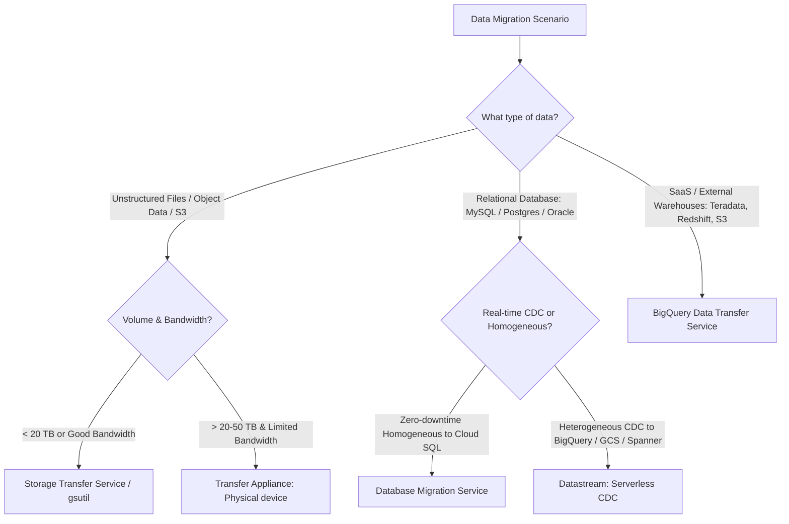
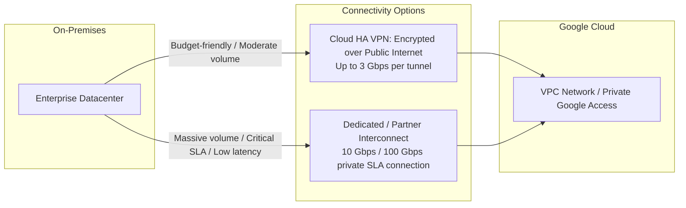
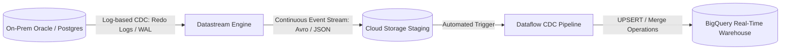

# 1.4 Diseño de Migraciones de Datos

Migrar data warehouses on-premises, bases de datos operacionales y data lakes de datos no estructurados hacia Google Cloud requiere seleccionar la herramienta de migración adecuada según el volumen de datos, el ancho de banda de red, el tiempo de inactividad permitido y la velocidad de cambio.

---

## 🧭 Matriz de Decisión de Herramientas de Migración de Google Cloud

### Comparación Completa de Herramientas de Migración

| Herramienta de Migración | Sistemas de Origen | Sistemas de Destino | Modo de Transferencia | Casos de Uso Clave |
| :--- | :--- | :--- | :--- | :--- |
| **Storage Transfer Service (STS)** | AWS S3, Azure Blob, endpoints HTTP, sistemas de archivos POSIX on-premises | Cloud Storage (GCS) | Transferencia de red administrada en la nube | Migración de archivos a gran escala, sincronización recurrente multi-cloud, movimientos automatizados de ciclo de vida |
| **Transfer Appliance** | Centros de datos on-premises, almacenamiento conectado a red (NAS) | Cloud Storage | Dispositivo de almacenamiento físico robusto de alta capacidad enviado por Google | Datasets de más de 20 TB a petabytes cuando el ancho de banda de red es limitado o los costos son prohibitivos |
| **Database Migration Service (DMS)** | MySQL, PostgreSQL, SQL Server, Oracle (on-premises, EC2, RDS) | Cloud SQL, AlloyDB | Replicación continua por red usando logs nativos del motor (por ejemplo, binlog, WAL) | Migración lift-and-shift con tiempo de inactividad mínimo de bases de datos transaccionales operacionales |
| **Datastream** | Oracle, PostgreSQL, MySQL, SQL Server | BigQuery, Cloud Storage, Spanner | Change Data Capture (CDC) serverless en tiempo real mediante minería de logs | Streaming continuo de mutaciones de base de datos (inserts, updates, deletes) hacia data lakes analíticos en BigQuery |
| **BigQuery Data Transfer Service (DTS)** | AWS S3, Teradata, Redshift, Snowflake, Google Ads, Campaign Manager, YouTube | Tablas de BigQuery | Extracción y carga por lotes programados | Migración de data warehouses empresariales heredados a BigQuery; automatización de cargas de datos de Google Marketing |

---

## 🔌 Redes Híbridas: Cloud VPN vs. Cloud Interconnect

Al transferir grandes volúmenes de datos empresariales por la red, elegir la opción de conectividad correcta es crítico para cumplir con los plazos de migración.

### Regla General de Dimensionamiento de Red para Preguntas del Examen:
- Si el volumen de datos es de **múltiples petabytes** y el tiempo de migración es limitado (por ejemplo, 1 mes) con una conexión lenta → **Transfer Appliance**.
- Si la migración requiere una conexión permanente de alto ancho de banda (&gt; 10 Gbps) con SLA empresarial directo → **Dedicated Interconnect**.
- Si la conexión requiere menor tiempo de configuración y ancho de banda moderado (&le; 3 Gbps) → **Cloud HA VPN** (combina múltiples túneles para ancho de banda agregado).

---

## ⚡ Change Data Capture (CDC) en Tiempo Real con Datastream

Las migraciones de datos modernas frecuentemente no pueden tolerar horas de tiempo de inactividad transaccional. Datastream proporciona CDC serverless basado en logs sin impactar el rendimiento de la base de datos transaccional.

### Ventajas Clave de Datastream:
- **Minería de Logs sin Impacto**: Lee los logs de escritura anticipada (WAL) o los logs de transacciones redo de la base de datos en lugar de ejecutar consultas de sondeo contra tablas operacionales.
- **Manejo Automático de Cambios de Schema**: Se adapta automáticamente cuando se agregan columnas a las tablas de origen.
- **Integración Nativa con BigQuery**: Ingesta por streaming directa con replicación automática mediante MERGE en BigQuery sin requerir código intermediario de Dataflow para casos de uso estándar de CDC.

---

## 🎯 Punto de Control: Escenario de Práctica para el Examen

### Escenario:
Una empresa minorista necesita migrar 120 TB de archivos históricos de logs de transacciones almacenados en un arreglo NAS NetApp on-premises hacia Google Cloud Storage en un plazo de dos semanas. La empresa cuenta con una conexión de internet dedicada de 50 Mbps que actualmente se utiliza al 80% de su capacidad por las operaciones comerciales diarias. Adquirir ancho de banda adicional tomaría tres meses para ser aprovisionado.

**¿Qué estrategia completa la migración dentro del plazo con costo mínimo y mínima interrupción de red?**

- **A.** Ejecutar el comando `gsutil -m cp` en múltiples servidores locales durante las horas nocturnas.
- **B.** Solicitar un Google Cloud Transfer Appliance, copiar los datos localmente a través de la red local de 10 GbE, enviar el dispositivo a Google y que sea hidratado directamente en el bucket de Cloud Storage de destino.
- **C.** Aprovisionar Cloud HA VPN y configurar Storage Transfer Service con agentes on-premises.
- **D.** Comprimir los archivos con gzip y transmitirlos vía Cloud Pub/Sub hacia Cloud Storage.

> **Respuesta Correcta: B**  
> **Explicación**: Con 50 Mbps y un 80% de utilización existente, el ancho de banda disponible es de 10 Mbps. Transferir 120 TB a través de una línea de 10 Mbps tomaría matemáticamente más de 3 años (`(120 * 10^12 * 8) / 10^7 segundos ≈ 1,111 días`). La única solución viable para cumplir con el plazo de dos semanas sin saturar la conexión de internet corporativa es un **Transfer Appliance** físico, que permite la ingesta local a alta velocidad y el envío físico rápido.
