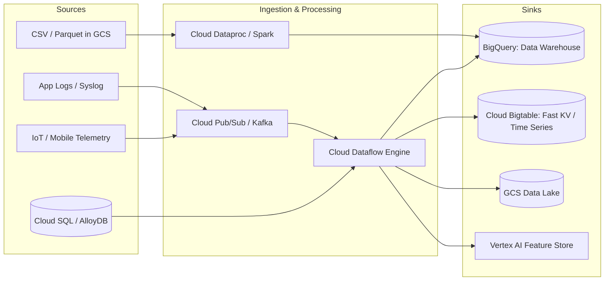
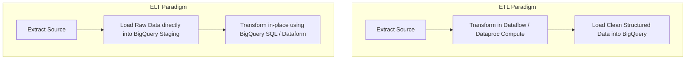
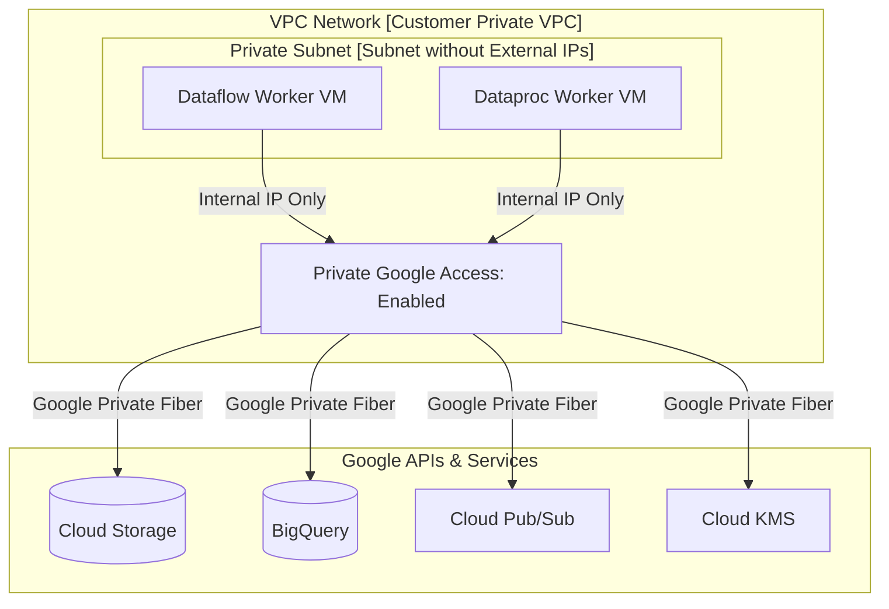

# 2.1 Planificación de Pipelines de Datos

Planificar un pipeline de datos escalable requiere alinear las fuentes de datos, los destinos, los motores de cómputo y la infraestructura de red segura para cumplir con los objetivos de rendimiento y latencia, manteniendo los costos predecibles.

---

## 🚰 Arquitectura de Fuentes y Destinos

Un pipeline de datos conecta los sistemas productores aguas arriba (fuentes) con los repositorios analíticos, operacionales o de machine learning aguas abajo (destinos).

### Matriz de Selección de Fuentes y Destinos

| Patrón de Fuente / Destino | Tecnología Recomendada | Modo de Procesamiento | Características |
| :--- | :--- | :--- | :--- |
| **Streaming de eventos de alto volumen** | Cloud Pub/Sub $\to$ Dataflow $\to$ Bigtable / BigQuery | Streaming en tiempo real | Latencia inferior al segundo, autoescalado horizontal, millones de mensajes/seg |
| **Mensajería de microservicios (FIFO)** | Pub/Sub con Ordering Keys $\to$ Dataflow | Streaming | Garantiza el procesamiento ordenado por clave mientras escala horizontalmente |
| **CDC de bases de datos transaccionales** | Datastream $\to$ BigQuery / GCS | Continuo / Micro-batch | Change Data Capture basado en logs con mínima carga sobre la base de datos |
| **Exportaciones analíticas masivas** | BigQuery $\to$ Cloud Storage | Exportación batch | `EXPORT DATA` nativo con soporte para Parquet, CSV y JSON |
| **Lecturas Key-Value de alto rendimiento** | Dataflow $\to$ Cloud Bigtable | Streaming / Batch | Rendimiento de escritura que escala linealmente con el número de nodos del cluster |

---

## 🔄 ETL vs. ELT: ¿Cuándo Elegir Cada Uno?

El debate entre Extract-Transform-Load (ETL) y Extract-Load-Transform (ELT) es un tema clásico del examen.

### Marco de Decisión:

| Criterio | Elegir ETL (Dataflow / Dataproc) | Elegir ELT (BigQuery / Dataform) |
| :--- | :--- | :--- |
| **Limpieza de Datos y Privacidad** | Cumplimiento estricto: la PII debe enmascararse o tokenizarse **antes** de ingresar al almacenamiento de datos. | La PII puede almacenarse de forma segura en datasets restringidos de datos crudos y enmascararse a nivel de vista. |
| **Paradigma de Procesamiento** | Eventos en streaming que requieren ventanas de sub-segundo y enriquecimiento. | Transformaciones batch programadas de datos tabulares o semiestructurados. |
| **Complejidad de Transformación** | Lógica compleja no-SQL (ej. inferencia de visión por computadora, bibliotecas personalizadas de Java/Python). | Transformaciones compatibles con SQL, agregaciones, joins y funciones de ventana. |
| **Costo y Simplicidad Operativa** | Requiere mantener jobs de pipeline y capacidad de workers. | Serverless; aprovecha el motor de consultas a escala de petabytes de BigQuery. |

---

## 🌐 Fundamentos de Redes Seguras para Pipelines

Los workers de procesamiento de datos en Google Cloud (VMs de workers de Dataflow, instancias de clusters de Dataproc, pods de workers de Cloud Composer) se ejecutan dentro de una Virtual Private Cloud (VPC). Asegurar su comunicación sin exponer los pipelines a la internet pública es esencial.

### Conceptos Críticos de Redes Evaluados en el Examen:

1. **Private Google Access (PGA)**:
   - Cuando los workers de Dataflow o Dataproc se lanzan sin direcciones IP externas (públicas) por cumplimiento de seguridad, PGA **debe estar habilitado en la subred**.
   - Permite que las instancias con IPs privadas RFC 1918 alcancen las APIs y servicios de almacenamiento de Google Cloud a través del enrutamiento interno de la red de Google.
2. **Deshabilitar IPs Públicas (`--no-use-public-ips`)**:
   - Mejor práctica de Google: siempre pasar el flag `--no-use-public-ips` al enviar jobs de Dataflow para cumplir con las directrices de seguridad empresarial.
3. **Private Service Connect (PSC)**:
   - Permite la comunicación privada y segura entre VPCs consumidoras y servicios administrados de productores (o plataformas SaaS) a través de endpoints privados sin necesidad de VPC peering.
4. **VPC Service Controls (VPC-SC)**:
   - Crea un perímetro criptográfico alrededor de los servicios de GCP (BigQuery, GCS, Cloud KMS) para prevenir la exfiltración de datos, incluso por usuarios autorizados con credenciales IAM válidas.

---

## 🔒 Estándares de Cifrado en Tránsito y en Reposo

- **Cifrado en Tránsito**: Todo el tráfico de red entre las instalaciones de Google Cloud, las instancias y las APIs de Google se cifra automáticamente usando **TLS 1.3** y ALTS (Application Layer Transport Security) interno de Google.
- **Cifrado en Reposo**: Se gestiona mediante claves predeterminadas o **CMEK (Customer-Managed Encryption Keys)** a través de Cloud KMS. Para Dataflow y Dataproc, los workers pueden usar CMEK para cifrar los discos temporales del pipeline, el estado intermedio de shuffle y los discos persistentes.

---

## 🎯 Punto de Control: Escenario de Práctica para el Examen

### Escenario:
Tu organización aplica una regla de seguridad empresarial estricta: ninguna instancia de cómputo ni máquina virtual de workers puede tener direcciones IP externas (públicas), y los datos que fluyen hacia Google Cloud nunca deben transitar por la internet pública. Estás configurando un pipeline de Cloud Dataflow para leer archivos de Cloud Storage, transformarlos y cargarlos en BigQuery.

Cuando envías el job del pipeline, los workers de Dataflow no logran comunicarse con Cloud Storage y BigQuery, y el job se aborta.

**¿Qué cambio de configuración debes implementar?**

- **A.** Otorgar a la cuenta de servicio del worker de Dataflow `roles/owner` en el proyecto.
- **B.** Adjuntar un gateway de Cloud NAT a la VPC y asignar direcciones IP públicas estáticas al router NAT.
- **C.** Habilitar **Private Google Access** en la subred donde se aprovisionan las instancias de workers de Dataflow.
- **D.** Aprovisionar un túnel de Cloud VPN entre los workers de Dataflow y el endpoint de la API de BigQuery.

> **Respuesta Correcta: C**  
> **Explicación**: Cuando las VMs de workers de Dataflow se aprovisionan sin direcciones IP públicas (mediante `--no-use-public-ips`), no pueden resolver ni alcanzar las APIs de Google (como Cloud Storage, BigQuery o Cloud Pub/Sub) a menos que **Private Google Access** esté habilitado en su subred. Habilitar Private Google Access enruta el tráfico de las APIs completamente a través de la red interna privada de Google sin requerir IPs públicas ni NAT.
