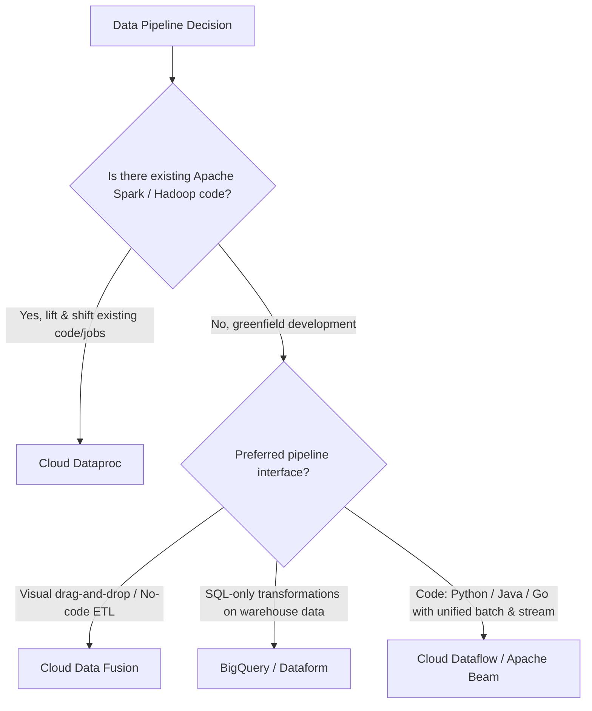
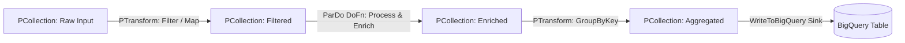
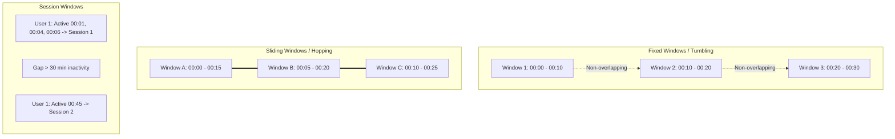
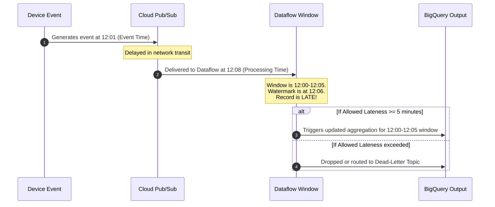

# 2.2 Construcción de Pipelines

Transformar flujos y lotes de datos crudos en datasets limpios y enriquecidos es la responsabilidad principal de un Ingeniero de Datos en Google Cloud. Esta lección cubre la selección de servicios, el modelo de programación de Apache Beam, la mecánica de ventanas en streaming y el enriquecimiento de datos con IA.

---

## ⚙️ Selección de Servicios: Dataflow vs. Dataproc vs. Cloud Data Fusion vs. BigQuery

Un desafío común del examen es determinar si se debe usar Cloud Dataflow, Cloud Dataproc, Cloud Data Fusion o BigQuery nativo para la ejecución de pipelines.



### Matriz de Comparación Integral

| Característica | Cloud Dataflow | Cloud Dataproc | Cloud Data Fusion | BigQuery |
| :--- | :--- | :--- | :--- | :--- |
| **Motor Subyacente** | Motor de ejecución de Apache Beam | Apache Spark, Hadoop, Hive, Presto, Flink | CDAP sobre Dataproc | Motor SQL Google Dremel |
| **¿Serverless?** | **Sí**: Completamente serverless, autoescalado dinámico, rebalanceo de workers | Opcional: Dataproc Serverless o VMs de cluster administrado | UI administrada, aprovisiona clusters de Dataproc internamente | **Sí**: Asignación de slots serverless |
| **Soporte de Streaming** | Latencia sub-segundo, semántica unificada batch/streaming | Spark Structured Streaming (micro-batch) | Pipelines en tiempo real vía Spark Streaming | Inserciones de streaming / BigQuery Storage Write API |
| **Mecanismo de Escalado** | Autoescalado horizontal de VMs de workers + Liquid Shuffling | Políticas de autoescalado en nodos de workers de Dataproc | Escalado de workers de Dataproc | Asignación dinámica de slots |
| **Esfuerzo Operativo** | **Cero gestión de infraestructura** | Requiere dimensionamiento de cluster, acciones de inicialización, mantenimiento de SO/paquetes | Bajo a medio | **Cero gestión de infraestructura** |
| **Punto Fuerte Principal** | Pipelines unificados de batch y streaming con ventanas complejas | Migración de aplicaciones Spark/Hadoop existentes con mínimas reescrituras de código | Integración ETL empresarial dirigida por GUI | Agregaciones SQL analíticas, joins y preparación de features |

---

## 🌊 Conceptos de Apache Beam y Dataflow

El modelo de programación de Apache Beam define cuatro primitivas fundamentales:



### Primitivas Principales:
1. **Pipeline**: Encapsula el DAG completo de operaciones de procesamiento de datos.
2. **PCollection**: Representa un dataset distribuido de múltiples elementos (puede ser acotado para batch o no acotado para streaming). Es inmutable.
3. **PTransform**: Una operación que toma una o más PCollections como entrada y produce una o más PCollections de salida.
4. **ParDo / DoFn**: La transformación principal de procesamiento paralelo. Similar a `map` y `flat_map`. Cada worker recibe elementos y produce cero o más salidas.

### Ejemplo de Pipeline en Python con Apache Beam:
```python
import apache_beam as beam
from apache_beam.options.pipeline_options import PipelineOptions, StandardOptions

options = PipelineOptions()
options.view_as(StandardOptions).streaming = True

with beam.Pipeline(options=options) as p:
    (
        p
        | "ReadFromPubSub" >> beam.io.ReadFromPubSub(subscription="projects/my-proj/subscriptions/events-sub")
        | "ParseJSON" >> beam.Map(json.loads)
        | "FilterHighValue" >> beam.Filter(lambda x: x['amount'] > 100)
        | "AddTimestamp" >> beam.Map(lambda x: beam.window.TimestampedValue(x, x['timestamp']))
        | "WindowIntoHours" >> beam.WindowInto(beam.window.FixedWindows(3600))
        | "SumPerUser" >> beam.CombinePerKey(sum)
        | "WriteToBigQuery" >> beam.io.WriteToBigQuery(
            table='my-proj:analytics.hourly_user_totals',
            schema='user_id:STRING, total:FLOAT',
            write_disposition=beam.io.BigQueryDisposition.WRITE_APPEND
        )
    )
```

---

## ⏱️ Mecánica de Streaming: Ventanas, Watermarks y Triggers

Los pipelines de streaming procesan datos no acotados. Para realizar agregaciones (ej. calcular conteos o promedios), los datos deben agruparse en fragmentos temporales finitos.

### 1. Tipos de Ventanas



- **Ventanas Fijas (Tumbling)**: Intervalos de tiempo discretos, uniformes y sin superposición (ej. cada 5 minutos). Cada elemento pertenece a exactamente una ventana.
- **Ventanas Deslizantes (Hopping)**: Intervalos de tiempo superpuestos definidos por una duración y una frecuencia de deslizamiento (ej. ventana de 10 minutos deslizándose cada 2 minutos). Un elemento puede pertenecer a múltiples ventanas.
- **Ventanas de Sesión**: Intervalos dinámicos agrupados por un período de inactividad del usuario (duración del gap). Altamente efectivas para el seguimiento del recorrido del usuario en sitios web.

### 2. Event Time vs. Processing Time
- **Event Time**: El instante en que el evento ocurrió físicamente en el dispositivo/aplicación de origen (incrustado dentro del payload del registro).
- **Processing Time**: La hora del reloj de pared cuando el worker del pipeline de Dataflow recibe y procesa el registro.

### 3. Watermarks y Datos de Llegada Tardía
La latencia de red o las desconexiones móviles provocan que los registros lleguen fuera de orden.
- **Watermark**: La noción del sistema sobre cuándo han llegado todos los datos hasta un determinado event time.
- **Allowed Lateness**: Especifica cuánto tiempo debe esperar el pipeline por datos retrasados después de que el watermark supere el final de una ventana.
- **Triggers**: Determinan cuándo se emite el cálculo acumulado de la ventana (ej. emitir estimaciones tempranas, emitir en el watermark o emitir actualizaciones por datos tardíos).



---

## 🤖 Enriquecimiento de Datos con IA en Pipelines

Los pipelines modernos de ingeniería de datos incorporan enriquecimiento con machine learning directamente en el flujo de ingesta:

1. **Enriquecimiento SQL con BigQuery ML**:
   - Llama a modelos Gemini o text-bison directamente desde SQL usando `ML.GENERATE_TEXT`:
   ```sql
   SELECT
     review_id,
     ml_generate_text_result['predictions'][0]['content'] AS sentiment_analysis
   FROM
     ML.GENERATE_TEXT(
       MODEL `my_project.ml_models.gemini_pro`,
       TABLE `my_project.raw_data.customer_reviews`,
       STRUCT(
         'Classify the sentiment of this review as POSITIVE, NEGATIVE, or NEUTRAL:' AS prompt,
         0.2 AS temperature
       )
     );
   ```

2. **Dataflow con Vertex AI Endpoints**:
   - Usa la transformación `RunInference` de Beam para ejecutar predicciones de modelos alojados en **Vertex AI Endpoints** o modelos embebidos de PyTorch/TensorFlow con batching automático y aceleración por GPU.

---

## 🎯 Punto de Control: Escenario de Práctica para el Examen

### Escenario:
Una aplicación de viajes compartidos transmite eventos de ubicación GPS desde millones de dispositivos móviles de conductores hacia Cloud Pub/Sub. El equipo de ingeniería de datos debe calcular la velocidad promedio de los conductores en intervalos de 10 minutos evaluados cada 2 minutos. Dado que los teléfonos móviles regularmente entran en túneles y pierden conectividad celular, los paquetes de datos GPS frecuentemente llegan con hasta 15 minutos de retraso. El equipo de business intelligence requiere estadísticas agregadas precisas, y los datos de llegada tardía deben actualizar los promedios históricos correspondientes.

**¿Cómo deberías diseñar la lógica de ventanas y triggers del pipeline de Dataflow?**

- **A.** Usar ventanas Fijas (Tumbling) de 10 minutos con triggers de processing-time y cero allowed lateness.
- **B.** Usar ventanas Deslizantes de 10 minutos de duración con un período de deslizamiento de 2 minutos, watermarking basado en event-time y un allowed lateness de al menos 15 minutos con modo de acumulación.
- **C.** Usar ventanas de Sesión con una duración de gap de 15 minutos y escribir las salidas directamente en Cloud Storage.
- **D.** Ingestar los datos directamente en BigQuery mediante inserciones batch de streaming y ejecutar una consulta cron cada 2 minutos.

> **Respuesta Correcta: B**  
> **Explicación**: El negocio requiere evaluar ventanas de 10 minutos cada 2 minutos, lo cual es la definición de una **ventana Deslizante (Hopping)** (10 minutos de duración, 2 minutos de deslizamiento). Los dispositivos móviles que pasan por túneles generan datos de llegada tardía en event time; por lo tanto, usar **watermarking basado en event-time** combinado con un **allowed lateness de 15+ minutos** asegura que los registros tardíos no se descarten, sino que actualicen los agregados de la ventana mediante el modo de acumulación.
