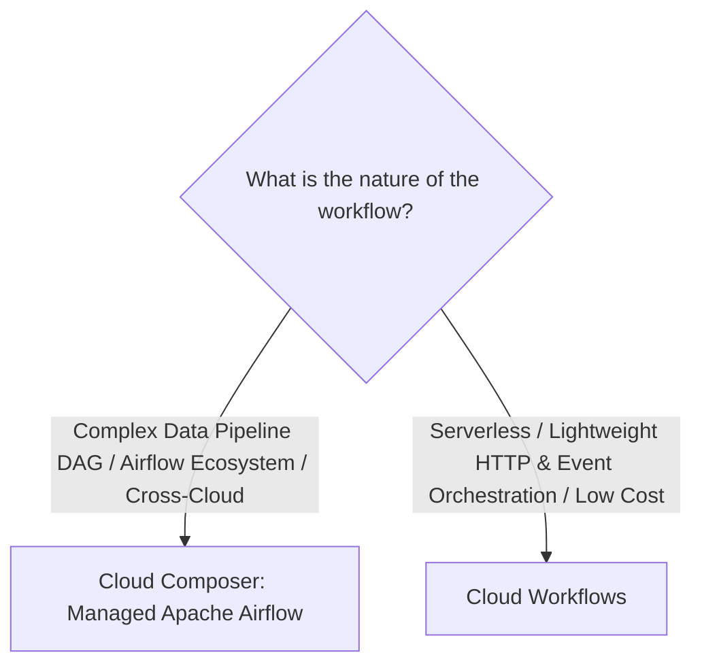
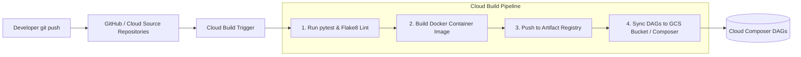

# 2.3 Despliegue y Operacionalización de Pipelines

Construir un pipeline es solo la mitad de la batalla. Entregar valor en producción requiere una orquestación robusta, pipelines de despliegue CI/CD automatizados, pruebas unitarias y configuraciones de lanzamiento automatizadas.

---

## 🎼 Orquestación: Cloud Composer vs. Cloud Workflows

Google Cloud proporciona dos motores de orquestación diferenciados:



### Comparación Directa

| Característica | Cloud Composer | Cloud Workflows |
| :--- | :--- | :--- |
| **Motor** | **Apache Airflow 2** administrado | Motor de workflows serverless nativo de Google |
| **Lenguaje** | Python (definiciones de DAG) | YAML o JSON |
| **Infraestructura** | Aprovisiona un cluster de GKE, una instancia de Cloud SQL y un bucket de Cloud Storage | **100% Serverless**; cero infraestructura permanente |
| **Arranque / Latencia** | Pesado; se ejecuta continuamente 24/7 | Arranque en frío en milisegundos; escala a cero |
| **Modelo de Costos** | Tarifa por hora por nodos de GKE, servidor web de Airflow y base de datos | Pago por paso ejecutado (costo prácticamente nulo cuando está inactivo) |
| **Mejor Uso** | Orquestación integral de plataformas de datos (Dataflow, Dataproc, BigQuery, dbt/Dataform, alertas de Slack) | Microservicios orientados a eventos, encadenamiento de Cloud Functions, triggers ligeros de Pub/Sub |

### Ejemplo de DAG de Apache Airflow 2 en Cloud Composer:
```python
from datetime import datetime, timedelta
from airflow import DAG
from airflow.providers.google.cloud.operators.dataflow import DataflowCreatePythonJobOperator
from airflow.providers.google.cloud.operators.bigquery import BigQueryInsertJobOperator

default_args = {
    'owner': 'data-engineering',
    'depends_on_past': False,
    'email_on_failure': True,
    'email': ['data-alerts@company.com'],
    'retries': 2,
    'retry_delay': timedelta(minutes=5),
}

with DAG(
    'daily_analytics_etl',
    default_args=default_args,
    schedule_interval='0 2 * * *',  # Daily at 02:00 UTC
    start_date=datetime(2026, 1, 1),
    catchup=False,
) as dag:

    run_dataflow_cleansing = DataflowCreatePythonJobOperator(
        task_id='run_dataflow_cleansing',
        py_file='gs://my-bucket/pipelines/cleanse.py',
        job_name='cleanse-orders-{{ ds_nodash }}',
        options={'temp_location': 'gs://my-bucket/temp'},
    )

    run_bigquery_marts = BigQueryInsertJobOperator(
        task_id='run_bigquery_marts',
        configuration={
            "query": {
                "query": "CALL `my_project.analytics.refresh_daily_marts`('{{ ds }}');",
                "useLegacySql": False,
            }
        },
    )

    run_dataflow_cleansing >> run_bigquery_marts
```

---

## 🚀 CI/CD para Ingeniería de Datos con Cloud Build

Automatizar las pruebas y el despliegue elimina los errores manuales al desplegar pipelines en entornos de staging y producción.



### Pasos Esenciales de CI/CD para el PDE:
1. **Pruebas Unitarias de Beam con `TestPipeline`**:
   - Beam incluye `apache_beam.testing.test_pipeline.TestPipeline` y `assert_that` para verificar transformaciones localmente contra PCollections sintéticas antes del despliegue.
2. **Dataflow Contenerizado (Flex Templates)**:
   - Empaqueta el código de Beam y sus dependencias en un contenedor Docker almacenado en **Artifact Registry**.
   - Permite soporte multilenguaje, dependencias personalizadas y ejecución automatizada a través de una API REST simple u operadores de Composer sin conflictos de entorno local de Python.
3. **Entornos y Configuraciones de Lanzamiento de Dataform**:
   - Configura las configuraciones de lanzamiento de Dataform para obtener código de la rama `main` de Git, compilar SQLX y ejecutar aserciones contra datasets de BigQuery de `dev`, `staging` o `prod` de forma automática.

---

## 🎯 Punto de Control: Escenario de Práctica para el Examen

### Escenario:
Un equipo de inteligencia financiera está desplegando un nuevo pipeline batch de Apache Beam en Python que procesa transacciones confidenciales. Durante las ejecuciones pico, el pipeline requiere extensiones C personalizadas para criptografía y dependencias específicas de bibliotecas Python. Cuando los ingenieros de datos despliegan el job directamente desde sus laptops individuales, las dependencias frecuentemente entran en conflicto con el entorno predeterminado de workers de Dataflow, resultando en workers fallidos. Además, la política corporativa prohíbe ejecutar código sin versionar en producción.

**¿Qué estrategia de despliegue resuelve estos problemas de dependencias y gobernanza?**

- **A.** Instalar las bibliotecas manualmente en la plantilla predeterminada de Compute Engine utilizada por Dataflow.
- **B.** Empaquetar el pipeline de Beam, las dependencias y el entorno de ejecución en una imagen Docker personalizada, subirla a Artifact Registry y lanzar el pipeline usando Dataflow Flex Templates orquestado por Cloud Composer.
- **C.** Reescribir el pipeline de Python en scripts bash ejecutándose en una VM estándar de Compute Engine.
- **D.** Colocar los archivos `.whl` de Python en un servidor FTP público y pasar la URL a los workers de Dataflow.

> **Respuesta Correcta: B**  
> **Explicación**: **Dataflow Flex Templates** permiten a los desarrolladores empaquetar el entorno de ejecución completo, incluyendo dependencias personalizadas, bibliotecas C y paquetes Python, en una imagen de contenedor Docker estandarizada almacenada de forma segura en **Google Cloud Artifact Registry**. Esto garantiza una ejecución consistente y reproducible en producción y se integra de manera limpia con CI/CD y la orquestación de Cloud Composer.
