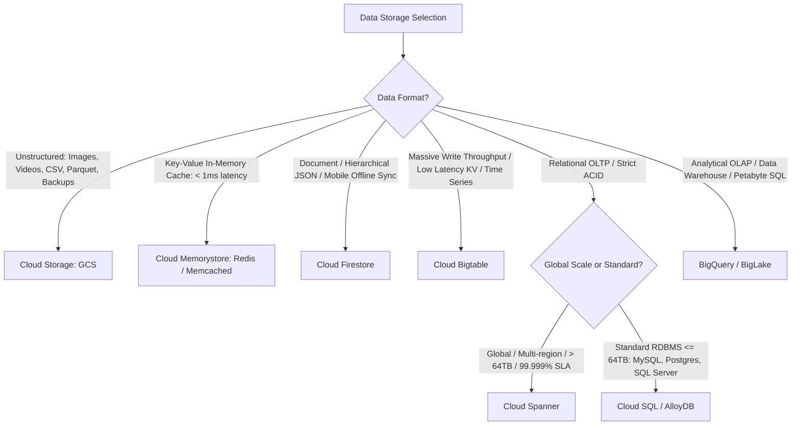
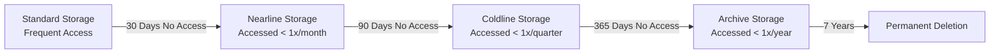

# 3.1 Selección de Sistemas de Almacenamiento

Elegir la tecnología de almacenamiento óptima en Google Cloud es uno de los dominios más evaluados en el examen de Professional Data Engineer. Esta lección te proporciona una matriz de evaluación exhaustiva, una taxonomía de patrones de acceso y estrategias de gestión del ciclo de vida del almacenamiento.

---

## 🗄️ Árbol de Decisión Maestro para Selección de Almacenamiento



---

## 📊 Matriz Comparativa Integral de Almacenamiento

| Servicio de Almacenamiento | Tipo / Paradigma | Latencia | Capacidad Máxima | Consistencia | Disparadores y Palabras Clave Principales del Examen |
| :--- | :--- | :--- | :--- | :--- | :--- |
| **BigQuery** | Data Warehouse Columnar Serverless (OLAP) | Segundos a sub-segundos | Ilimitada (Petabytes / Exabytes) | Fuerte | Analítica SQL compleja, agregaciones, data warehousing, BI Engine, BigQuery ML. |
| **Cloud Bigtable** | Almacén NoSQL Wide-column Key-Value | Sub-10ms (1-5ms típico) | Petabytes (escala linealmente por nodo) | Atómica por fila individual; Eventual entre clusters | Alto throughput de escritura (> 100K QPS), series temporales, telemetría IoT, AdTech, tickers financieros. El diseño del row-key es crítico. |
| **Cloud Spanner** | Base de Datos Relacional Distribuida Globalmente (OLTP) | Milisegundos bajos (10-20ms) | Ilimitada (escalamiento horizontal) | **Consistencia Externa** (TrueTime) | Transacciones ACID globales, gestión de inventario entre regiones, SLA de 99.999%, schema relacional a escala masiva. |
| **Cloud SQL** | RDBMS Administrado (MySQL, PostgreSQL, SQL Server) | Milisegundos bajos | 64 TB por instancia | Fuerte | Aplicaciones web relacionales estándar, migración de ERP/CRM legacy, transacciones ACID regionales hasta 64TB. |
| **AlloyDB for PostgreSQL** | PostgreSQL empresarial de alto rendimiento | Milisegundos bajos | Cientos de Terabytes | Fuerte | Cargas de trabajo transaccionales de alto rendimiento, hasta 4x más rápido que PostgreSQL estándar, integración de búsqueda vectorial con IA (`pgvector`). |
| **Cloud Firestore** | Almacén de Documentos NoSQL Serverless | Milisegundos bajos | Escala horizontalmente | Fuerte (documentos) | Aplicaciones móviles, clientes web, perfiles de usuario, carritos de compra, sincronización offline de dispositivos. |
| **Cloud Storage (GCS)** | Almacenamiento de Objetos (No estructurado/Blobs) | Milisegundos a Segundos | Ilimitada | Fuerte read-after-write y metadatos | Staging de archivos sin procesar, almacenamiento de data lake, respaldos, archivos de recuperación ante desastres, activos multimedia. |
| **Cloud Memorystore** | Caché en Memoria Administrada (Redis / Memcached) | **Sub-milisegundo** | Hasta cientos de GBs | En memoria | Estado de sesión, tablas de clasificación de juegos, capa de caché de baja latencia frente a bases de datos relacionales. |

---

## ⏳ Gestión del Ciclo de Vida de los Datos

La gestión de niveles de almacenamiento y la eliminación automática son vitales para el gobierno de costos.

### 1. Clases de Almacenamiento y Reglas de Ciclo de Vida de Cloud Storage (GCS)



#### Configuración de Ciclo de Vida de GCS (JSON):
```json
{
  "rule": [
    {
      "action": {"type": "SetStorageClass", "storageClass": "NEARLINE"},
      "condition": {"age": 30, "matchesPrefix": ["logs/"]}
    },
    {
      "action": {"type": "SetStorageClass", "storageClass": "ARCHIVE"},
      "condition": {"age": 90}
    },
    {
      "action": {"type": "Delete"},
      "condition": {"age": 365}
    }
  ]
}
```

### 2. Expiración de Tablas y Particiones en BigQuery
- Establece la **expiración predeterminada de particiones** a nivel de dataset o tabla:
  ```sql
  CREATE TABLE `analytics.audit_events`
  (
    event_id STRING,
    event_timestamp TIMESTAMP
  )
  PARTITION BY DATE(event_timestamp)
  OPTIONS(
    partition_expiration_days = 90
  );
  ```
  Las particiones con más de 90 días de antigüedad se eliminan automáticamente sin incurrir en operaciones de borrado manual.

### 3. Políticas de Recolección de Basura (GC) en Cloud Bigtable
Bigtable mantiene múltiples versiones de los datos de cada celda. Las políticas de GC dictan la eliminación automática:
- **Max Versions**: Retiene solo las últimas $N$ versiones (por ejemplo, conservar los 3 pings GPS más recientes).
- **Max Age (TTL)**: Retiene las celdas solo por una duración específica (por ejemplo, eliminar registros con más de 30 días).
- **Reglas Compuestas**: Unión (`OR`) o Intersección (`AND`) de Edad y Versiones.

---

## 🎯 Punto de Control: Escenario de Práctica para el Examen

### Escenario:
Un fabricante de vehículos autónomos conectados recibe telemetría de 500,000 vehículos cada segundo. Cada vehículo transmite ubicación GPS, velocidad, temperatura del motor y códigos de diagnóstico. El sistema de ingesta debe soportar más de 1,500,000 operaciones de escritura por segundo con latencia inferior a 10ms. Los ingenieros de analítica consultan periódicamente las últimas 24 horas de datos para VINs de vehículos individuales. La arquitectura de datos debe escalar horizontalmente agregando nodos a medida que la flota de vehículos se expande.

**¿Qué servicio de Google Cloud debería elegir el ingeniero de datos para almacenar esta telemetría en tiempo real?**

- **A.** Cloud Spanner con una configuración multi-regional.
- **B.** Cloud SQL for PostgreSQL configurado con 10 réplicas de lectura.
- **C.** Cloud Bigtable con un row key optimizado que comienza con `VIN#Timestamp`.
- **D.** Cloud Firestore en modo Datastore.

> **Respuesta Correcta: C**  
> **Explicación**: **Cloud Bigtable** está diseñado específicamente para throughput masivo de escritura (millones de escrituras por segundo), latencia inferior a 10 milisegundos y escalamiento horizontal a escala de petabytes. Un diseño de row-key como `VIN#Timestamp` agrupa todos los eventos de un vehículo dado de forma secuencial, haciendo que los range scans de las últimas 24 horas de telemetría de un vehículo sean extremadamente rápidos. Cloud Spanner (Opción A) está diseñado para cargas de trabajo ACID relacionales multi-región y es significativamente más costoso por operación de escritura. Cloud SQL (Opción B) no puede sostener 1.5M escrituras/segundo (limitado a 64TB y escrituras de master único).
