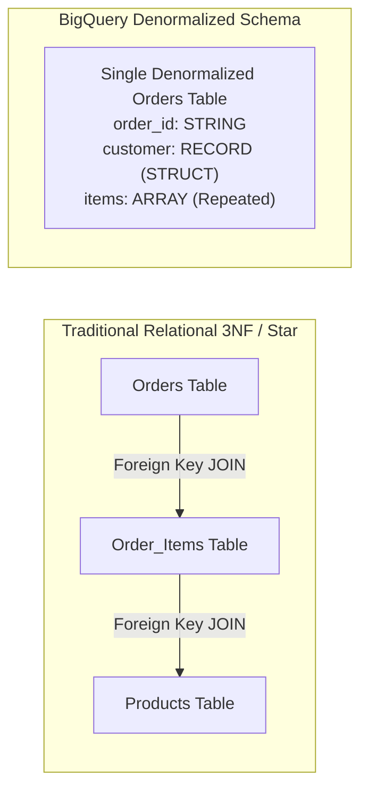
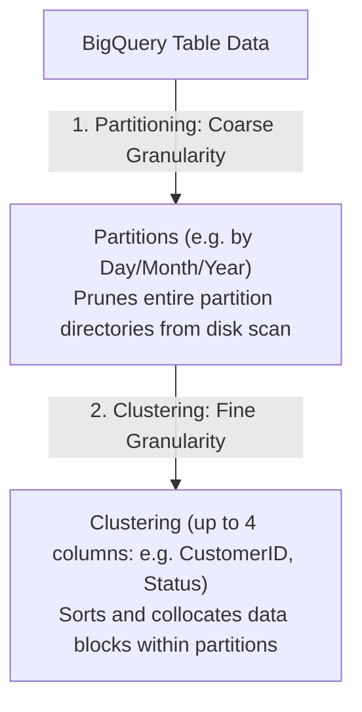

# 3.2 Data Warehousing con BigQuery

BigQuery es el data warehouse analítico serverless, completamente administrado y a escala de petabytes de Google Cloud. Dominar el modelado de datos, particionamiento, clustering y la mecánica de almacenamiento de BigQuery es esencial para el examen PDE.

---

## 🏛️ Modelado de Datos: Normalización vs. Desnormalización (Campos Anidados y Repetidos)

Los data warehouses tradicionales on-premises dependen de schemas altamente normalizados (3NF) o schemas tipo Star / Snowflake con claves foráneas estrictas para conservar espacio en disco.

En BigQuery, **el cómputo y el almacenamiento están físicamente desacoplados**. El espacio en disco en Colossus es económico, pero el shuffle de datos a través de la red durante operaciones `JOIN` de tablas grandes consume costoso tiempo de slots. Por lo tanto, el principio de diseño óptimo en BigQuery es la **desnormalización usando campos Anidados y Repetidos**.



### Por qué los Campos Anidados y Repetidos Son Superiores en BigQuery:
1. **Preserva las Relaciones Internamente**: BigQuery almacena los datos en formato columnar Capacitor. Un registro anidado (`STRUCT`) y un campo repetido (`ARRAY`) mantienen los elementos hijos co-localizados en los mismos bloques físicos de disco junto con su fila padre.
2. **Joins sin Shuffle**: Elimina los costosos shuffles distribuidos y las operaciones `JOIN` entre nodos del cluster.
3. **Integridad de Datos**: Elimina las anomalías de producto cartesiano al unir tablas hijas de múltiples niveles con relaciones uno-a-muchos.

### Ejemplo de DDL SQL: Structs y Arrays
```sql
CREATE TABLE `ecommerce.orders`
(
  order_id STRING NOT NULL,
  order_timestamp TIMESTAMP NOT NULL,
  customer STRUCT<
    id STRING,
    name STRING,
    email STRING
  >,
  items ARRAY<STRUCT<
    product_id STRING,
    sku STRING,
    quantity INT64,
    price NUMERIC
  >>,
  shipping_address STRUCT<
    city STRING,
    state STRING,
    postal_code STRING
  >
)
PARTITION BY DATE(order_timestamp)
CLUSTER BY customer.id, shipping_address.state;
```

### Consultas de Registros Anidados y Repetidos con `UNNEST`:
```sql
-- Flatten the items array to calculate product-level sales
SELECT
  o.order_id,
  o.customer.name,
  item.product_id,
  item.quantity * item.price AS line_total
FROM
  `ecommerce.orders` AS o,
  UNNEST(o.items) AS item
WHERE
  DATE(o.order_timestamp) = '2026-11-01';
```

---

## ✂️ Estrategias de Particionamiento y Clustering

Optimizar los patrones de acceso a datos reduce drásticamente el tiempo de ejecución de consultas y el costo financiero (con precios bajo demanda, BigQuery cobra por byte escaneado).



### 1. Particionamiento de Tablas
El particionamiento divide una tabla grande en segmentos físicos distintos. Cuando una consulta contiene un filtro de partición (por ejemplo, `WHERE order_date >= '2026-01-01'`), BigQuery **poda** todas las demás particiones, escaneando cero bytes para las fechas no seleccionadas.

#### Tipos de Particionamiento:
- **Particionamiento por unidad de tiempo**: Particionado por columna de tipo `DATE`, `DATETIME` o `TIMESTAMP` (por ejemplo, diario, mensual o anual).
- **Particionamiento por tiempo de ingesta**: Particionado automáticamente por la pseudo-columna `_PARTITIONDATE` o `_PARTITIONTIME` cuando se cargan los registros.
- **Particionamiento por rango de enteros**: Particionado por una columna de enteros con parámetros definidos de `start`, `end` e `interval` (por ejemplo, rangos de cuentas de clientes `1-10000`, `10001-20000`).

> ⚠️ **Alerta de Cuota del Examen**: Una tabla de BigQuery soporta un máximo de **10,000 particiones**. Si particionas diariamente, tu tabla puede almacenar más de 27 años de datos. Particionar por hora permite aproximadamente 1.1 años.

### 2. Clustering de Tablas
El clustering ordena automáticamente los datos según los valores de una a cuatro columnas especificadas. Agrupa los datos relacionados en los mismos bloques de almacenamiento.

#### Comparación entre Particionamiento y Clustering

| Característica | Particionamiento | Clustering |
| :--- | :--- | :--- |
| **Cantidad de Columnas** | Exactamente **una** columna | **Una a cuatro** columnas (¡el orden importa!) |
| **Previsibilidad de Costos** | Conocido de antemano antes de ejecutar la consulta (mostrado en el validador de consultas) | Desconocido de antemano; la reducción de costos se materializa en tiempo de ejecución |
| **Cardinalidad** | Cardinalidad baja a moderada (máximo 10,000 valores distintos) | Columnas de alta cardinalidad (por ejemplo, `user_id`, `device_id`, `uuid`) |
| **Mantenimiento** | Ninguno | El re-clustering automático se ejecuta en segundo plano sin costo |

### Mejor Práctica: ¡Combina Ambos!
```sql
CREATE TABLE `analytics.transactions`
(
  tx_id STRING,
  user_id STRING,
  country_code STRING,
  amount NUMERIC,
  created_at TIMESTAMP
)
PARTITION BY DATE(created_at)
CLUSTER BY user_id, country_code;
```

---

## 🔍 Índices de Búsqueda en BigQuery

Para consultas de logs no estructurados o semi-estructurados con alta cardinalidad (por ejemplo, buscar una dirección IP específica o un mensaje de error en logs de texto/JSON), los escaneos completos son costosos.
- Crea un **Search Index**:
  ```sql
  CREATE SEARCH INDEX log_text_idx ON `monitoring.system_logs`(ALL COLUMNS);
  ```
- Usa la función `SEARCH()` en las consultas:
  ```sql
  SELECT * FROM `monitoring.system_logs`
  WHERE SEARCH(log_message, '`Out of Memory`');
  ```
  ¡BigQuery utiliza el índice invertido para omitir completamente los bloques que no coinciden!

---

## 🎯 Punto de Control: Escenario de Práctica para el Examen

### Escenario:
Una plataforma de streaming de medios registra heartbeats de reproducción de video en BigQuery a una tasa de 100 millones de filas por día. Los analistas de datos ejecutan rutinariamente dos tipos de consultas:
1. Dashboards agregados diarios filtrados por fecha (`WHERE event_timestamp BETWEEN '2026-10-01' AND '2026-10-07'`).
2. Investigaciones forenses profundas filtradas por fecha Y un usuario específico (`WHERE user_id = 'usr_98124'`).

Actualmente, la tabla no está particionada y las consultas escanean múltiples terabytes, lo que resulta en altos costos de consulta y ejecución lenta.

**¿Cómo debería el ingeniero de datos rediseñar la tabla de BigQuery para optimizar el rendimiento y minimizar los costos?**

- **A.** Particionar la tabla por `user_id` y aplicar clustering por `event_timestamp`.
- **B.** Particionar la tabla por `DATE(event_timestamp)` y aplicar clustering por `user_id`.
- **C.** Fragmentar la tabla en tablas diarias individuales (`heartbeats_20261001`, `heartbeats_20261002`) y consultar con comodines de tabla.
- **D.** Crear una Materialized View para cada usuario en la plataforma.

> **Respuesta Correcta: B**  
> **Explicación**: Particionar por `DATE(event_timestamp)` poda todos los días innecesarios para ambos tipos de consulta, reduciendo drásticamente los bytes escaneados. Aplicar clustering por `user_id` dentro de esas particiones de fecha asegura que las consultas forenses dirigidas a un usuario específico de alta cardinalidad solo lean los bloques de almacenamiento específicos que contienen los datos de ese usuario. La fragmentación de tablas (Opción C) se considera un anti-patrón en Google Cloud y se desaconseja fuertemente en favor del particionamiento nativo. No se puede particionar por un string de alta cardinalidad como `user_id` (Opción A), ya que BigQuery limita las tablas a 10,000 particiones.
