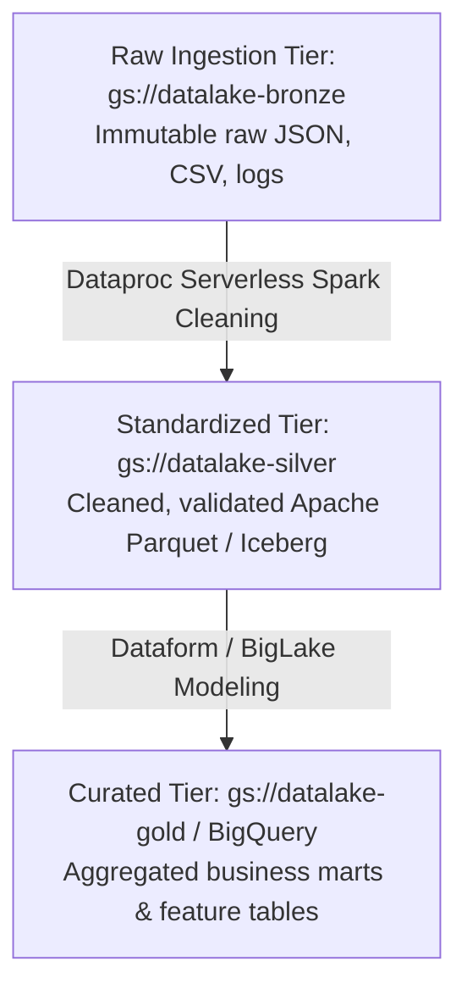
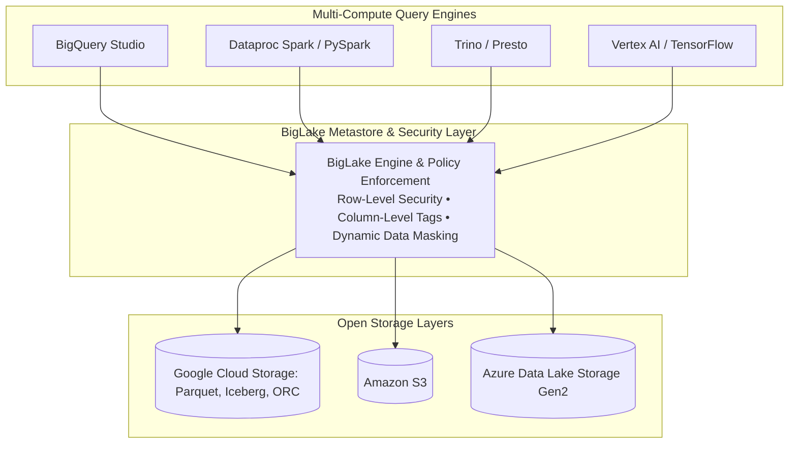
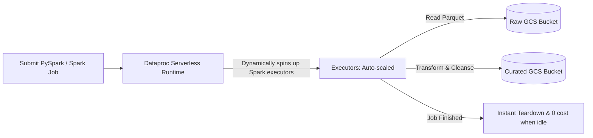

# 3.3 Arquitecturas de Data Lake y BigLake

Un data lake en Google Cloud proporciona almacenamiento duradero y rentable para datos estructurados, semi-estructurados y no estructurados a escala de exabytes utilizando Cloud Storage (GCS) y BigLake.

---

## 🌊 Cloud Storage (GCS) como Base del Data Lake Empresarial

Cloud Storage actúa como el repositorio principal del data lake en Google Cloud gracias a su durabilidad anual de 99.999999999% (11 nueves), escala virtualmente ilimitada y control de acceso granular.



### Convenciones de Particionamiento por Directorios (Hive Partitioning)
Al almacenar archivos Parquet u ORC en GCS, estructurar los directorios con pares clave-valor permite que los motores de consulta (BigQuery, Spark, Presto) realicen automáticamente la poda de particiones:
```
gs://my-datalake/events/dt=2026-11-01/region=US/part-0001.parquet
gs://my-datalake/events/dt=2026-11-01/region=EU/part-0002.parquet
gs://my-datalake/events/dt=2026-11-02/region=US/part-0003.parquet
```

---

## 💎 BigLake: Motor de Almacenamiento Unificado con Gobernanza Granular

Históricamente, los ingenieros de datos enfrentaban un dilema:
- **Almacenamiento Nativo de BigQuery**: Proporciona seguridad granular (a nivel de columna, a nivel de fila, enmascaramiento de datos), pero requiere copiar los archivos al almacenamiento propietario de BigQuery.
- **Tablas Externas de GCS**: Formatos de archivo abiertos (Parquet, ORC, Iceberg), pero el acceso era binario (permisos de todo o nada a nivel de bucket en GCS) y el rendimiento de las consultas se veía afectado.

**BigLake resuelve este dilema** desacoplando el cómputo y la gobernanza del formato de almacenamiento.



### Superpoderes Arquitectónicos de BigLake:
1. **Delegación de Acceso mediante Service Connections**:
   - Los usuarios finales y analistas no necesitan permisos de lectura sobre los buckets subyacentes de GCS.
   - Las consultas se conectan a través de un **BigQuery Connection Resource**, que utiliza una cuenta de servicio dedicada para acceder a los archivos de forma segura.
2. **Seguridad Granular a Nivel de Columna y Fila sobre Formatos Abiertos**:
   - Puedes aplicar policy tags de BigQuery y seguridad a nivel de fila directamente a tablas Parquet o Iceberg que residen en GCS ¡sin mover los archivos!
3. **Aceleración del Rendimiento de Almacenamiento**:
   - Almacena en caché los metadatos externos y aprovecha BigQuery BI Engine para acelerar las consultas sobre archivos en GCS.

### Creación de una Tabla BigLake sobre Parquet en GCS:
```sql
CREATE EXTERNAL TABLE `enterprise_lake.sales_biglake`
WITH CONNECTION `us-central1.gcs_lake_connection`
OPTIONS (
  format = 'PARQUET',
  uris = ['gs://enterprise-datalake/sales/*.parquet'],
  hive_partition_uri_prefix = 'gs://enterprise-datalake/sales/'
);
```

---

## ⚡ Procesamiento de Datos del Lake con Dataproc Serverless

Los data lakes legacy requieren aprovisionar, dimensionar y administrar clusters permanentes de VMs con Hadoop/Spark. **Dataproc Serverless** elimina la gestión de clusters por completo.



### Comando CLI para Enviar un Job Spark con Dataproc Serverless:
```bash
gcloud dataproc batches submit pyspark gs://my-scripts/cleanse_lake.py \
    --project=my-data-project \
    --region=us-central1 \
    --deps-bucket=gs://my-lake-staging \
    --subnet=default
```
- No es necesario crear ni eliminar clusters.
- La facturación se cobra estrictamente por segundo de CPU y memoria utilizados por el driver y los executors de Spark.

---

## 🎯 Punto de Control: Escenario de Práctica para el Examen

### Escenario:
Una organización de ciencia de datos almacena 3 PB de datos crudos y curados en formato Apache Parquet en Google Cloud Storage. El Director de Cumplimiento exige que:
1. Los analistas solo puedan consultar registros relevantes para sus respectivos territorios geográficos de ventas (seguridad a nivel de fila).
2. Los números de tarjetas de crédito almacenados en los archivos Parquet deben estar enmascarados para los usuarios que no pertenecen al área de finanzas (enmascaramiento de datos a nivel de columna).
3. Los científicos de datos deben poder continuar ejecutando consultas en Spark y BigQuery sobre los archivos Parquet sin procesar sin duplicar los datos en almacenamiento propietario.

**¿Qué arquitectura cumple con todos los requisitos de cumplimiento y consulta?**

- **A.** Ingestar todos los archivos Parquet en tablas administradas estándar de BigQuery y eliminar los archivos de GCS.
- **B.** Implementar tablas BigLake sobre los archivos Parquet en GCS, definir políticas de acceso a nivel de fila en BigQuery y aplicar policy tags de taxonomía de Dataplex para el enmascaramiento a nivel de columna.
- **C.** Crear buckets de GCS separados para cada territorio geográfico y duplicar los archivos filtrados usando Cloud Functions.
- **D.** Depender de permisos de archivo POSIX en Cloud Storage para restringir el acceso a directorios.

> **Respuesta Correcta: B**  
> **Explicación**: **BigLake** extiende la gobernanza empresarial de BigQuery—incluyendo Seguridad a Nivel de Fila (RLS), Seguridad a Nivel de Columna (CLS) y enmascaramiento dinámico de datos—directamente a formatos de tablas abiertas (Parquet, ORC, Iceberg) en Cloud Storage sin copiar los datos a BigQuery. Cloud Storage por sí solo (Opciones C y D) solo soporta ACLs/IAM a nivel de bucket u objeto y no puede evaluar filtros de fila ni máscaras de columna.
