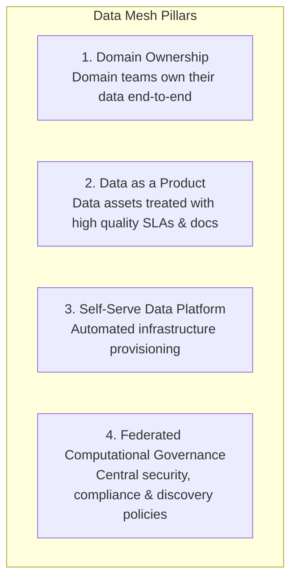
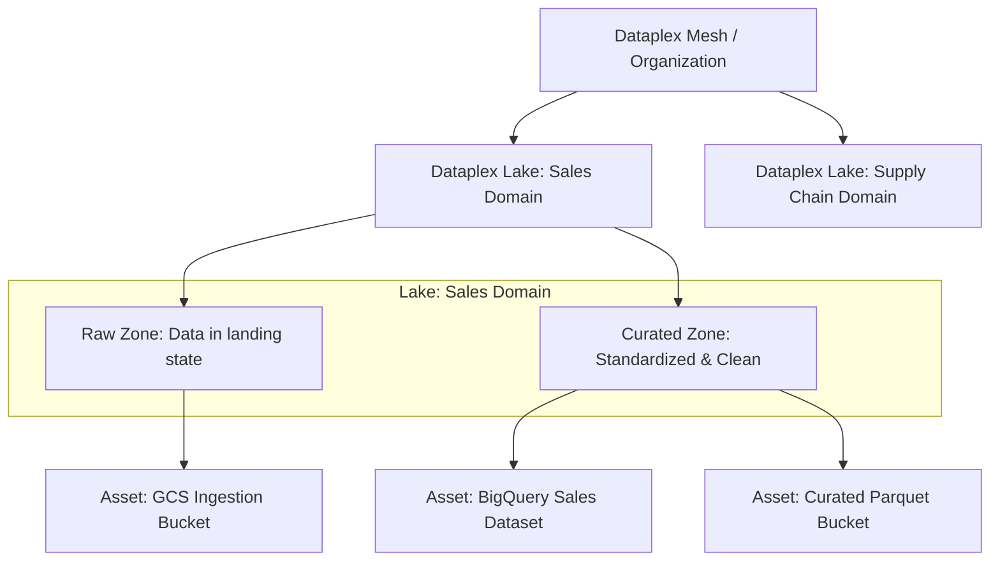

# 3.4 Plataforma de Datos Moderna con Dataplex y Data Mesh

Las organizaciones empresariales con cientos de equipos y petabytes de datos enfrentan un problema común: los data lakes monolíticos centralizados se convierten en cuellos de botella operativos. Google Cloud implementa el patrón **Data Mesh** de forma nativa a través de **Dataplex**.

---

## 🕸️ El Paradigma Data Mesh en Google Cloud

Data Mesh transforma la arquitectura de datos, pasando de equipos de ingeniería centralizados a una propiedad descentralizada orientada por dominios:



### Mapeo de Data Mesh a Servicios de Google Cloud:
- **Dominios**: Proyectos individuales de GCP pertenecientes a unidades de negocio funcionales (por ejemplo, `finance-domain`, `supply-chain-domain`).
- **Productos de Datos**: Tablas de BigQuery, vistas, tablas de BigLake y buckets de GCS curados para consumidores.
- **Gobernanza Central y Catálogo**: **Dataplex** y **Dataplex Catalog**.
- **Compartición de Datos**: **Analytics Hub**.

---

## 🏛️ Jerarquía Estructural de Dataplex

Dataplex administra datos distribuidos sin requerir el movimiento físico de datos a un solo proyecto central.



### Componentes:
1. **Dataplex Lake**: Un contenedor lógico que representa un dominio de negocio o un límite regulatorio.
2. **Dataplex Zone**: Una categoría dentro de un Lake:
   - **Raw Zone**: Contiene datos en estado crudo y sin curar. Requisitos de formato flexibles.
   - **Curated Zone**: Contiene datos limpios y curados listos para consumo en producción. Requiere formatos estructurados/columnares (Parquet, ORC, Avro, tablas nativas de BigQuery).
3. **Dataplex Asset**: Apunta a buckets físicos de Cloud Storage o datasets de BigQuery. ¡El almacenamiento subyacente permanece físicamente en su proyecto original de GCP!

---

## 🔍 Dataplex Catalog y Descubrimiento Automatizado de Datos

- **Rastreo Automático de Metadatos**: Dataplex escanea automáticamente los buckets de Cloud Storage, extrae schemas (JSON, CSV, Avro, Parquet), los registra como tablas externas en BigQuery y los indexa en Dataplex Catalog.
- **Perfilado de Datos**: Dataplex ejecuta jobs de perfilado automatizados que calculan estadísticas de columnas (mínimo, máximo, porcentajes de nulos, conteos de valores distintos, distribuciones de cuartiles) sin exponer PII sin procesar.
- **Tareas de Calidad de Datos**: Define reglas declarativas en YAML (o aserciones en Cloud Storage / BigQuery) que se ejecutan de forma programada:
  ```yaml
  rules:
    - column: customer_id
      ruleType: NOT_NULL
    - column: order_total
      ruleType: VALUE_RANGE
      threshold: 1.0
      params:
        minValue: 0
    - column: email
      ruleType: REGEX_MATCH
      params:
        regex: "^[A-Za-z0-9._%+-]+@[A-Za-z0-9.-]+\\.[A-Za-z]{2,}$"
  ```
- **Alertas Automatizadas**: Publica las fallas en métricas de calidad de datos directamente en Cloud Monitoring y Cloud Logging.

---

## 🎯 Punto de Control: Escenario de Práctica para el Examen

### Escenario:
Un conglomerado global opera 15 unidades de negocio distintas en múltiples continentes. Cada unidad opera sus propios proyectos independientes de Google Cloud con presupuestos y equipos de ingeniería separados. El Director de Datos (CDO) desea establecer una arquitectura de gobernanza de datos corporativa que:
1. Permita a cada unidad de negocio retener completa autonomía sobre sus pipelines de datos y recursos de almacenamiento.
2. Permita a los analistas de datos multifuncionales descubrir y buscar todos los datasets corporativos en las 15 unidades de negocio desde un solo portal.
3. Escanee automáticamente en busca de violaciones a las reglas de calidad de datos y aplique etiquetas de seguridad unificadas a nivel de columna de forma centralizada.

**¿Qué enfoque arquitectónico cumple con estos requisitos?**

- **A.** Obligar a las 15 unidades de negocio a replicar sus datos diariamente en un único dataset centralizado de BigQuery en un proyecto raíz corporativo.
- **B.** Implementar una arquitectura Data Mesh usando Dataplex, registrando los buckets de GCS y los datasets de BigQuery de cada unidad de negocio como Assets de Dataplex organizados en Lakes por dominio, con metadatos centralizados indexados en Dataplex Catalog.
- **C.** Usar gsutil rsync para copiar todos los archivos a un cluster Hadoop on-premises para indexación de metadatos.
- **D.** Escribir scripts personalizados en Python para consultar las tablas de metadatos de BigQuery cada hora y almacenar los resultados en Cloud SQL.

> **Respuesta Correcta: B**  
> **Explicación**: **Dataplex** es la solución nativa de Google Cloud para implementar un **Data Mesh** federado. Permite que las unidades de negocio individuales mantengan la propiedad física y la autonomía sobre sus activos de almacenamiento en sus propios proyectos, mientras proporciona descubrimiento centralizado de metadatos, inferencia automática de schemas, perfilamiento de datos, validación de calidad de datos y políticas de seguridad unificadas a través de Lakes y Zones orientados por dominio. Centralizar los datos físicamente en un solo proyecto (Opción A) crea un cuello de botella administrativo y viola la autonomía de los dominios.
