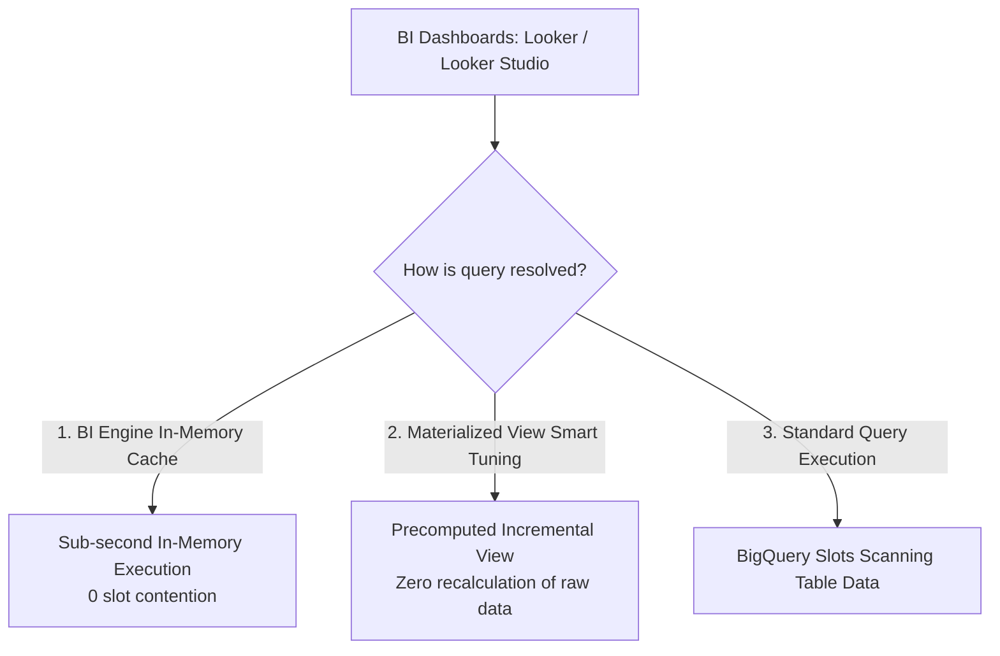
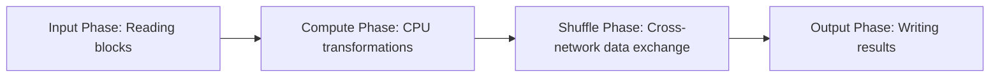
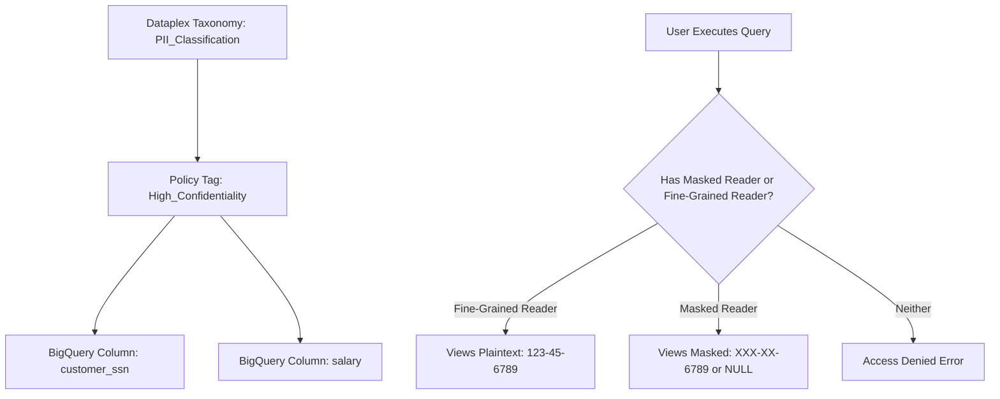

# 4.1 Preparación de Datos para Visualización y Optimización de Consultas

Conectar dashboards de business intelligence (Looker, Looker Studio, Tableau) a BigQuery requiere estrategias para evitar la lentitud de los dashboards, reducir el agotamiento de slots y aplicar control de acceso detallado.

---

## 🏎️ BigQuery BI Engine y Materialized Views



### 1. BigQuery BI Engine
- **Qué es**: Un servicio de análisis rápido en memoria integrado directamente en BigQuery.
- **Cómo funciona**: Almacena en caché columnas de tablas y segmentos de particiones a los que se accede con frecuencia en RAM de alta velocidad.
- **Ventaja clave**: Ofrece **tiempos de respuesta inferiores a un segundo** para dashboards interactivos sin requerir modificaciones de ETL ni la extracción de datos a cubos de memoria de BI externos.
- **Asignación**: Se configura por proyecto y región (por ejemplo, asigna 50 GB de capacidad de BI Engine en `us-central1`).

### 2. Materialized Views (MVs)
Las Materialized Views precalculan y almacenan en caché los resultados de una consulta para lograr un rendimiento extremadamente rápido.

#### Superpoderes de las Materialized Views de BigQuery:
1. **Actualización incremental**: Cuando se agregan nuevos datos a la tabla base, BigQuery solo procesa el delta y actualiza la vista automáticamente sin volver a leer toda la tabla.
2. **Smart Tuning (reescritura transparente de consultas)**: Si un analista escribe una consulta contra la **tabla base**, el optimizador de consultas de BigQuery redirige automáticamente la consulta para leer desde la Materialized View si resulta más económico y rápido. ¡El usuario ni siquiera necesita hacer referencia al nombre de la MV en su SQL!
3. **Alineación de particiones**: Las MVs heredan y se alinean con el particionamiento de la tabla base.

```sql
-- Creating an auto-refreshing Materialized View
CREATE MATERIALIZED VIEW `analytics.mv_daily_sales_by_category`
PARTITION BY order_date
CLUSTER BY category_id
OPTIONS (enable_refresh = true, refresh_interval_minutes = 30)
AS
SELECT
  DATE(order_timestamp) AS order_date,
  category_id,
  COUNT(order_id) AS total_orders,
  SUM(order_total) AS total_revenue
FROM
  `analytics.orders`
GROUP BY
  order_date, category_id;
```

---

## 🔬 Solución de Problemas en Consultas de BigQuery con Bajo Rendimiento

Cuando las consultas se ejecutan lentamente o consumen capacidad de slots inesperada, usa el **BigQuery Execution Graph** e `INFORMATION_SCHEMA` para identificar los cuellos de botella de rendimiento.



### Identificación de Cuellos de Botella en el Plan de Ejecución:

| Síntoma en el Execution Graph | Causa Raíz | Solución de Optimización |
| :--- | :--- | :--- |
| **Alto `Wait Ms`** | **Contención de slots**: La consulta está en cola esperando slots de cómputo disponibles. | Aumenta los slots de línea base de la reserva o compra slots de escalado automático; programa las consultas batch no críticas fuera de las horas pico usando la prioridad `BATCH`. |
| **Sesgo de datos (retraso del worker final)** | Un worker procesa millones de filas más que otros workers paralelos debido a claves `JOIN` o `GROUP BY` desequilibradas (por ejemplo, millones de registros con `NULL` o con la clave predeterminada `0`). | Filtra las claves `NULL` antes de unir, o aplica salting a las claves de join sesgadas. |
| **Derrame a disco (Shuffle Spill)** | Desbordamiento de memoria intermedia durante `JOIN` u `ORDER BY` intensivos. El worker se quedó sin RAM y tuvo que paginar datos a disco persistente. | Filtra temprano; evita `CROSS JOIN` cartesianos entre múltiples tablas sin filtros; aplica los filtros `WHERE` antes de los joins. |
| **Bytes escaneados masivos** | Tabla no particionada o consulta sin filtro de partición (por ejemplo, usar `WHERE DATE(timestamp_col) = ...` en lugar de filtrar directamente por la columna de timestamp particionada). | Particiona y aplica clustering a la tabla; asegúrate de que la cláusula `WHERE` haga referencia a la columna particionada exacta sin funciones que la envuelvan. |

---

## 🛡️ Seguridad a Nivel de Columna y Enmascaramiento Dinámico de Datos

La gobernanza de datos con frecuencia exige que los analistas junior o el personal regional puedan ver agregados analíticos sin ver atributos sensibles (como SSNs, salarios o correos electrónicos).



### Pasos de Implementación:
1. **Crea la taxonomía y los policy tags**: En Dataplex / Data Catalog, crea una taxonomía (por ejemplo, `Security_Tier`) con policy tags (`PII_High`, `Confidential`).
2. **Asigna policy tags al schema de BigQuery**:
   ```sql
   ALTER TABLE `customer_data.profiles`
   ALTER COLUMN ssn
   SET DATA POLICY `projects/my-proj/locations/us/dataPolicies/ssn_mask_policy`;
   ```
3. **Configura las reglas de enmascaramiento dinámico de datos**:
   - **Enmascaramiento predeterminado**: Devuelve el valor predeterminado (`""`, `0`, `1970-01-01`).
   - **Hash (SHA-256)**: Devuelve un hash criptográfico irreversible.
   - **Enmascaramiento parcial**: Muestra los primeros/últimos caracteres (por ejemplo, `***-**-6789`).
   - **Nullify**: Reemplaza con `NULL`.

---

## 🎯 Punto de Control: Escenario de Práctica para el Examen

### Escenario:
Un dashboard ejecutivo de comercio minorista en Looker Studio se conecta directamente a una tabla BigQuery no particionada de 20 TB que contiene tres años de eventos de pedidos. Durante las sesiones informativas matutinas de la dirección, más de 50 gerentes abren el dashboard simultáneamente. Las consultas del dashboard tardan más de 45 segundos en cargar, alcanzan repetidamente los límites de cuota de slots del proyecto y generan costos masivos de consultas bajo demanda. Los datos de pedidos subyacentes se actualizan una vez por hora.

**¿Qué combinación de acciones resuelve los problemas de latencia, contención de slots y costo con el mínimo de gestión continua? (Elige dos)**

- **A.** Fragmentar la tabla de pedidos en 1,000 tablas separadas por ID de tienda.
- **B.** Particionar la tabla base por fecha y aplicar clustering por tienda y categoría de producto.
- **C.** Habilitar y asignar capacidad de **BigQuery BI Engine** para el proyecto de analítica.
- **D.** Escribir un script de Python para exportar la tabla a archivos CSV en discos de Compute Engine cada mañana.
- **E.** Migrar toda la tabla a Cloud Memorystore for Redis.

> **Respuestas Correctas: B y C**  
> **Explicación**: El particionamiento por fecha y el clustering por las dimensiones del dashboard que se filtran con frecuencia (tienda y producto) reducen drásticamente el volumen de datos escaneados por BigQuery. Asignar memoria de **BigQuery BI Engine** almacena en caché los campos del dashboard consultados con frecuencia en RAM ultrarrápida, ofreciendo tiempos de respuesta inferiores a un segundo para docenas de usuarios concurrentes de Looker Studio mientras reduce drásticamente el consumo de slots. La fragmentación de tablas (Opción A) y la exportación a CSV (Opción D) son anti-patrones, mientras que Redis (Opción E) no puede realizar agregaciones SQL complejas de múltiples columnas sobre 20 TB de datos tabulares.
