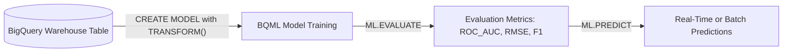
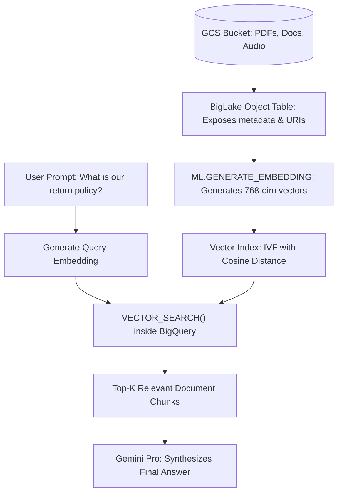

# 4.2 Preparación de Datos para IA, Machine Learning y RAG

Los ingenieros de datos modernos deben cerrar la brecha entre las plataformas de datos empresariales y la inteligencia artificial. El examen Professional Data Engineer evalúa rigurosamente tu capacidad para entrenar modelos con BigQuery ML y preparar conjuntos de datos no estructurados para Vector Search y Retrieval-Augmented Generation (RAG).

---

## 🧠 Machine Learning Dentro del Warehouse: BigQuery ML (BQML)

BigQuery ML democratiza el machine learning al permitir que los ingenieros de SQL entrenen, evalúen y sirvan modelos de ML directamente dentro de BigQuery sin exportar datos a notebooks de Python ni a servidores externos.



### Tipos de Modelos Soportados y Disparadores Comunes del Examen

| Tipo de Modelo | Algoritmo en BQML | Palabra Clave del Examen / Enunciado del Problema |
| :--- | :--- | :--- |
| **Regresión Lineal** | `MODEL_TYPE='LINEAR_REG'` | Predicción de valores numéricos continuos (por ejemplo, predecir el precio de venta de una vivienda o los ingresos futuros). |
| **Clasificación Binaria / Multiclase** | `MODEL_TYPE='LOGISTIC_REG'` o `'BOOSTED_TREE_CLASSIFIER'` | Predicción de resultados categóricos (por ejemplo, churn sí/no, detección de fraude, conversión de clientes). |
| **Pronóstico de Series Temporales** | `MODEL_TYPE='ARIMA_PLUS'` | Pronóstico de demanda de múltiples series temporales con modelado automático de días festivos, estacionalidad y descomposición de tendencias. |
| **Segmentación de Clientes** | `MODEL_TYPE='KMEANS'` | Clustering no supervisado de clientes o transacciones basado en similitudes de comportamiento. |
| **Sistemas de Recomendación** | `MODEL_TYPE='MATRIX_FACTORIZATION'` | Filtrado colaborativo para recomendar productos, películas o artículos basado en matrices de interacción usuario-artículo. |
| **AutoML Tables** | `MODEL_TYPE='AUTOML_CLASSIFIER'` | Búsqueda automatizada de arquitectura neuronal y ajuste de hiperparámetros para obtener la máxima precisión en modelos tabulares. |

### Ejemplo de Código BQML de Extremo a Extremo:
```sql
-- 1. Train a churn classification model with embedded feature preprocessing
CREATE OR REPLACE MODEL `ml_dataset.customer_churn_model`
TRANSFORM(
  ML.STANDARD_SCALER(tenure_months) OVER() AS scaled_tenure,
  ML.QUANTILE_BUCKETIZE(total_spend, 5) OVER() AS spend_bucket,
  country,
  churned
)
OPTIONS(
  model_type = 'BOOSTED_TREE_CLASSIFIER',
  input_label_cols = ['churned'],
  max_iterations = 20,
  auto_class_weights = TRUE
) AS
SELECT
  tenure_months,
  total_spend,
  country,
  churned
FROM
  `ml_dataset.historical_subscribers`;

-- 2. Evaluate model performance
SELECT * FROM ML.EVALUATE(MODEL `ml_dataset.customer_churn_model`);

-- 3. Run batch prediction on new users
SELECT
  user_id,
  predicted_churned,
  predicted_churned_probs
FROM
  ML.PREDICT(
    MODEL `ml_dataset.customer_churn_model`,
    TABLE `ml_dataset.active_subscribers`
  );
```

---

## ⚡ Datos No Estructurados, Vector Search y Arquitecturas RAG

Retrieval-Augmented Generation (RAG) fundamenta los Large Language Models (LLMs) con bases de conocimiento privadas de la empresa. Google Cloud integra este pipeline de forma nativa usando BigLake Object Tables, embeddings de Vertex AI y BigQuery Vector Search.



### 1. BigLake Object Tables
Las object tables exponen archivos no estructurados almacenados en Cloud Storage (PDFs, imágenes, archivos de audio) como tablas de BigQuery que contienen metadatos de archivos (tamaño, tipo de contenido, tiempo de generación) y URLs firmadas seguras.
```sql
CREATE EXTERNAL TABLE `rag_dataset.legal_contracts_objects`
WITH CONNECTION `us-central1.vertex_ai_conn`
OPTIONS (
  object_metadata = 'SIMPLE',
  uris = ['gs://enterprise-contracts/*.pdf']
);
```

### 2. Generación de Embeddings de Texto con SQL
Usando una Cloud AI Connection con Vertex AI, BigQuery puede convertir texto en representaciones vectoriales de alta dimensionalidad directamente en SQL:
```sql
CREATE OR REPLACE TABLE `rag_dataset.contract_embeddings` AS
SELECT
  doc_id,
  content,
  ml_generate_embedding_result AS text_embedding
FROM
  ML.GENERATE_EMBEDDING(
    MODEL `rag_dataset.text_embedding_model`,
    TABLE `rag_dataset.contract_chunks`,
    STRUCT(TRUE AS flatten_json_output)
  );
```

### 3. Creación de un Vector Index para Búsqueda de Similitud de Alta Velocidad
Cuando realizas búsquedas de vecinos más cercanos sobre millones de embeddings vectoriales, un vector index acelera la búsqueda de minutos a milisegundos:
```sql
CREATE VECTOR INDEX contract_vec_idx
ON `rag_dataset.contract_embeddings`(text_embedding)
OPTIONS(
  index_type = 'IVF',
  distance_type = 'COSINE'
);
```

### 4. Ejecución de Vector Search
```sql
SELECT
  base.doc_id,
  base.content,
  distance
FROM
  VECTOR_SEARCH(
    TABLE `rag_dataset.contract_embeddings`,
    'text_embedding',
    (SELECT ml_generate_embedding_result FROM ML.GENERATE_EMBEDDING(
       MODEL `rag_dataset.text_embedding_model`,
       (SELECT 'What are the liability caps for data breach?' AS content)
     )),
    top_k => 5,
    distance_type => 'COSINE'
  );
```

---

## 🎯 Punto de Control: Escenario de Práctica para el Examen

### Escenario:
Una gran red de salud tiene 2,000,000 de documentos PDF de investigación médica almacenados en Google Cloud Storage. Los investigadores clínicos quieren formular preguntas en lenguaje natural en un portal web interno y recibir respuestas que citen los pasajes exactos de los artículos de investigación. El equipo de ingeniería de datos debe diseñar un pipeline serverless y escalable para indexar los documentos y recuperar los párrafos más relevantes semánticamente para el prompt del LLM.

**¿Qué arquitectura proporciona la implementación de Google Cloud más eficiente y escalable?**

- **A.** Escribir un script de Python en Compute Engine para descargar todos los PDFs, extraer el texto y escribir el texto sin procesar en Cloud Memorystore for Redis.
- **B.** Crear una BigLake Object Table sobre los PDFs de Cloud Storage, analizar los fragmentos de texto, generar embeddings usando `ML.GENERATE_EMBEDDING` de BigQuery conectado a Vertex AI, construir un BigQuery Vector Index con distancia Cosine y recuperar los pasajes coincidentes usando `VECTOR_SEARCH()`.
- **C.** Entrenar una red neuronal personalizada de TensorFlow en Dataproc para clasificar cada PDF en 10 categorías estáticas.
- **D.** Cargar los blobs binarios de los PDFs en Cloud Spanner y realizar búsquedas de texto completo con regex.

> **Respuesta Correcta: B**  
> **Explicación**: Las BigLake Object Tables permiten que BigQuery lea y procese documentos no estructurados que residen en Cloud Storage. Generar embeddings vectoriales con `ML.GENERATE_EMBEDDING` y usar `VECTOR_SEARCH()` nativo de BigQuery con un vector index IVF proporciona un mecanismo de recuperación semántica totalmente serverless y altamente optimizado que impulsa sistemas RAG de producción a escala de petabytes. Redis (Opción A) y las regex de Spanner (Opción D) no proporcionan embeddings vectoriales semánticos.
