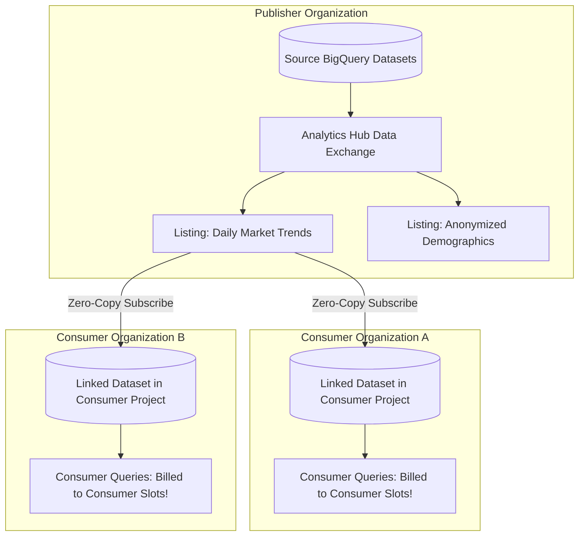
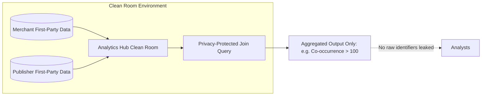
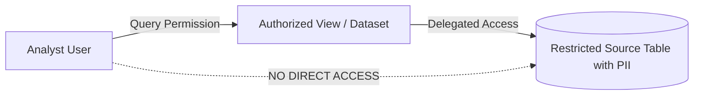

# 4.3 Compartición Segura de Datos y Analytics Hub

Compartir datos entre unidades de negocio corporativas, socios y clientes externos sin crear copias de datos costosas e inseguras es una competencia fundamental en el examen PDE.

---

## 🏛️ Arquitectura de BigQuery Analytics Hub

Históricamente, compartir datos entre organizaciones requería exportar archivos a SFTP o a buckets de GCS, exponiendo a las empresas a filtraciones de seguridad, datos obsoletos y costos masivos de egreso.

**Analytics Hub** permite compartir datos de forma segura, multi-tenant y sin copias (zero-copy) entre organizaciones y proyectos:

### Conceptos Fundamentales de Analytics Hub:
1. **Data Exchange**: Un contenedor seguro para agrupar listings. Puede ser privado (dentro de una organización o con socios invitados) o público (marketplace comercial).
2. **Listing**: Hace referencia a un dataset (o vista) de BigQuery publicado con metadatos, documentación y términos de licencia.
3. **Linked Dataset**: Cuando un suscriptor se suscribe a un listing, se crea un **linked dataset** de solo lectura en su proyecto de BigQuery.
   - **Copia cero de datos**: Los datos no se replican. Las consultas en el proyecto del consumidor leen directamente de los bloques de almacenamiento del publicador.
   - **Frescura en tiempo real**: Cualquier actualización confirmada por el publicador es visible inmediatamente para todos los suscriptores.
   - **Segregación de costos**: **El consumidor paga por los slots de cómputo** usados para consultar el linked dataset. ¡El publicador solo paga por su almacenamiento principal!

---

## 🧼 Clean Rooms Centrados en la Privacidad

En sectores regulados (como publicidad, retail media y salud), varias empresas quieren unir sus datos de first-party (por ejemplo, cruzar impresiones publicitarias con compras en tienda) sin que ninguna empresa revele identidades de clientes sin procesar ni PII.

### Controles de Clean Rooms en BigQuery:
- **Reglas de análisis**: Los publicadores adjuntan reglas que restringen qué consultas se pueden ejecutar (por ejemplo, prohibir `SELECT *`, exigir umbrales mínimos de agregación como `COUNT() >= 50` para prevenir ataques de privacidad diferencial).
- **Protecciones de columnas**: Ciertas columnas solo se pueden usar en cláusulas `JOIN` y no pueden aparecer en la proyección `SELECT` de salida.

---

## 👁️ Vistas Autorizadas y Datasets Autorizados

Cuando compartes porciones específicas de datos dentro de la misma organización sin otorgar permisos directos a las tablas:

- **Vista Autorizada**: Te permite compartir resultados de consultas (con filtros de filas, agregaciones o exclusiones de columnas) con usuarios específicos sin darles acceso a las tablas subyacentes.
- **Dataset Autorizado**: Autoriza un dataset completo que contiene múltiples vistas para consultar un dataset de origen, simplificando la gestión de permisos para grandes suites de informes.

---

## 🎯 Punto de Control: Escenario de Práctica para el Examen

### Escenario:
Una agencia de investigación de mercados agrega tendencias de transacciones con tarjeta de crédito de cientos de minoristas. La agencia quiere proporcionar a 50 empresas clientes corporativas acceso en tiempo real a benchmarks diarios de ventas por categoría. El líder de ingeniería requiere que:
1. Los datos se compartan sin copiar ni exportar físicamente petabytes de datos a diario.
2. Los clientes vean los nuevos datos de ventas en el segundo en que la agencia los publica.
3. Los costos computacionales de consultar los benchmarks sean pagados por cada empresa cliente, no por la agencia de investigación.

**¿Qué característica de BigQuery debería implementar el ingeniero de datos?**

- **A.** Crear un pipeline de Dataflow que escriba archivos CSV diarios en un bucket público de Cloud Storage.
- **B.** Otorgar el rol `roles/bigquery.dataViewer` al Google Group de cada cliente sobre el dataset interno de BigQuery de la agencia.
- **C.** Publicar los datasets en un **Analytics Hub Data Exchange** y hacer que los clientes se suscriban para crear linked datasets en sus propios proyectos de Google Cloud.
- **D.** Escribir un script de Python para ejecutar `EXPORT DATA` en el proyecto de BigQuery individual de cada cliente cada medianoche.

> **Respuesta Correcta: C**  
> **Explicación**: **Analytics Hub** permite a los publicadores compartir datasets mediante data exchanges. Los suscriptores crean **linked datasets** en sus propios proyectos de GCP. Se accede a los datos mediante una referencia zero-copy (frescura en tiempo real sin replicación), y los costos de slots de cómputo de las consultas se cargan completamente al proyecto del suscriptor, cumpliendo todos los requisitos del negocio. La Opción B otorga acceso directo a los datasets internos y corre el riesgo de agotar las cuotas de consulta de la agencia o de facturarle las consultas de los clientes. Las Opciones A y D implican una replicación diaria de datos costosa y frágil.
