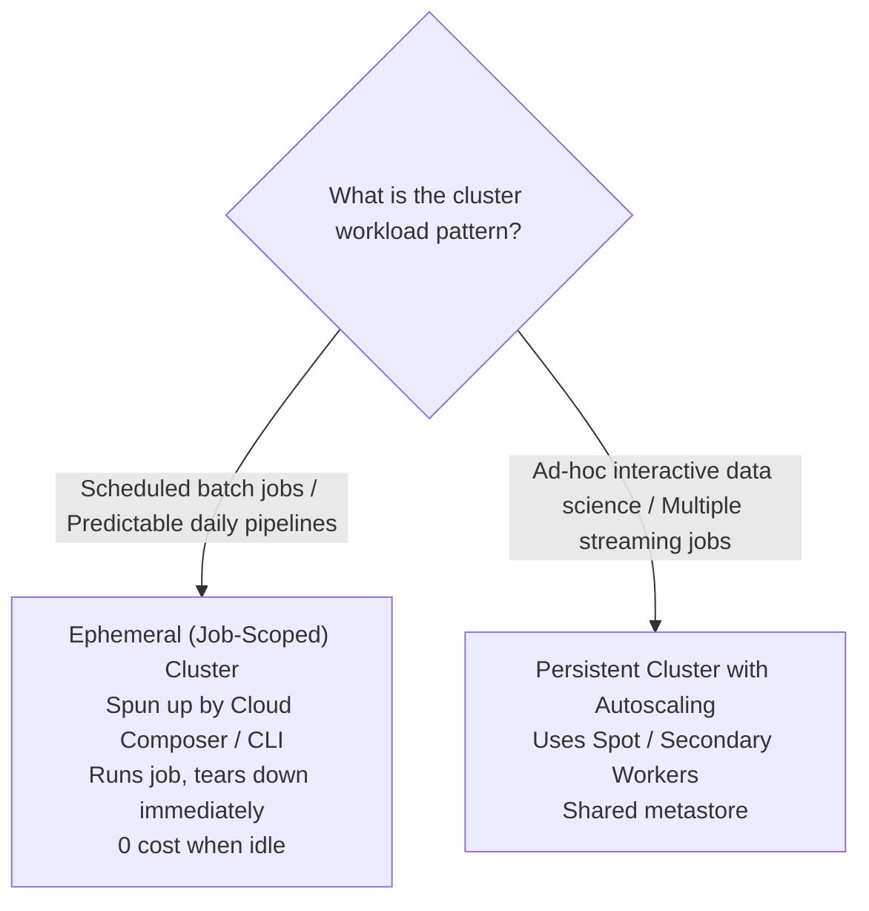
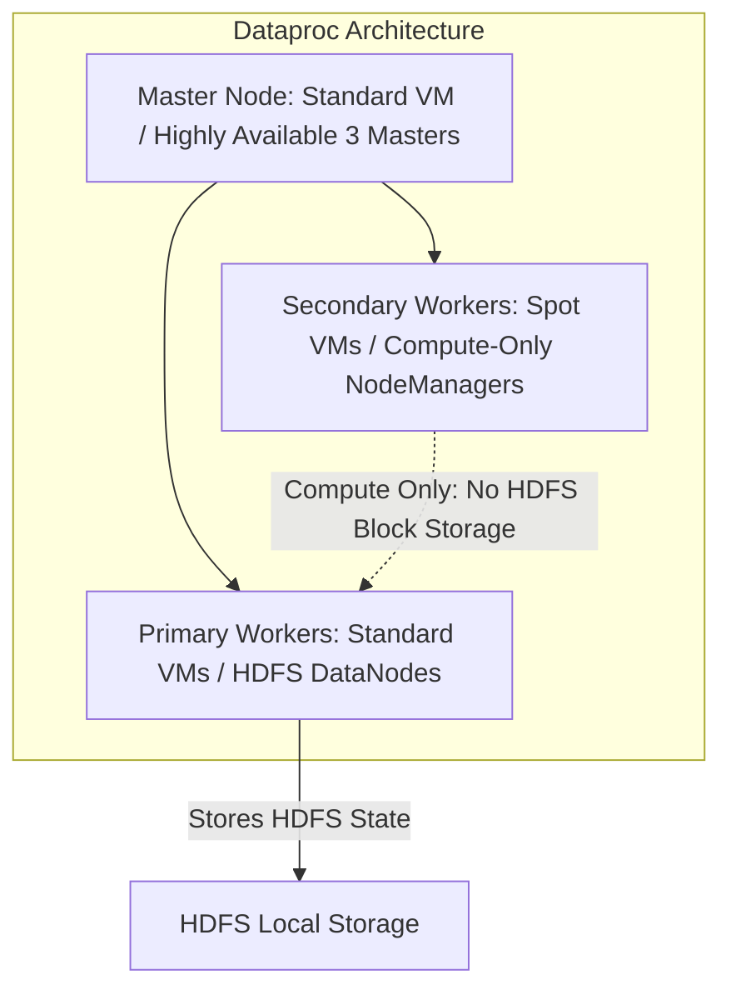

# 5.1 Optimización de Recursos: Cómputo y Costos

Optimizar los recursos de cómputo y almacenamiento permite a las organizaciones maximizar el throughput mientras minimizan los gastos en la nube. En el examen PDE, uno de los enfoques principales es la optimización de los **clusters de Dataproc** y las configuraciones de almacenamiento.

---

## 💻 Dataproc: Clusters efímeros (por trabajo) vs. persistentes

Un dilema operativo común en Google Cloud es si mantener clusters de Dataproc en ejecución continua 24/7 o crear clusters efímeros para cada trabajo.

### Comparación Directa:

| Dimensión | Clusters efímeros (por trabajo) | Clusters persistentes en ejecución |
| :--- | :--- | :--- |
| **Ciclo de Vida** | Se crean específicamente para un único trabajo o workflow; se eliminan en cuanto el trabajo termina. | Se ejecutan 24/7 o durante períodos prolongados de varios meses. |
| **Costo en Inactividad** | **Cero costo en inactividad** (no hay VMs en ejecución cuando no hay trabajo). | Costo significativo en inactividad a menos que se escale agresivamente a cero. |
| **Aislamiento de Trabajos** | Aislamiento completo. Sin riesgo de que un trabajo de Spark con mal comportamiento agote la RAM o haga fallar otro trabajo. | Recursos compartidos; riesgo de contención de recursos y de "vecinos ruidosos". |
| **Flexibilidad de Versiones** | Cada trabajo puede especificar su propia versión de imagen del cluster, versión de Java y librerías de Python. | Actualizar Spark o los paquetes del SO requiere migrar todos los pipelines existentes. |
| **Sobrecarga de Inicio** | Agrega de 90 a 180 segundos de aprovisionamiento del cluster antes de que comience la ejecución del trabajo. | Ejecución inmediata del trabajo (sin retraso de inicio). |
| **Mejor Uso** | Pipelines ETL/ELT nocturnos programados y orquestados por Cloud Composer. | Notebooks interactivos de Jupyter / Zeppelin, descubrimiento de datos ad-hoc, streaming continuo 24/7. |

---

## 💰 Optimización de Costos de Dataproc: Spot VMs y Autoscaling

Para reducir los costos de cómputo de Dataproc hasta en un 60–80%, usa **Secondary Worker Nodes** configurados con **Spot (Preemptible) VMs**.

### Reglas de Oro para Workers Spot en Dataproc:
1. **Master Node**: **Nunca** debe ser Spot/Preemptible. Perder un master termina el cluster.
2. **Primary Workers**: Deben ser VMs estándar persistentes. Los primary workers alojan los daemons DataNode del Hadoop Distributed File System (HDFS). Si demasiados DataNodes desaparecen simultáneamente, HDFS sufre corrupción de datos.
3. **Secondary Workers**: Pueden ser hasta **100% Spot VMs**. Los secondary workers actúan puramente como nodos de cómputo (YARN NodeManagers). Si Google Cloud reclama una Spot VM, ¡YARN simplemente reprograma la tarea afectada en otro worker con cero fallas del trabajo!
4. **Desacopla con el Cloud Storage Connector**:
   - Nunca almacenes datos de entrada o salida de forma permanente en los discos HDFS locales.
   - Usa el **conector nativo de Google Cloud Storage (`gs://`)** como tu capa de almacenamiento. Esto permite crear y destruir clusters a voluntad sin arriesgar la pérdida de datos.

---

## ⚡ Lista de Verificación para la Optimización de Costos de BigQuery

1. **Evita `SELECT *`**: BigQuery cobra según la cantidad de bytes leídos en las columnas consultadas. Proyectar solo las columnas necesarias reduce los costos proporcionalmente.
2. **Filtra siempre por partición**: Asegúrate de que las consultas analíticas especifiquen los límites de partición (`WHERE date_col >= ...`) para podar los segmentos de almacenamiento físico innecesarios.
3. **Aplica un Límite Máximo de Bytes Facturados por Consulta**:
   - Evita consultas descontroladas estableciendo el límite `--maximum_bytes_billed` en las consultas o configurando cuotas personalizadas a nivel de proyecto/usuario.
4. **Usa la Expiración de Tablas y Particiones**: Transiciona o elimina automáticamente las tablas temporales obsoletas.

---

## 🎯 Punto de Control: Escenario de Práctica para el Examen

### Escenario:
Una empresa de analítica de marketing ejecuta un trabajo de Apache Spark todas las noches a las 02:00 UTC que transforma datos de clickstream de clientes. El trabajo tarda 45 minutos en ejecutarse en un cluster de 20 nodos. Durante las 23 horas restantes del día, no se ejecuta ningún trabajo de Spark. La empresa quiere minimizar los costos de cómputo y evitar la proliferación de infraestructura, asegurando al mismo tiempo que no ocurran fallas en el trabajo debido a la interrupción (preemption) de máquinas.

**¿Qué arquitectura debería implementar el ingeniero de datos?**

- **A.** Mantener un cluster de 20 nodos con VMs estándar en ejecución continua 24/7 con un cron job en el nodo master.
- **B.** Usar Cloud Composer para crear un cluster efímero de Dataproc compuesto por 2 nodos primary worker estándar y 18 secondary workers con Spot VMs, ejecutar el trabajo de Spark leyendo y escribiendo desde Cloud Storage, y eliminar automáticamente el cluster al finalizar el trabajo.
- **C.** Aprovisionar un cluster de 20 nodos compuesto completamente por Spot VMs, incluido el nodo master.
- **D.** Ejecutar el trabajo de Spark en una única instancia de Compute Engine con 128 vCPUs.

> **Respuesta Correcta: B**  
> **Explicación**: Los clusters efímeros eliminan 23 horas de costos de cómputo inactivo cada día. Combinar 2 primary workers estándar (que protegen los metadatos de HDFS) con 18 secondary workers de Spot VM reduce el costo de cómputo hasta en un 70%, a la vez que garantiza la resiliencia del trabajo, ya que la interrupción de los secondary workers no causa pérdida de datos ni fallas del cluster. Desacoplar el almacenamiento a GCS (`gs://`) asegura que los datos persistan independientemente del ciclo de vida del cluster. Los nodos master nunca deben ser Spot VMs (Opción C).
