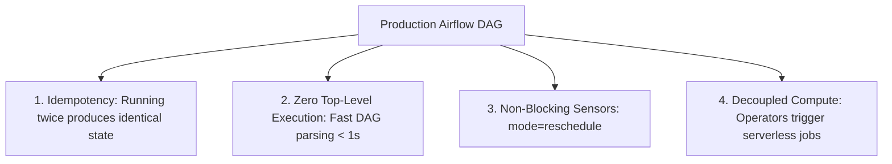

# 5.2 Diseño de Automatización y Mejores Prácticas para DAGs en Cloud Composer

Cloud Composer (Apache Airflow administrado) es la plataforma de orquestación principal de Google Cloud. Escribir DAGs eficientes, resilientes y repetibles requiere apegarse a estrictas mejores prácticas arquitectónicas que se evalúan a fondo en el examen de certificación.

---

## 📐 Principios Fundamentales del Diseño de DAGs Resilientes



### 1. La Regla de la Idempotencia
Una tarea de pipeline es **idempotente** si ejecutarla varias veces con exactamente las mismas entradas produce el mismo estado que ejecutarla una sola vez.
- **Anti-patrón**: Una consulta `INSERT INTO` sin truncamiento ni reemplazo de partición. Reintentar una tarea fallida da como resultado registros duplicados.
- **Mejor Práctica**: En BigQuery, usa `WRITE_TRUNCATE` para las particiones de destino, o usa sentencias SQL `MERGE`:
  ```sql
  MERGE `analytics.daily_users` T
  USING `staging.daily_users` S
  ON T.user_id = S.user_id AND T.date = S.date
  WHEN MATCHED THEN
    UPDATE SET T.session_count = S.session_count
  WHEN NOT MATCHED THEN
    INSERT (user_id, date, session_count) VALUES (S.user_id, S.date, S.session_count);
  ```

### 2. Eliminar el Código de Nivel Superior en los Archivos DAG
El scheduler de Airflow analiza cada archivo Python de la carpeta `dags/` de forma continua (cada 30 segundos).
- ❌ **Anti-patrón**: Colocar consultas a bases de datos, llamadas a APIs o lecturas pesadas de archivos a nivel de módulo global del archivo DAG.
  ```python
  # BAD: This API call runs every 30 seconds on every DAG parsing loop!
  active_users = requests.get("https://api.internal/users").json()
  ```
- ✅ **Mejor Práctica**: Mueve toda la lógica computacional dentro de tareas, operadores o funciones de Python ejecutadas por el `PythonOperator`.

### 3. Optimización de Sensores: `reschedule` vs. `poke`
Al esperar datos upstream (por ejemplo, esperar un archivo en GCS o una partición externa de BigQuery):
- `mode="poke"` (Predeterminado): El proceso del worker permanece activo, ocupando un worker slot y consumiendo recursos del cluster 24/7 mientras duerme entre verificaciones.
- `mode="reschedule"` (Recomendado): El sensor libera el worker slot entre verificaciones y entra en suspensión, permitiendo que otras tareas del pipeline se ejecuten.

```python
wait_for_raw_file = GCSObjectExistenceSensor(
    task_id="wait_for_raw_file",
    bucket="enterprise-landing",
    object="incoming/{{ ds }}/orders.csv",
    mode="reschedule",  # Frees worker slot between checks!
    poke_interval=300,  # Checks every 5 minutes
    timeout=3600,       # Fails after 1 hour
)
```

---

## 🛠️ DAG Completo de Cloud Composer Multi-Servicio

```python
from datetime import datetime, timedelta
from airflow import DAG
from airflow.providers.google.cloud.sensors.gcs import GCSObjectExistenceSensor
from airflow.providers.google.cloud.operators.dataproc import (
    DataprocCreateClusterOperator,
    DataprocSubmitJobOperator,
    DataprocDeleteClusterOperator
)
from airflow.providers.google.cloud.operators.bigquery import BigQueryInsertJobOperator

CLUSTER_NAME = "ephemeral-spark-{{ ds_nodash }}"
PROJECT_ID = "company-analytics"
REGION = "us-central1"

CLUSTER_CONFIG = {
    "master_config": {"num_instances": 1, "machine_type_uri": "n2-standard-4"},
    "worker_config": {"num_instances": 2, "machine_type_uri": "n2-standard-4"},
    "secondary_worker_config": {
        "num_instances": 10,
        "machine_type_uri": "n2-standard-4",
        "is_preemptible": True,
    },
}

with DAG(
    "ecommerce_nightly_etl",
    schedule_interval="0 1 * * *",
    start_date=datetime(2026, 1, 1),
    catchup=False,
    default_args={"retries": 2, "retry_delay": timedelta(minutes=5)},
) as dag:

    # 1. Wait for raw file with non-blocking sensor
    check_file = GCSObjectExistenceSensor(
        task_id="check_file",
        bucket="company-landing",
        object="raw/{{ ds }}/transactions.json",
        mode="reschedule",
        poke_interval=180,
    )

    # 2. Spin up ephemeral Dataproc cluster
    create_cluster = DataprocCreateClusterOperator(
        task_id="create_dataproc_cluster",
        project_id=PROJECT_ID,
        region=REGION,
        cluster_name=CLUSTER_NAME,
        cluster_config=CLUSTER_CONFIG,
    )

    # 3. Submit Spark Job
    submit_spark = DataprocSubmitJobOperator(
        task_id="submit_spark_job",
        project_id=PROJECT_ID,
        region=REGION,
        job={
            "placement": {"cluster_name": CLUSTER_NAME},
            "pyspark_job": {
                "main_python_file_uri": "gs://company-scripts/spark_transform.py",
                "args": ["--date", "{{ ds }}"],
            },
        },
    )

    # 4. Tear down cluster immediately
    delete_cluster = DataprocDeleteClusterOperator(
        task_id="delete_dataproc_cluster",
        project_id=PROJECT_ID,
        region=REGION,
        cluster_name=CLUSTER_NAME,
        trigger_rule="all_done",  # Deletes cluster even if Spark job fails!
    )

    # 5. Refresh BigQuery Data Marts
    refresh_bq = BigQueryInsertJobOperator(
        task_id="refresh_bq_marts",
        configuration={
            "query": {
                "query": "CALL `company-analytics.marts.refresh_sales`('{{ ds }}');",
                "useLegacySql": False,
            }
        },
    )

    check_file >> create_cluster >> submit_spark >> delete_cluster >> refresh_bq
```

---

## 🎯 Punto de Control: Escenario de Práctica para el Examen

### Escenario:
Un equipo de datos mantiene un DAG de Apache Airflow en Cloud Composer con 40 tareas de sensor que esperan que archivos de socios lleguen a un servidor SFTP a lo largo del día. Aunque el throughput general del pipeline es bajo, otros DAGs críticos del entorno se retrasan con frecuencia y quedan en estado "queued", y los Celery workers de Cloud Composer muestran un 100% de utilización de capacidad.

**¿Cuál es la causa raíz y la corrección arquitectónica óptima?**

- **A.** El scheduler de Airflow se ha caído; reinicia el entorno de Cloud Composer.
- **B.** Las tareas de sensor se ejecutan en el modo `poke` predeterminado, ocupando todos los worker slots disponibles mientras duermen; cambia el modo del sensor a `reschedule` para que los worker slots se liberen entre verificaciones.
- **C.** La reparación automática de nodos de GKE está deshabilitando instancias de cómputo; desactiva la reparación automática de GKE.
- **D.** Duplica la cantidad de slots de BigQuery asignados al proyecto.

> **Respuesta Correcta: B**  
> **Explicación**: De forma predeterminada, los sensores de Airflow operan en modo `poke`, lo que bloquea un worker slot activo durante toda la duración del tiempo de espera (incluso mientras duerme). Con 40 sensores haciendo polling de forma continua, todos los worker slots se agotan, dejando sin recursos a otros DAGs y manteniéndolos atascados en el estado "queued". Cambiar los sensores a `mode="reschedule"` hace que la tarea de sensor libere su worker slot y duerma hasta el siguiente intervalo, liberando capacidad de worker para otras tareas.
