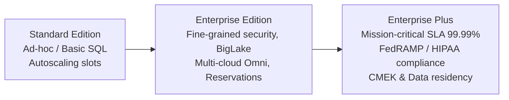
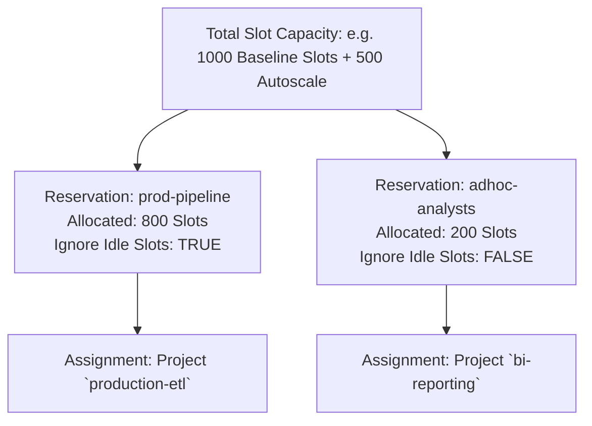
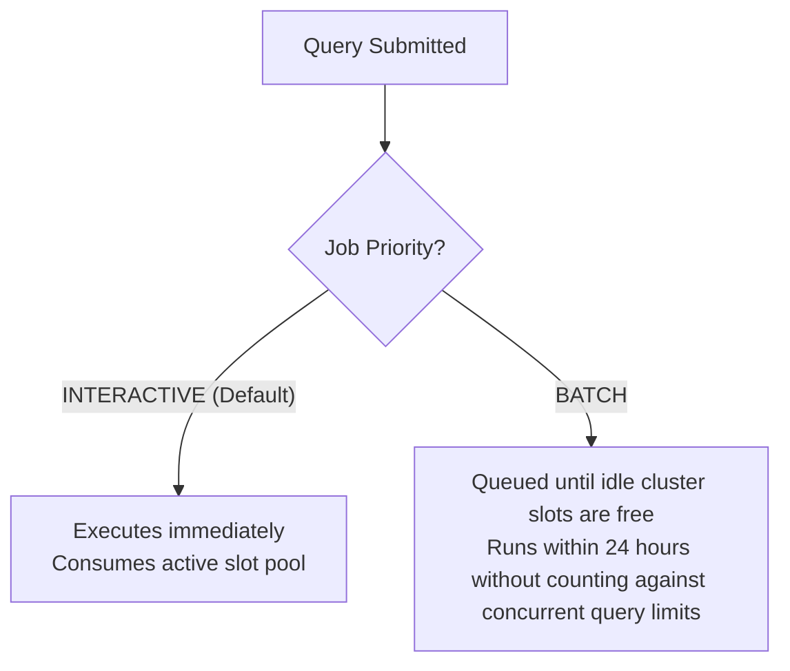

# 5.3 Gestión de Cargas de Trabajo y Capacidad: BigQuery Editions y Slots

Gestionar la capacidad de cómputo asegura que las analíticas críticas para el negocio se ejecuten de manera confiable sin encontrar cuellos de botella por "vecinos ruidosos" ni picos de facturación impredecibles. BigQuery organiza los recursos de cómputo mediante **Editions**, **Reservations** y **Job Prioritization**.

---

## 🏛️ BigQuery Editions: Standard vs. Enterprise vs. Enterprise Plus

Google Cloud estructura la capacidad de BigQuery en tres Editions en niveles, diseñadas para distintos requisitos operativos y de gobernanza:



### Comparación de Características por Edition:

| Característica | Standard | Enterprise | Enterprise Plus |
| :--- | :--- | :--- | :--- |
| **Modelo de Precios** | Slots con autoscaling (pago por slot-hora) | Slots de línea base + slots con autoscaling (compromisos de 1 o 3 años opcionales) | Slots de línea base + slots con autoscaling con los descuentos más altos |
| **Data Masking y Seguridad a Nivel de Columna** | Básico | **Soporte completo** | **Soporte completo** |
| **BigLake Multi-Cloud (Omni)** | No | **Sí** | **Sí** |
| **BigQuery ML** | Soportado | Soportado | Soportado |
| **SLA de Disponibilidad** | 99.9% | 99.99% | **99.99%** |
| **Carga de Trabajo Objetivo** | Consultas analíticas ad-hoc de bajo costo, desarrollo y pruebas | Cargas de trabajo de producción empresariales, gobernanza compleja, BI Engine | Cargas de trabajo financieras y de salud altamente reguladas, DR de misión crítica |

---

## 🎟️ Gestión de Capacidad: Reservations y Asignaciones de Slots

Un **slot** es la unidad de CPU virtual de BigQuery que se usa para ejecutar consultas SQL. Cuando usas BigQuery Editions, la capacidad se gestiona mediante **Reservations**.



### Mecánicas Clave de las Reservations:
1. **Slots de Línea Base**: Slots dedicados aprovisionados de forma continua para manejar cargas de consulta en estado estable.
2. **Slots con Autoscaling**: Se agregan dinámicamente en respuesta a ráfagas de consultas y luego se reducen a cero cuando la demanda disminuye.
3. **Uso Compartido de Slots Inactivos (`ignore_idle_slots = FALSE`)**:
   - Si `prod-pipeline` está inactiva, sus slots no utilizados pueden ser consumidos temporalmente por `adhoc-analysts`.
   - Cuando `prod-pipeline` envía una nueva consulta, recupera inmediatamente sus slots de línea base, limitando las consultas ad-hoc si es necesario.
   - Establece `ignore_idle_slots = TRUE` cuando se requieren garantías estrictas de latencia y no se permite ninguna interferencia de vecinos ruidosos.
4. **Asignaciones**:
   - Vincula las Reservations a una Organización, Carpeta o Proyecto.
   - Pueden dirigirse a tipos de trabajo específicos: `QUERY`, `PIPELINE` (Dataform, load jobs) o `ML_EXTERNAL`.

---

## ⏳ Prioridades de Consultas Interactive vs. Batch

Al enviar consultas a BigQuery, puedes configurar la prioridad de la consulta:



### Cuándo Usar la Prioridad Batch:
- **Agregaciones Nocturnas y ETL**: Trabajos que no requieren una salida instantánea para una persona.
- **Evitar los Límites de Concurrencia**: Las consultas interactivas tienen estrictos límites de tasa concurrente (por ejemplo, 100 consultas concurrentes por proyecto). Las consultas batch se ponen en cola de forma ordenada en segundo plano y se ejecutan automáticamente a medida que hay capacidad disponible, sin fallar.

```bash
# Submitting a query with BATCH priority using the bq CLI
bq query \
  --use_legacy_sql=false \
  --batch=true \
  "SELECT customer_id, SUM(amount) FROM \`analytics.orders\` GROUP BY 1;"
```

---

## 🎯 Punto de Control: Escenario de Práctica para el Examen

### Escenario:
Una empresa ejecuta su dashboard ejecutivo en tiempo real de misión crítica junto con docenas de consultas exploratorias ad-hoc ejecutadas por pasantes de ciencia de datos dentro del mismo proyecto de GCP. Ocasionalmente, cuando los pasantes ejecutan consultas exploratorias grandes, las consultas del dashboard ejecutivo experimentan ralentizaciones severas e incumplen su SLA de latencia de 5 segundos.

**¿Qué estrategia de gestión de capacidad garantiza el rendimiento del dashboard sin aislar por completo a los pasantes en una cuenta de facturación separada?**

- **A.** Cambiar todas las consultas a prioridad BATCH.
- **B.** Crear dos BigQuery Reservations distintas bajo una Enterprise Edition: una dedicada al proyecto del dashboard ejecutivo con slots de línea base dedicados, y una segunda Reservation con slots de autoscaling para el proyecto de los pasantes; configurar la Reservation del dashboard con `ignore_idle_slots = TRUE`.
- **C.** Eliminar el dataset de los pasantes y moverlos a Cloud SQL.
- **D.** Reiniciar manualmente el daemon de asignación de slots de BigQuery cada mañana.

> **Respuesta Correcta: B**  
> **Explicación**: Crear **Reservations** dedicadas y asignar los proyectos de forma independiente aísla la capacidad de cómputo. Dar al proyecto del dashboard ejecutivo su propia Reservation con slots de línea base garantizados y establecer `ignore_idle_slots = TRUE` evita que cualquier consulta descontrolada de los pasantes compita por los slots del dashboard o los tome prestados, garantizando tiempos de respuesta de menos de un segundo independientemente de la actividad ad-hoc en segundo plano.
