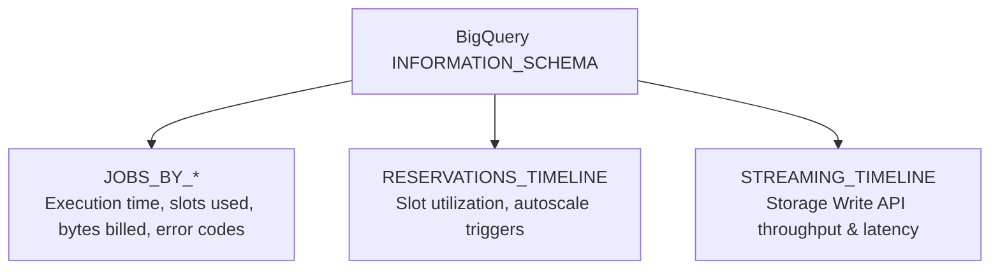

# 5.4 Monitoreo, Observabilidad y Resolución de Problemas

Mantener visibilidad sobre la salud de la plataforma de datos permite detectar rápidamente fallos de pipelines, cuellos de botella de slots y anomalías de costos.

---

## 📈 Observabilidad de BigQuery con `INFORMATION_SCHEMA`

BigQuery expone telemetría administrativa en tiempo real a través de vistas del sistema en `INFORMATION_SCHEMA`. Este es el método principal para diagnosticar costos de consulta elevados, uso descontrolado de slots y fallos de ejecución.



### Encontrar las 5 consultas más costosas de las últimas 24 horas:
```sql
SELECT
  job_id,
  user_email,
  query,
  total_bytes_billed / POW(10, 12) AS tb_billed,
  (total_bytes_billed / POW(10, 12)) * 6.25 AS estimated_cost_usd,
  total_slot_ms / (1000 * 60) AS slot_minutes,
  creation_time
FROM
  `region-us`.INFORMATION_SCHEMA.JOBS_BY_PROJECT
WHERE
  creation_time >= TIMESTAMP_SUB(CURRENT_TIMESTAMP(), INTERVAL 24 HOUR)
  AND job_type = 'QUERY'
ORDER BY
  total_bytes_billed DESC
LIMIT 5;
```

### Identificar consultas que experimentan una contención de slots severa:
```sql
SELECT
  job_id,
  user_email,
  start_time,
  end_time,
  -- High wait ratio indicates query spent time waiting for slots
  job_stages[SAFE_OFFSET(0)].wait_ms_avg AS first_stage_wait_ms,
  total_slot_ms
FROM
  `region-us`.INFORMATION_SCHEMA.JOBS_BY_PROJECT
WHERE
  creation_time >= TIMESTAMP_SUB(CURRENT_TIMESTAMP(), INTERVAL 1 HOUR)
  AND error_result IS NULL
ORDER BY
  first_stage_wait_ms DESC
LIMIT 10;
```

---

## 🚨 Resolución de Errores Comunes en Plataformas de Datos

El examen de certificación con frecuencia presenta códigos de error exactos y solicita el diagnóstico adecuado:

| Código de Error / Síntoma | Causa Raíz | Remediación Recomendada |
| :--- | :--- | :--- |
| **`quotaExceeded: Exceeded rate limits`** | Demasiadas modificaciones de tablas o solicitudes de API por segundo (por ejemplo, creación/eliminación de tablas o inserciones de streaming). | Implementa **exponential backoff con jitter** en los clientes productores; consolida las escrituras de tablas en micro-lotes; usa la BigQuery Storage Write API con commits por lotes. |
| **`resourcesExceeded: Query exceeded memory limits during shuffle`** | Memoria intermedia de shuffle agotada durante un `JOIN` masivo sin índices o un `ORDER BY` sin particionar. | Filtra los datos antes de los joins; no hagas join de tablas grandes por strings de alta cardinalidad sin clustering; elimina el `ORDER BY` global de las subconsultas que no sean finales. |
| **Dataflow: `System lag keeps growing`** | El pipeline de streaming de Dataflow no puede seguir el ritmo del volumen de ingesta desde Pub/Sub. | Verifica la CPU/memoria de los workers en Cloud Monitoring; aumenta el máximo de workers (`--maxNumWorkers`); confirma que los sinks externos downstream (por ejemplo, Bigtable) no estén limitando las escrituras. |
| **Pub/Sub: `Oldest unacknowledged message age spike`** | Los consumidores downstream (workers de Dataflow o suscriptores) están fallando o no pueden procesar los mensajes con suficiente rapidez. | Revisa los logs de los workers consumidores en Cloud Logging para detectar excepciones no controladas; inspecciona la suscripción de dead-letter en busca de anomalías de esquema. |

---

## 💰 Alertas de Anomalías de Facturación y Presupuestos

Para protegerte contra costos en la nube descontrolados:
1. **Presupuestos y Alertas de Cloud Billing**:
   - Configura alertas de umbral al 50%, 80%, 100% y 120% del presupuesto mensual pronosticado.
   - Adjunta una notificación de Cloud Pub/Sub para activar una Cloud Function que deshabilite automáticamente la facturación o limite las cuotas de consulta cuando el gasto supere límites críticos.
2. **Cuotas Personalizadas de BigQuery**:
   - Establece límites máximos de uso diario de consultas por proyecto o por usuario (por ejemplo, limita las consultas ad-hoc de los desarrolladores a 2 TB escaneados por día).

---

## 🎯 Punto de Control: Escenario de Práctica para el Examen

### Escenario:
Un pipeline de streaming de Dataflow consume mensajes de Cloud Pub/Sub y escribe registros analíticos en Cloud Bigtable. A las 14:00, se activan las alarmas operativas: la métrica **Pub/Sub oldest unacknowledged message age** aumenta rápidamente, y la latencia del sistema de Dataflow ha pasado de 2 segundos a 35 minutos. Al inspeccionar Cloud Monitoring, observas que las VMs worker de Dataflow han alcanzado el límite configurado `--maxNumWorkers`, con un 95% de utilización de CPU en todos los workers.

**¿Cuál es el primer paso de diagnóstico y la remediación recomendada?**

- **A.** Eliminar el topic de Pub/Sub y volver a crearlo.
- **B.** Inspeccionar las métricas de utilización de CPU y latencia de escritura de Cloud Bigtable en Cloud Monitoring; si Bigtable está limitando las escrituras o presenta hot-spotting, agrega nodos de Bigtable o revisa el diseño de row-key, y aumenta `--maxNumWorkers` de Dataflow.
- **C.** Cambiar Dataflow a DirectRunner.
- **D.** Otorgar permisos `roles/owner` a la cuenta de servicio de Dataflow.

> **Respuesta Correcta: B**  
> **Explicación**: Un aumento en la antigüedad del backlog de Pub/Sub y en el system lag de Dataflow, junto con la CPU de los workers al máximo, indica que el pipeline está bloqueado. En arquitecturas de streaming que escriben en Cloud Bigtable, la limitación del sink (por ejemplo, CPU de Bigtable al 100% o hot-spotting debido a un hashing de row-key deficiente) hace que los workers de Dataflow se acumulen y encolen registros en memoria, elevando la CPU y el lag. Revisar las métricas de Bigtable y escalar la capacidad / corregir los hotspots de claves elimina el cuello de botella.
