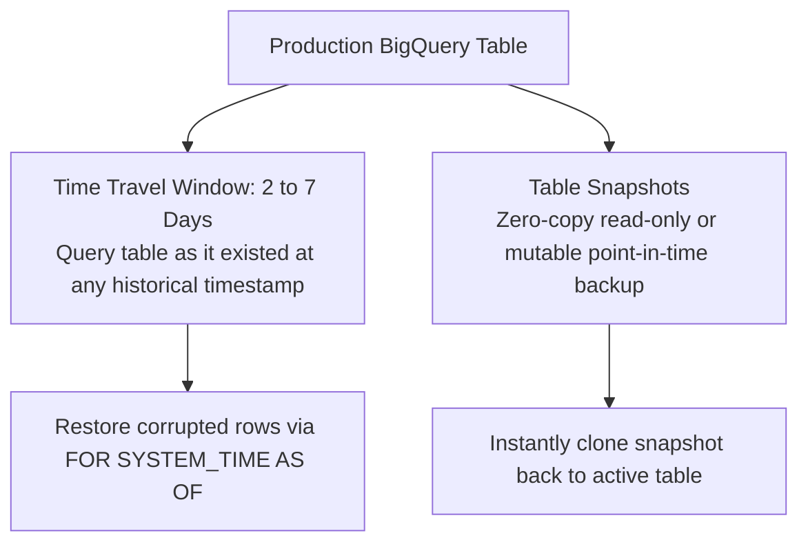

# 5.5 Resiliencia, Failover y Recuperación ante Desastres

La pérdida de datos, el error humano (eliminaciones accidentales de tablas) y las interrupciones de infraestructura regional deben planificarse con anticipación. Esta lección cubre técnicas de recuperación, modelos de replicación y mecanismos de protección de datos zero-copy.

---

## 🛡️ Defensa contra la Corrupción de Datos: Time Travel y Snapshots de BigQuery

Cuando un ingeniero junior ejecuta accidentalmente `DELETE FROM production.users WHERE 1=1` o ejecuta un job ETL defectuoso que sobrescribe una partición, BigQuery proporciona mecanismos de seguridad integrados.



### 1. Time Travel de BigQuery (`FOR SYSTEM_TIME AS OF`)
BigQuery conserva versiones históricas de los datos de las tablas durante hasta **7 días** (configurable de 2 a 7 días a nivel de dataset):

```sql
-- Querying table state exactly as it existed 4 hours ago
SELECT *
FROM `production.users`
FOR SYSTEM_TIME AS OF TIMESTAMP_SUB(CURRENT_TIMESTAMP(), INTERVAL 4 HOUR);

-- Restoring a deleted table or corrupted partition
CREATE OR REPLACE TABLE `production.users` AS
SELECT *
FROM `production.users`
FOR SYSTEM_TIME AS OF TIMESTAMP '2026-11-08 12:00:00 UTC';
```

### 2. Snapshots de Tablas de BigQuery
- **Almacenamiento Zero-Copy**: Crear un snapshot de tabla no duplica el almacenamiento físico. Solo pagas por el almacenamiento delta cuando las filas cambian o se eliminan en la tabla base.
- **Sintaxis**:
  ```sql
  CREATE SNAPSHOT TABLE `backup_dataset.orders_snapshot_20261108`
  CLONE `production.orders`
  OPTIONS(
    expiration_timestamp = TIMESTAMP '2026-12-08 00:00:00 UTC'
  );
  ```

---

## 🔄 Arquitecturas de Alta Disponibilidad y Failover

```mermaid
graph TD
    subgraph Cloud_SQL_High_Availability_HA ["Cloud SQL High Availability HA"]
        SQL_Primary[Primary Instance: Zone A] -->|Synchronous Persistent Disk Replication| SQL_Standby[Standby Instance: Zone B]
        SQL_Primary -. Automatic Failover 60s .-> SQL_Standby
    end

    subgraph Cloud_Spanner_Multi_Region ["Cloud Spanner Multi-Region"]
        Span1[Region US-East: Leader/Read-Write] <-->|TrueTime + Paxos Consensus Sync| Span2[Region US-Central: Read-Write]
        Span2 <-->|TrueTime + Paxos Consensus Sync| Span3[Region US-West: Read-Write]
    end

    subgraph Cloud_Bigtable_Multi_Cluster ["Cloud Bigtable Multi-Cluster"]
        BTC1[Cluster 1: us-central1-a] <-->|Asynchronous Replication| BTC2[Cluster 2: us-east1-b]
    end
```



### Comparación de Failover:

| Servicio de Almacenamiento | Mecanismo de Replicación | Características de Failover | Perfil RPO / RTO |
| :--- | :--- | :--- | :--- |
| **Cloud SQL HA** | Replicación síncrona de disco persistente a nivel de bloque entre dos zonas de la misma región. | Failover automático en 60–120 segundos. El endpoint de DNS redirige el tráfico de forma transparente. | **RPO = 0** (Cero pérdida de datos entre zonas) / **RTO $\approx$ 1-2 minutos**. |
| **Cloud Spanner** | Consenso de quórum Paxos multi-región / multi-zona síncrono con relojes atómicos TrueTime. | Failover transparente instantáneo. Si falla una zona o región, el quórum restante continúa atendiendo transacciones. | **RPO = 0** / **RTO = 0** (Disponibilidad instantánea y continua con SLA de 99.999%). |
| **Cloud Bigtable** | Replicación multi-clúster asíncrona entre zonas o regiones. | El enrutamiento Anycast multi-clúster redirige automáticamente el tráfico al clúster saludable. | **RPO $\approx$ segundos** (lag asíncrono) / **RTO $\approx$ 0** (desvío instantáneo del tráfico). |
| **Cloud Memorystore (Redis)** | Nivel de Alta Disponibilidad con master y réplicas de lectura entre zonas. | Failover automático a la réplica en ~30 segundos. | Recuperación de caché en memoria. |

---

## 🎯 Punto de Control: Escenario de Práctica para el Examen

### Escenario:
A las 10:15 AM, un script de despliegue ETL se ejecutó accidentalmente con un filtro invertido, truncando y corrompiendo la tabla principal `customer_loyalty` en BigQuery. La tabla contiene 50 TB de datos y es consultada por APIs operativas las 24 horas, los 7 días de la semana. El ingeniero líder debe restaurar la tabla a su estado exacto de las 10:00 AM de esta mañana con el mínimo absoluto de tiempo de inactividad y sin pagar por reimportar los 50 TB completos desde los archivos de backup en Cloud Storage.

**¿Cuál es la solución más rápida y rentable?**

- **A.** Abrir un ticket de soporte de Google Cloud y solicitar una restauración desde cinta.
- **B.** Restaurar la tabla usando BigQuery Time Travel ejecutando una consulta `CREATE OR REPLACE TABLE` que utilice la cláusula `FOR SYSTEM_TIME AS OF TIMESTAMP '2026-11-08 10:00:00 UTC'`.
- **C.** Exportar los registros de auditoría de Cloud Logging y reproducir manualmente cada mutación SQL.
- **D.** Eliminar el dataset y redesplegar desde Terraform.

> **Respuesta Correcta: B**  
> **Explicación**: **Time Travel** de BigQuery rastrea automáticamente las mutaciones de datos durante hasta 7 días. Al consultar la tabla con `FOR SYSTEM_TIME AS OF TIMESTAMP '2026-11-08 10:00:00 UTC'` dentro de una sentencia `CREATE OR REPLACE TABLE`, el ingeniero de datos restaura la tabla a su estado prístino anterior al incidente en segundos usando punteros de almacenamiento internos, sin incurrir en transferencia de red externa ni en reproducción manual de logs.
